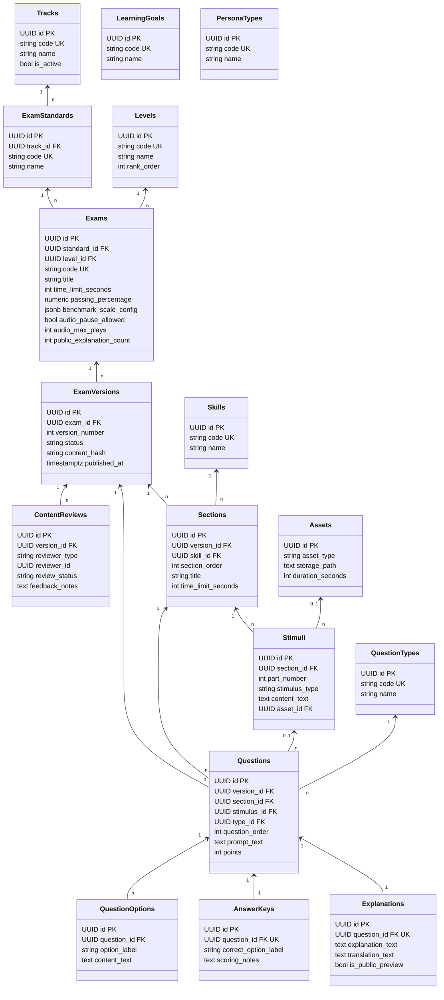
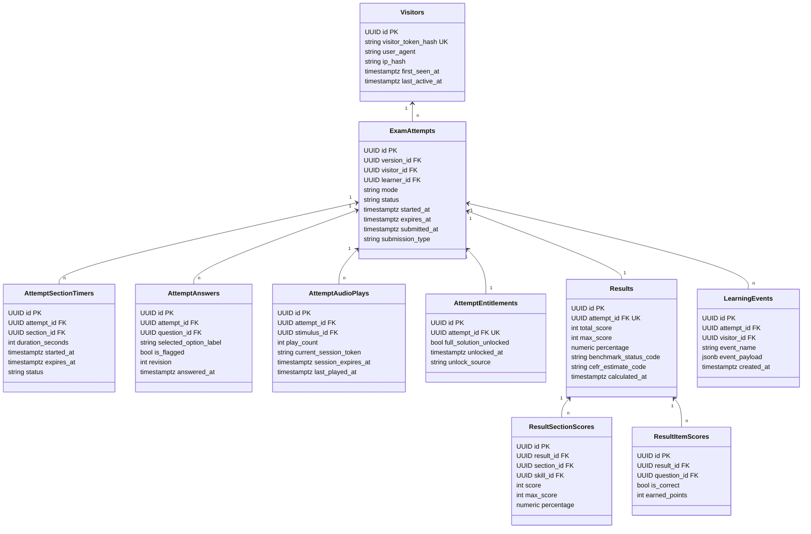
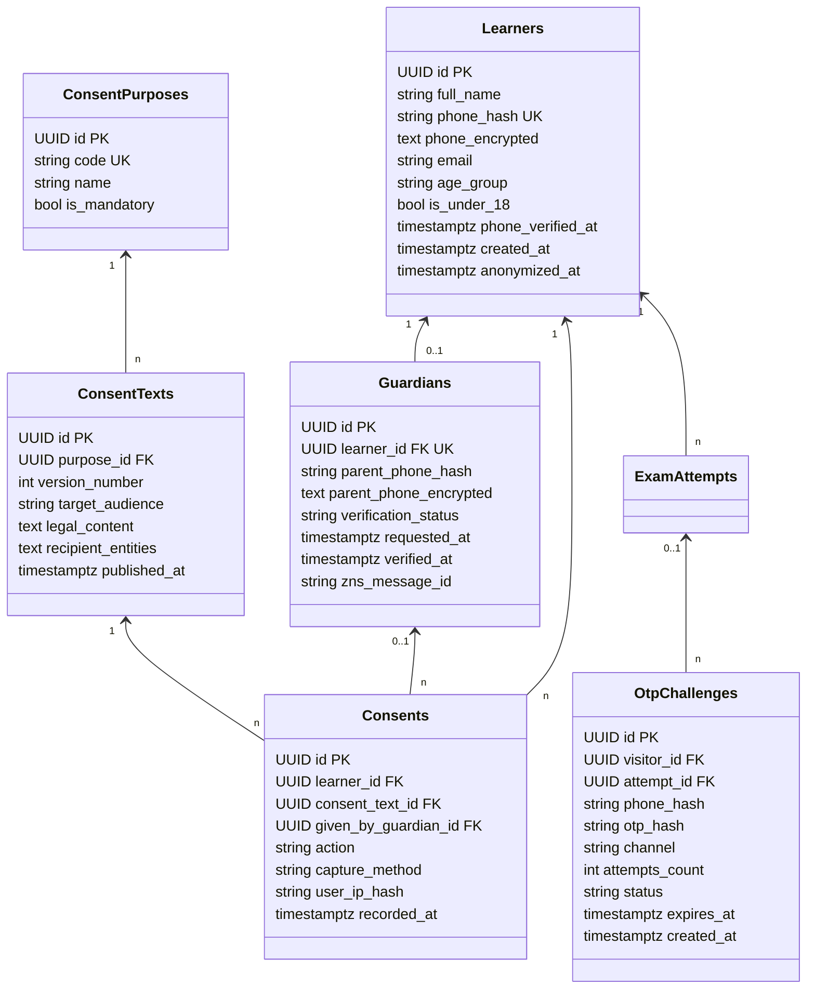
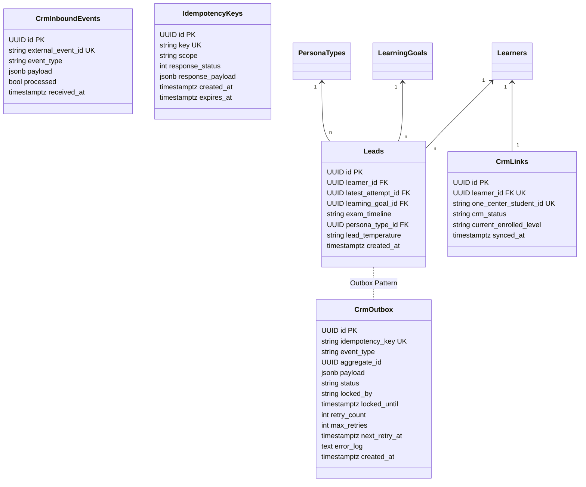
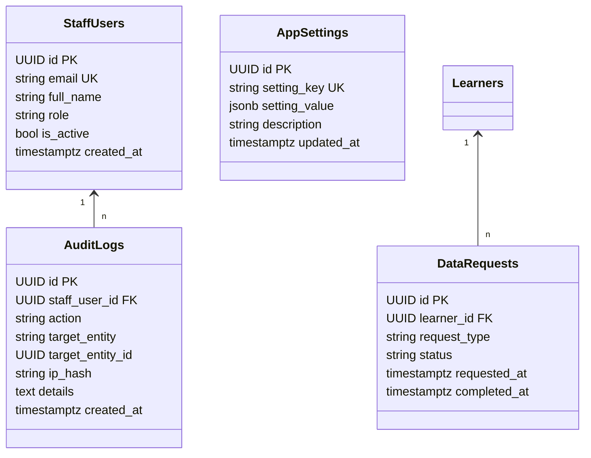
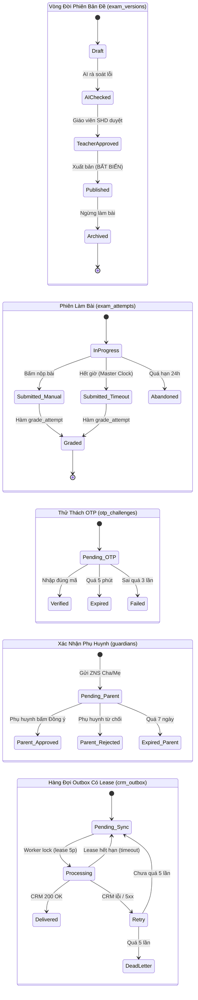
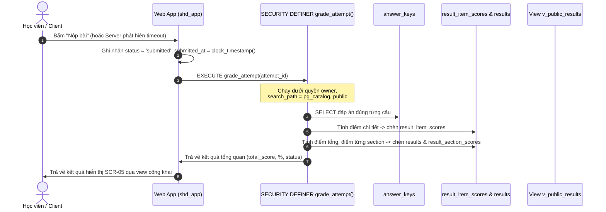

# Thiết Kế Kiến Trúc Dữ Liệu & Data Model (Data Architecture Specification)

> **Tài liệu:** `docs/architecture/02-data-model.md`  
> **Dự án:** Nền tảng tự học & luyện thi tiếng Đức miễn phí (`tuhoctiengduc.shdeducation.vn`)  
> **Phiên bản:** v1.1 (Cập nhật sau phiên rà soát Điểm dừng 1 - Hard Gate 1)  
> **Vai trò:** Data Architect & Lead Systems Engineer  
> **Tài liệu đầu vào:** `docs/ux/00-assumptions.md`, `docs/ux/02-user-flows.md`, `docs/ux/03-screen-inventory.md`, `docs/ux/08-sample-exam-spec.md`, `docs/engineering-rules.md`.  
> **Trạng thái:** Chờ Duyệt (Điểm Dừng 1 - Hard Gate 1)

---

## 1. Tổng Quan Kiến Trúc & Các Quyết Định Bất Biến Đã Chốt

Mô hình dữ liệu của nền tảng được thiết kế xoay quanh 6 nguyên tắc kiến trúc cốt lõi:
1. **Server-Side Grading & Đường Chấm Điểm Biệt Lập:** Bảng `answer_keys` lưu trữ đáp án đúng hoàn toàn độc lập với bảng câu hỏi. Role ứng dụng `shd_app` bị thu hồi quyền `SELECT` trên bảng `answer_keys` ở cấp độ PostgreSQL. Việc chấm điểm được thực thi thông qua hàm `SECURITY DEFINER` `grade_attempt(p_attempt_id)` với `search_path` cố định (`pg_catalog, public`). Role `shd_grader` phụ trách chấm thi biệt lập và hoàn toàn không có quyền đọc bảng dữ liệu định danh cá nhân (PII).
2. **Phiên Bản Đề Bất Biến (Immutable Exam Versions):** Đề thi được quản lý theo vòng đời phiên bản (`draft` $\rightarrow$ `ai_checked` $\rightarrow$ `teacher_approved` $\rightarrow$ `published` $\rightarrow$ `archived`). Khi đã chuyển sang `published`, toàn bộ cây nội dung (sections, stimuli, questions, options, answer_keys, explanations) bị khóa cứng bằng database trigger. Mọi lượt làm bài (`exam_attempts`) liên kết tới một phiên bản đề bất biến cụ thể.
3. **Sổ Cái Đồng Ý Chỉ-Ghi-Thêm (Append-Only Consent Ledger):** Mọi hành vi cho phép hoặc rút lại sự đồng ý xử lý dữ liệu cá nhân đều được ghi thành dòng mới trong bảng `consents`. Trạng thái đồng ý hiện hành và khả năng liên hệ lead (`v_contactable_leads`) được suy ra thông qua database views, tuân thủ Luật Bảo vệ dữ liệu cá nhân số 91/2025/QH15 và Nghị định 356/2025/NĐ-CP.
4. **Bảo Mật PII & Mã Hóa Có Phong Bì (Envelope Encryption):** Số điện thoại và dữ liệu nhạy cảm được mã hóa đối xứng AES-256-GCM theo cấu trúc Envelope chứa `{v, kid, iv, tag, ct}` hỗ trợ xoay khóa không downtime. Số điện thoại, địa chỉ IP và mã token khách vãng lai (`visitor_token`) được lưu dạng băm HMAC-SHA256 với các khóa bí mật riêng biệt (`PHONE_HASH_PEPPER`, `IP_HASH_PEPPER`, `TOKEN_HASH_PEPPER`) để tra cứu chống trùng lặp mà không lộ dữ liệu thô.
5. **Khả Năng Mở Rộng Đa Ngôn Ngữ & Lookup Data (Non-German Hardcoded):** Không dùng enum cố định gắn với tiếng Đức. Các trục phân loại Ngôn ngữ (`tracks`), Chuẩn khảo thí (`exam_standards`), Cấp độ CEFR (`levels`), Kỹ năng (`skills`), Dạng câu hỏi (`question_types`), Mục tiêu học (`learning_goals`), và Nhóm đối tượng (`persona_types`) đều được quản lý bằng bảng tra cứu (lookup tables) có ràng buộc toàn vẹn.
6. **Đồng Hồ Tổng Luôn Thắng (Master Clock Precedence - DEC-ARCH-04):** Mọi quy tắc giới hạn thời gian từng phần (`attempt_section_timers`) đều chịu sự chi phối tuyệt đối của thời điểm kết thúc phiên làm bài tổng (`exam_attempts.expires_at`). Khi đồng hồ tổng chạm 0, hệ thống lập tức cưỡng chế nộp bài bất kể phần thi thành phần còn thời gian hay không.

---

## 2. Sơ Đồ Thực Thể - Mối Quan Hệ (Entity-Relationship Diagrams v1.1)

Hệ thống bao gồm 42 bảng logic được chia thành 5 phân hệ dữ liệu:



### 2.1. Phân Hệ 2: Làm Bài & Chấm Điểm (Attempts, Section Timers & Results)



### 2.2. Phân Hệ 3: Người Học, Phụ Huynh, Xác Thực OTP & Sổ Cái Đồng Ý



### 2.3. Phân Hệ 4: Lead Tuyển Sinh, CRM Outbox Có Lease & Khóa Idempotency



### 2.4. Phân Hệ 5: Quản Trị & Vận Hành (Staff, Audit Logs 5 Năm & Data Requests)



---

## 3. Từ Điển Bảng Dữ Liệu Chi Tiết (Table Dictionary v1.1 - 42 Bảng)

### Nhóm 1: Nội Dung Đề Thi & Bảng Tra Cứu (17 Bảng)

#### 1. `tracks`
- **Mục đích:** Lưu trữ các đường đua ngôn ngữ (tiếng Đức, tiếng Hàn, tiếng Nhật...). Mở rộng không sửa cấu trúc.
- **Cột chính:** `id` (UUID PK), `code` (varchar(32) UK), `name` (varchar(128)), `is_active` (boolean default true), `created_at` (timestamptz UTC).
- **Mức nhạy cảm PII:** Không có.
- **Thời hạn lưu trữ đề xuất:** Vĩnh viễn (Master Data).

#### 2. `exam_standards`
- **Mục đích:** Danh mục chuẩn khảo thí theo từng ngôn ngữ (TELC, Goethe-Institut, ÖSD, TestDaF...).
- **Cột chính:** `id` (UUID PK), `track_id` (UUID FK tracks), `code` (varchar(32) UK), `name` (varchar(128)), `is_active` (boolean default true).
- **Mức nhạy cảm PII:** Không có.
- **Thời hạn lưu trữ đề xuất:** Vĩnh viễn (Master Data).

#### 3. `levels`
- **Mục đích:** Khung cấp độ năng lực ngôn ngữ theo CEFR (A1, A2, B1, B2, C1, C2).
- **Cột chính:** `id` (UUID PK), `code` (varchar(16) UK), `name` (varchar(64)), `rank_order` (int UK).
- **Mức nhạy cảm PII:** Không có.
- **Thời hạn lưu trữ đề xuất:** Vĩnh viễn (Master Data).

#### 4. `skills`
- **Mục đích:** Kỹ năng ngôn ngữ (Lesen - Đọc, Hören - Nghe, Schreiben - Viết, Sprechen - Nói).
- **Cột chính:** `id` (UUID PK), `code` (varchar(32) UK), `name` (varchar(64)).
- **Mức nhạy cảm PII:** Không có.
- **Thời hạn lưu trữ đề xuất:** Vĩnh viễn (Master Data).

#### 5. `question_types`
- **Mục đích:** Dạng thức câu hỏi trắc nghiệm (`single_choice`, `true_false`, `matching`).
- **Cột chính:** `id` (UUID PK), `code` (varchar(32) UK), `name` (varchar(64)).
- **Mức nhạy cảm PII:** Không có.
- **Thời hạn lưu trữ đề xuất:** Vĩnh viễn (Master Data).

#### 6. `learning_goals` (BẢNG MỚI - LOOKUP)
- **Mục đích:** Danh mục mục tiêu học tập của người học, phục vụ phân loại phễu tuyển sinh không hardcode.
- **Cột chính:** `id` (UUID PK), `code` (varchar(32) UK - `cert`, `ausbildung`, `visa18b`, `comms`), `name` (varchar(128)), `description` (text null), `is_active` (boolean default true).
- **Mức nhạy cảm PII:** Không có.
- **Thời hạn lưu trữ đề xuất:** Vĩnh viễn (Master Data).

#### 7. `persona_types` (BẢNG MỚI - LOOKUP)
- **Mục đích:** Danh mục nhóm đối tượng người học tham gia thi thử.
- **Cột chính:** `id` (UUID PK), `code` (varchar(32) UK - `student_under18`, `university`, `worker`, `parent`), `name` (varchar(128)), `is_active` (boolean default true).
- **Mức nhạy cảm PII:** Không có.
- **Thời hạn lưu trữ đề xuất:** Vĩnh viễn (Master Data).

#### 8. `exams`
- **Mục đích:** Thực thể bài thi cấp cao. Chứa cấu hình chung, ngưỡng điểm đạt và thang quy đổi CEFR.
- **Cột chính:** 
  - `id` (UUID PK), `standard_id` (UUID FK exam_standards), `level_id` (UUID FK levels).
  - `code` (varchar(64) UK), `title` (varchar(255)).
  - `time_limit_seconds` (int not null default 3900 - quy định 65 phút).
  - `passing_percentage` (numeric(5,2) not null default 60.00 - ngưỡng điểm tham khảo đạt chuẩn, ví dụ 60.00% tương ứng 18/30 điểm).
  - `benchmark_scale_config` (jsonb not null - cấu hình thang điểm tham khảo và mã CEFR tương ứng).
  - `audio_pause_allowed` (boolean not null default false - cấu hình cấm/cho phép nút pause Hören).
  - `audio_max_plays` (int not null default 2 - số lần phát tối đa do server quản lý).
  - `public_explanation_count` (int not null default 2 - số câu giải thích mở trước lead gate, từ câu 1 đến N).
  - `is_active` (boolean default true), `created_at` (timestamptz UTC).
- **Mức nhạy cảm PII:** Không có.
- **Thời hạn lưu trữ đề xuất:** Vĩnh viễn.

#### 9. `exam_versions`
- **Mục đích:** Quản lý vòng đời và tính bất biến của nội dung đề thi.
- **Cột chính:** `id` (UUID PK), `exam_id` (UUID FK exams), `version_number` (int not null), `status` (varchar(32) not null check in (`draft`, `ai_checked`, `teacher_approved`, `published`, `archived`)), `content_hash` (varchar(64) null - SHA256 cây nội dung), `published_at` (timestamptz null), `created_at` (timestamptz UTC).
- **Ràng buộc duy nhất:** `UNIQUE(exam_id, version_number)`; Partial Unique Index: `CREATE UNIQUE INDEX uq_exam_published_version ON exam_versions(exam_id) WHERE status = 'published'`.
- **Mức nhạy cảm PII:** Không có.
- **Thời hạn lưu trữ đề xuất:** Vĩnh viễn.

#### 10. `content_reviews`
- **Mục đích:** Lưu lịch sử phê duyệt chất lượng đề thi của AI và giáo viên bản ngữ SHD trước khi xuất bản.
- **Cột chính:** `id` (UUID PK), `version_id` (UUID FK exam_versions), `reviewer_type` (varchar(16) check in (`ai`, `teacher`)), `reviewer_id` (UUID null), `review_status` (varchar(32) check in (`approved`, `rejected`, `needs_revision`)), `feedback_notes` (text), `created_at` (timestamptz UTC).
- **Mức nhạy cảm PII:** Không có.
- **Thời hạn lưu trữ đề xuất:** 5 năm (kiểm định học thuật).

#### 11. `sections`
- **Mục đích:** Các phần thi thành phần trong phiên bản đề (ví dụ: Section 1 - Kỹ năng Đọc Lesen, Section 2 - Kỹ năng Nghe Hören).
- **Quyết định thiết kế cấu trúc:** `section` đại diện cho **Kỹ năng thi lớn** có giới hạn thời gian độc lập. Các phần bài tập nhỏ hơn (Teil 1, Teil 2, Teil 3...) được quản lý thông qua thực thể `stimuli` kèm thuộc tính `part_number`.
- **Cột chính:** 
  - `id` (UUID PK), `version_id` (UUID FK exam_versions), `skill_id` (UUID FK skills).
  - `section_order` (int not null), `title` (varchar(128)), `instructions` (text).
  - `time_limit_seconds` (int null - ví dụ: Lesen 2700s = 45m, Hören 1200s = 20m).
- **Mức nhạy cảm PII:** Không có.
- **Thời hạn lưu trữ đề xuất:** Theo vòng đời `exam_versions`.

#### 12. `stimuli`
- **Mục đích:** Ngữ liệu bài thi: bài đọc (Reading passage) hoặc đoạn băng âm thanh (Audio track) dùng chung cho một nhóm câu hỏi (ví dụ: Teil 1 Durchsagen).
- **Cột chính:** `id` (UUID PK), `section_id` (UUID FK sections), `part_number` (int not null default 1 - thể hiện Teil 1, Teil 2, Teil 3), `stimulus_type` (varchar(16) check in (`text`, `audio`, `image`)), `title` (varchar(255)), `content_text` (text null), `asset_id` (UUID FK assets null).
- **Ràng buộc:** `CONSTRAINT chk_stimulus_audio_asset CHECK ((stimulus_type = 'audio' AND asset_id IS NOT NULL) OR (stimulus_type != 'audio'))`.
- **Mức nhạy cảm PII:** Không có.
- **Thời hạn lưu trữ đề xuất:** Theo vòng đời `exam_versions`.

#### 13. `assets`
- **Mục đích:** Lưu trữ đường dẫn tệp âm thanh nghe Hören và hình ảnh minh họa trên hệ thống lưu trữ đám mây.
- **Cột chính:** `id` (UUID PK), `asset_type` (varchar(16) check in (`audio_mp3`, `image_png`, `image_webp`)), `storage_path` (text not null), `file_size_bytes` (bigint), `duration_seconds` (int null), `mime_type` (varchar(64)), `created_at` (timestamptz UTC).
- **Mức nhạy cảm PII:** Không có.
- **Thời hạn lưu trữ đề xuất:** Vĩnh viễn.

#### 14. `questions`
- **Mục đích:** Định nghĩa các câu hỏi trắc nghiệm (từ Câu 1 đến 30).
- **Cột chính:** 
  - `id` (UUID PK), `version_id` (UUID FK exam_versions not null - trực tiếp tham chiếu version để tăng tốc truy vấn và khóa toàn vẹn).
  - `section_id` (UUID FK sections not null).
  - `stimulus_id` (UUID FK stimuli null).
  - `type_id` (UUID FK question_types not null).
  - `question_order` (int not null - từ 1 đến 30).
  - `prompt_text` (text not null), `points` (int not null default 1).
- **Ràng buộc:** `UNIQUE(version_id, question_order)`.
- **Mức nhạy cảm PII:** Không có.
- **Thời hạn lưu trữ đề xuất:** Theo vòng đời `exam_versions`.

#### 15. `question_options`
- **Mục đích:** Các lựa chọn phương án của từng câu hỏi (A, B, C hoặc Richtig/Falsch).
- **Cột chính:** `id` (UUID PK), `question_id` (UUID FK questions), `option_label` (varchar(8) not null - 'A', 'B', 'C'), `content_text` (text not null), `option_order` (int not null).
- **Ràng buộc:** `UNIQUE(question_id, option_label)`.
- **Mức nhạy cảm PII:** Không có.
- **Thời hạn lưu trữ đề xuất:** Theo vòng đời `exam_versions`.

#### 16. `answer_keys` (BẢNG BẢO MẬT TỐI CAO - CÔ LẬP ROLE)
- **Mục đích:** Lưu đáp án đúng của từng câu hỏi. Bảng độc lập hoàn toàn, không nối khóa ngoại hở ra API.
- **Cột chính:** `id` (UUID PK), `question_id` (UUID FK questions UK), `correct_option_label` (varchar(8) not null), `scoring_notes` (text null), `created_at` (timestamptz UTC).
- **Phân quyền bảo vệ:** `REVOKE ALL ON answer_keys FROM PUBLIC; GRANT SELECT ON answer_keys TO shd_grader; REVOKE ALL ON answer_keys FROM shd_app;`. Role `shd_app` chỉ có thể gọi hàm `grade_attempt` (SECURITY DEFINER) chứ không thể SELECT bảng này.
- **Mức nhạy cảm PII:** Không chứa PII nhưng là dữ liệu tối mật kinh doanh (Business Critical).
- **Thời hạn lưu trữ đề xuất:** Theo vòng đời `exam_versions`.

#### 17. `explanations`
- **Mục đích:** Lời giải thích sư phạm chi tiết bằng tiếng Việt, phân tích ngữ pháp, từ vựng và bản dịch bài đọc.
- **Cột chính:** `id` (UUID PK), `question_id` (UUID FK questions UK), `explanation_text` (text not null), `translation_text` (text null), `vocabulary_notes` (jsonb null), `is_public_preview` (boolean not null default false - Câu 1 & 2 đặt là true; Câu 3–30 đặt là false).
- **Phân quyền truy cập:** Role `shd_app` không SELECT trực tiếp bảng này mà truy cập qua view `v_public_explanations` (khi chưa mở khóa) hoặc view có kiểm tra `attempt_entitlements`.
- **Mức nhạy cảm PII:** Không có.
- **Thời hạn lưu trữ đề xuất:** Theo vòng đời `exam_versions`.

---

### Nhóm 2: Làm Bài & Chấm Điểm (10 Bảng)

#### 18. `visitors`
- **Mục đích:** Định danh khách vãng lai ẩn danh truy cập qua Cookie / LocalStorage.
- **Cột chính:** 
  - `id` (UUID PK).
  - `visitor_token_hash` (varchar(64) UK not null - lưu chuỗi băm HMAC-SHA256 của visitor token gửi từ client kèm khóa bí mật `TOKEN_HASH_PEPPER`, không lưu token thô).
  - `user_agent` (text null).
  - `ip_hash` (varchar(64) null - băm HMAC-SHA256 kèm `IP_HASH_PEPPER`, không lưu IP thô).
  - `first_seen_at` (timestamptz UTC), `last_active_at` (timestamptz UTC).
- **Mức nhạy cảm PII:** Định danh gián tiếp / Dữ liệu hành vi.
- **Thời hạn lưu trữ đề xuất:** 90 ngày kể từ lần hoạt động cuối [Cần pháp chế duyệt].

#### 19. `exam_attempts`
- **Mục đích:** Phiên làm bài thi thử của người học. Nguồn sự thật duy nhất về thời gian và kết quả nộp bài.
- **Cột chính:** 
  - `id` (UUID PK), `version_id` (UUID FK exam_versions).
  - `visitor_id` (UUID FK visitors not null), `learner_id` (UUID FK learners null - cập nhật sau khi qua Lead Gate).
  - `mode` (varchar(16) not null default 'exam' check in (`exam`, `practice`)).
  - `status` (varchar(32) not null check in (`in_progress`, `submitted`, `graded`, `abandoned`)).
  - `started_at` (timestamptz UTC not null), `expires_at` (timestamptz UTC not null - đồng hồ server).
  - `submitted_at` (timestamptz UTC null).
  - `submission_type` (varchar(16) null check in (`manual`, `timeout`)).
- **Mức nhạy cảm PII:** Hành vi học tập.
- **Thời hạn lưu trữ đề xuất:** 3 năm phục vụ báo cáo năng lực [Cần pháp chế duyệt].

#### 20. `attempt_section_timers` (BẢNG MỚI - ĐỒNG HỒ PHẦN THI CƯỠNG CHẾ SERVER)
- **Mục đích:** Quản lý thời gian độc lập cho từng phần thi (Section) do server giám sát và cưỡng chế.
- **Cột chính:** 
  - `id` (UUID PK), `attempt_id` (UUID FK exam_attempts), `section_id` (UUID FK sections).
  - `duration_seconds` (int not null - lấy từ `sections.time_limit_seconds`).
  - `started_at` (timestamptz UTC null - ghi nhận khi người học chuyển tới phần thi này).
  - `expires_at` (timestamptz UTC null - tính bằng `LEAST(started_at + duration_seconds, exam_attempts.expires_at)`).
  - `status` (varchar(16) not null default 'not_started' check in (`not_started`, `in_progress`, `completed`, `expired`)).
- **Ràng buộc:** `UNIQUE(attempt_id, section_id)`.
- **Mức nhạy cảm PII:** Dữ liệu thời gian làm bài.
- **Thời hạn lưu trữ đề xuất:** Theo vòng đời `exam_attempts`.

#### 21. `attempt_answers`
- **Mục đích:** Ghi nhận phương án người học lựa chọn cho từng câu hỏi (hỗ trợ tự lưu nháp real-time và kiểm soát xung đột ghi đè Optimistic Concurrency Control).
- **Cột chính:** 
  - `id` (UUID PK), `attempt_id` (UUID FK exam_attempts), `question_id` (UUID FK questions).
  - `selected_option_label` (varchar(8) null).
  - `is_flagged` (boolean default false).
  - `revision` (int not null default 1 - số hiệu phiên bản cập nhật nháp).
  - `answered_at` (timestamptz UTC).
- **Ràng buộc:** `UNIQUE(attempt_id, question_id)`.
- **Cơ chế xung đột:** Khi client gửi cập nhật đáp án, client bắt buộc gửi kèm `revision`. Server chỉ chấp nhận nếu `revision_client == revision_db`, sau đó tăng `revision = revision + 1`. Nếu không khớp, server từ chối và trả về lỗi `REVISION_CONFLICT` (HTTP 409).
- **Mức nhạy cảm PII:** Hành vi học tập.
- **Thời hạn lưu trữ đề xuất:** Theo vòng đời `exam_attempts`.

#### 22. `attempt_audio_plays`
- **Mục đích:** SERVER-AUTHORITATIVE AUDIOPLAY COUNTER VỚI PHIÊN PHÁT CÓ TOKEN. Kiểm soát số lần nghe Hören theo quy định (tối đa 2 lần). Tải lại trang không bị trừ thêm lượt.
- **Cột chính:** 
  - `id` (UUID PK), `attempt_id` (UUID FK exam_attempts), `stimulus_id` (UUID FK stimuli).
  - `play_count` (int not null default 0 check (play_count <= 2)).
  - `current_session_token` (varchar(64) null - token cấp phiên phát audio hiện hành).
  - `session_expires_at` (timestamptz UTC null - thời điểm hết hạn phiên phát token hiện tại, bằng thời lượng audio + 60s buffer).
  - `last_played_at` (timestamptz UTC).
- **Ràng buộc:** `UNIQUE(attempt_id, stimulus_id)`.
- **Quy tắc phiên phát:** Khi người dùng bấm nghe, client gửi yêu cầu xin token phát. Nếu phiên hiện tại cho lần phát đó vẫn còn hiệu lực (`clock_timestamp() < session_expires_at`), server trả lại token cũ mà KHÔNG tăng `play_count`. Chỉ khi bắt đầu lượt nghe mới sau khi phiên trước kết thúc thì `play_count` mới tăng thêm 1.
- **Mức nhạy cảm PII:** Hành vi học tập.
- **Thời hạn lưu trữ đề xuất:** Theo vòng đời `exam_attempts`.

#### 23. `attempt_entitlements`
- **Mục đích:** Quyền lợi xem lời giải chi tiết gắn với phiên làm bài. Lưu trong DB, không dùng flag client.
- **Cột chính:** `id` (UUID PK), `attempt_id` (UUID FK exam_attempts UK), `full_solution_unlocked` (boolean not null default false), `unlocked_at` (timestamptz UTC null), `unlock_source` (varchar(32) null - 'lead_gate_otp', 'admin_override').
- **Mức nhạy cảm PII:** Quyền lợi dịch vụ.
- **Thời hạn lưu trữ đề xuất:** Theo vòng đời `exam_attempts`.

#### 24. `results`
- **Mục đích:** Bảng điểm tổng quan sau khi nộp bài: Điểm tổng, % đúng, trạng thái benchmark và ước lượng CEFR chuẩn hóa dạng mã code.
- **Cột chính:** 
  - `id` (UUID PK), `attempt_id` (UUID FK exam_attempts UK).
  - `total_score` (int not null - ví dụ 21).
  - `max_score` (int not null default 30).
  - `percentage` (numeric(5,2) not null - 70.00).
  - `benchmark_status_code` (varchar(32) not null - mã chuẩn hóa: `passed_reference`, `below_reference`).
  - `cefr_estimate_code` (varchar(16) not null - mã chuẩn hóa: `B1`, `B1_MINUS`, `A2`).
  - `calculated_at` (timestamptz UTC).
- **Mức nhạy cảm PII:** Kết quả học tập.
- **Thời hạn lưu trữ đề xuất:** 3 năm [Cần pháp chế duyệt].

#### 25. `result_section_scores` (BẢNG MỚI - ĐIỂM CHI TIẾT TỪNG PHẦN THI ĐA NGÔN NGỮ)
- **Mục đích:** Thay thế các cột hardcode tiếng Đức (`lesen_score`, `hoeren_score`) bằng cấu trúc động theo từng section/kỹ năng.
- **Cột chính:** 
  - `id` (UUID PK), `result_id` (UUID FK results), `section_id` (UUID FK sections), `skill_id` (UUID FK skills).
  - `score` (int not null - ví dụ Lesen: 12, Hören: 9).
  - `max_score` (int not null - ví dụ 15).
  - `percentage` (numeric(5,2) not null).
- **Ràng buộc:** `UNIQUE(result_id, section_id)`.
- **Mức nhạy cảm PII:** Kết quả học tập.
- **Thời hạn lưu trữ đề xuất:** Theo vòng đời `results`.

#### 26. `result_item_scores`
- **Mục đích:** Điểm chi tiết từng câu do hàm `grade_attempt` tính toán đối chiếu với `answer_keys`.
- **Cột chính:** `id` (UUID PK), `result_id` (UUID FK results), `question_id` (UUID FK questions), `is_correct` (boolean not null), `earned_points` (int not null).
- **Ràng buộc:** `UNIQUE(result_id, question_id)`.
- **Phân quyền:** Role `shd_app` không SELECT trực tiếp mà thông qua view kiểm tra `attempt_entitlements`.
- **Mức nhạy cảm PII:** Kết quả học tập.
- **Thời hạn lưu trữ đề xuất:** Theo vòng đời `results`.

#### 27. `learning_events`
- **Mục đích:** Nhật ký phân tích hành vi học tập (Analytics Event Log: play audio, offline mode, q3 click...).
- **Cột chính:** `id` (UUID PK), `attempt_id` (UUID FK exam_attempts null), `visitor_id` (UUID FK visitors null), `event_name` (varchar(64) not null), `event_payload` (jsonb not null), `created_at` (timestamptz UTC).
- **Mức nhạy cảm PII:** Dữ liệu hành vi.
- **Thời hạn lưu trữ đề xuất:** 12 tháng (tổng hợp dữ liệu phân tích CRO).

---

### Nhóm 3: Người Học, Phụ Huynh, Xác Thực & Đồng Ý (6 Bảng)

#### 28. `learners`
- **Mục đích:** Hồ sơ học viên sau khi điền thông tin Lead Gate.
- **Cột chính:** 
  - `id` (UUID PK), `full_name` (varchar(128) not null).
  - `phone_hash` (varchar(64) not null UK - HMAC-SHA256 tra cứu).
  - `phone_encrypted` (text not null - Chuỗi JSON định dạng Envelope: `{"v":1,"kid":"key-2026-v1","iv":"...","tag":"...","ct":"..."}`).
  - `email` (varchar(255) null - tùy chọn).
  - `age_group` (varchar(32) not null check in (`student_under18`, `university`, `worker`, `parent`)).
  - `is_under_18` (boolean not null default false).
  - `phone_verified_at` (timestamptz UTC null - thời điểm xác thực OTP thành công).
  - `created_at` (timestamptz UTC), `anonymized_at` (timestamptz UTC null).
- **Ràng buộc toàn vẹn:** `CONSTRAINT chk_learner_under18_age CHECK ((is_under_18 = true AND age_group = 'student_under18') OR (is_under_18 = false AND age_group != 'student_under18'))`.
- **Mức nhạy cảm PII:** **ĐỊNH DANH TRỰC TIẾP (Direct PII)**.
- **Thời hạn lưu trữ đề xuất:** Lưu trữ đến khi có yêu cầu xóa hoặc 3 năm không có tương tác [Cần pháp chế duyệt].

#### 29. `guardians`
- **Mục đích:** Thông tin cha mẹ/người giám hộ bắt buộc đối với học viên dưới 18 tuổi theo Luật 91/2025/QH15.
- **Cột chính:** 
  - `id` (UUID PK), `learner_id` (UUID FK learners UK).
  - `parent_phone_hash` (varchar(64) not null - HMAC tra cứu).
  - `parent_phone_encrypted` (text not null - Envelope JSON AES-256-GCM).
  - `verification_status` (varchar(32) not null default 'pending' check in (`pending`, `approved`, `rejected`, `expired`)).
  - `requested_at` (timestamptz UTC), `verified_at` (timestamptz UTC null), `zns_message_id` (varchar(64) null).
- **Mức nhạy cảm PII:** **ĐỊNH DANH TRỰC TIẾP (Direct PII)**.
- **Thời hạn lưu trữ đề xuất:** Theo vòng đời tài khoản học viên vị thành niên.

#### 30. `otp_challenges`
- **Mục đích:** Quản lý vòng đời mã xác thực OTP gửi qua Zalo ZNS / SMS.
- **Cột chính:** 
  - `id` (UUID PK), `visitor_id` (UUID FK visitors).
  - `attempt_id` (UUID FK exam_attempts null - liên kết trực tiếp phiên làm bài kích hoạt OTP).
  - `phone_hash` (varchar(64) not null).
  - `otp_hash` (varchar(64) not null - HMAC băm với `OTP_HASH_PEPPER`, không lưu số thô).
  - `channel` (varchar(16) not null default 'zalo_zns' check in (`zalo_zns`, `sms`)).
  - `attempts_count` (int not null default 0 check(attempts_count <= 3)).
  - `status` (varchar(16) not null default 'pending' check in (`pending`, `verified`, `expired`, `failed`)).
  - `expires_at` (timestamptz UTC not null - 5 phút sau khi tạo).
  - `created_at` (timestamptz UTC not null).
- **Nguồn xác định SĐT đã xác thực:** Một SĐT được xem là hợp lệ khi có bản ghi `otp_challenges` trạng thái `verified` trong vòng 30 ngày HOẶC `learners.phone_verified_at IS NOT NULL`.
- **Mức nhạy cảm PII:** Dữ liệu xác thực.
- **Thời hạn lưu trữ đề xuất:** 7 ngày (đối soát chi phí viễn thông).

#### 31. `consent_purposes`
- **Mục đích:** Danh mục các mục đích xử lý dữ liệu cá nhân theo Luật 91/2025/QH15.
- **Cột chính:** `id` (UUID PK), `code` (varchar(32) UK - `scoring_history`, `course_consulting`, `study_abroad_18b`), `name` (varchar(128)), `is_mandatory` (boolean not null), `is_active` (boolean default true).
- **Mức nhạy cảm PII:** Không có.
- **Thời hạn lưu trữ đề xuất:** Vĩnh viễn.

#### 32. `consent_texts`
- **Mục đích:** Văn bản pháp lý chi tiết của từng điều khoản đồng ý (phân tách văn bản cho học viên và văn bản cho phụ huynh).
- **Cột chính:** 
  - `id` (UUID PK), `purpose_id` (UUID FK consent_purposes), `version_number` (int not null).
  - `target_audience` (varchar(16) not null default 'learner' check in (`learner`, `guardian`)).
  - `legal_content` (text not null).
  - `recipient_entities` (text not null - 'SHD Education, SHD Academy, SHD Career, SHD International').
  - `published_at` (timestamptz UTC).
- **Ràng buộc:** `UNIQUE(purpose_id, version_number, target_audience)`.
- **Mức nhạy cảm PII:** Không có.
- **Thời hạn lưu trữ đề xuất:** Vĩnh viễn (bằng chứng pháp lý giải trình).

#### 33. `consents` (SỔ CÁI CHỈ-GHI-THÊM)
- **Mục đích:** Sổ cái ghi nhận hành vi đồng ý hoặc rút lại đồng ý của người học và phụ huynh. CẤM UPDATE/DELETE.
- **Cột chính:** 
  - `id` (UUID PK), `learner_id` (UUID FK learners).
  - `consent_text_id` (UUID FK consent_texts).
  - `given_by_guardian_id` (UUID FK guardians null - lưu ID phụ huynh nếu người đồng ý là cha mẹ, NULL nếu học viên tự đồng ý).
  - `action` (varchar(16) not null check in (`granted`, `revoked`)).
  - `capture_method` (varchar(32) not null - 'web_checkbox', 'zalo_button').
  - `user_ip_hash` (varchar(64) null - băm HMAC kèm `IP_HASH_PEPPER`).
  - `recorded_at` (timestamptz UTC not null).
- **Mức nhạy cảm PII:** Bằng chứng pháp lý gắn với định danh.
- **Thời hạn lưu trữ đề xuất:** 5 năm sau khi kết thúc tương tác theo Luật 91/2025/QH15 [Cần pháp chế duyệt].

---

### Nhóm 4: Lead Tuyển Sinh, CRM Outbox & Khóa Idempotency (5 Bảng)

#### 34. `leads`
- **Mục đích:** Thực thể Lead phục vụ đội ngũ tuyển sinh. Trạng thái đồng bộ CRM được loại bỏ khỏi bảng này để đảm bảo một nguồn sự thật duy nhất (Single Source of Truth) từ `crm_outbox`.
- **Cột chính:** 
  - `id` (UUID PK), `learner_id` (UUID FK learners).
  - `latest_attempt_id` (UUID FK exam_attempts).
  - `learning_goal_id` (UUID FK learning_goals not null).
  - `exam_timeline` (varchar(32) not null - '1m', '1_3m', '3_6m', 'unknown').
  - `persona_type_id` (UUID FK persona_types not null).
  - `lead_temperature` (varchar(16) not null check in (`hot`, `warm`, `nurture`)).
  - `created_at` (timestamptz UTC).
- **Quy tắc phân loại nhiệt độ (Thống nhất với Proposal):**
  - `hot`: `exam_timeline` là `'1m'` hoặc `'1_3m'`; HOẶC đăng ký tư vấn du học nghề Ausbildung / Visa 18b; HOẶC điểm thi rất thấp (<50% cần cấp tốc) hoặc mấp mé (>70% muốn thi ngay).
  - `warm`: `exam_timeline` là `'3_6m'`; HOẶC muốn nhận tư vấn lộ trình tổng quát.
  - `nurture`: `exam_timeline` là `'unknown'` hoặc `>6m`; chỉ nhận ebook tự học.
- **Mức nhạy cảm PII:** Định danh thương mại.
- **Thời hạn lưu trữ đề xuất:** 2 năm [Cần pháp chế duyệt].

#### 35. `crm_outbox` (TRANSACTIONAL OUTBOX PATTERN VỚI KHÓA LEASE)
- **Mục đích:** Hàng đợi transactional outbox gửi dữ liệu sang One Center CRM. Hỗ trợ khóa thuê (Lease) cho worker chạy song song an toàn bằng `FOR UPDATE SKIP LOCKED`.
- **Cột chính:** 
  - `id` (UUID PK), `idempotency_key` (varchar(128) not null UK).
  - `event_type` (varchar(64) not null - 'lead.created', 'parent.verified').
  - `aggregate_id` (UUID not null).
  - `payload` (jsonb not null - chỉ chứa dữ liệu PII tối thiểu cần thiết cho CRM).
  - `status` (varchar(16) not null default 'pending' check in (`pending`, `processing`, `delivered`, `failed`, `dead_letter`)).
  - `locked_by` (varchar(64) null - định danh worker instance đang giữ khóa lease).
  - `locked_until` (timestamptz UTC null - thời hạn khóa lease, ví dụ: 5 phút).
  - `retry_count` (int not null default 0), `max_retries` (int not null default 5).
  - `next_retry_at` (timestamptz UTC not null default clock_timestamp()).
  - `error_log` (text null), `created_at` (timestamptz UTC).
- **Công thức tính Idempotency Key:**
  - Sự kiện Lead: `lead_created:{learner_id}:{attempt_id}`
  - Sự kiện Phụ huynh: `parent_verified:{guardian_id}:{learner_id}`
- **Mức nhạy cảm PII:** Payload chứa PII được bảo vệ.
- **Thời hạn lưu trữ đề xuất:** Xóa dữ liệu thành công sau 30 ngày; giữ log lỗi 90 ngày.

#### 36. `crm_links`
- **Mục đích:** Lưu trữ liên kết học viên giữa hệ thống thi thử và One Center CRM.
- **Cột chính:** `id` (UUID PK), `learner_id` (UUID FK learners UK), `one_center_student_id` (varchar(64) not null UK), `crm_status` (varchar(32)), `current_enrolled_level` (varchar(16) null), `synced_at` (timestamptz UTC).
- **Mức nhạy cảm PII:** Liên kết mã định danh ngoài.
- **Thời hạn lưu trữ đề xuất:** Theo vòng đời học viên.

#### 37. `crm_inbound_events`
- **Mục đích:** Tiếp nhận webhook từ One Center CRM (học viên nhập học, cập nhật trình độ).
- **Cột chính:** `id` (UUID PK), `external_event_id` (varchar(64) not null UK), `event_type` (varchar(64) not null), `payload` (jsonb not null), `processed` (boolean not null default false), `received_at` (timestamptz UTC).
- **Mức nhạy cảm PII:** Sự kiện nghiệp vụ.
- **Thời hạn lưu trữ đề xuất:** 90 ngày.

#### 38. `idempotency_keys` (BẢNG MỚI - KHÓA IDEMPOTENCY TOÀN HỆ THỐNG)
- **Mục đích:** Kiểm soát chống xử lý trùng lặp cho các yêu cầu API quan trọng và giao tiếp liên dịch vụ.
- **Cột chính:** 
  - `id` (UUID PK), `key` (varchar(128) not null UK), `scope` (varchar(32) not null check in (`api_request`, `crm_outbox`, `crm_inbound`)).
  - `response_status` (int null), `response_payload` (jsonb null).
  - `created_at` (timestamptz UTC not null default clock_timestamp()).
  - `expires_at` (timestamptz UTC not null - dọn dẹp sau 24h đến 7 ngày).
- **Mức nhạy cảm PII:** Không có.
- **Thời hạn lưu trữ đề xuất:** 7 ngày (tự động xóa bản ghi hết hạn).

---

### Nhóm 5: Quản Trị & Vận Hành (4 Bảng)

#### 39. `staff_users`
- **Mục đích:** Tài khoản cán bộ tuyển sinh, giáo viên duyệt đề và quản trị viên SHD.
- **Cột chính:** `id` (UUID PK), `email` (varchar(255) not null UK), `full_name` (varchar(128)), `role` (varchar(32) check in (`admin`, `teacher`, `advisor`, `auditor`)), `is_active` (boolean default true), `created_at` (timestamptz UTC).
- **Mức nhạy cảm PII:** PII nội bộ cán bộ nhân viên.
- **Thời hạn lưu trữ đề xuất:** Vĩnh viễn hoặc theo hợp đồng lao động.

#### 40. `audit_logs` (SỔ CÁI AUDIT CHỈ-GHI-THÊM - THỜI HẠN 5 NĂM)
- **Mục đích:** Ghi vết mọi hành vi truy cập PII (giải mã SĐT) và thao tác quản trị viên.
- **Cột chính:** `id` (UUID PK), `staff_user_id` (UUID FK staff_users null), `action` (varchar(64) not null - 'decrypt_phone', 'approve_exam_version', 'anonymize_learner'), `target_entity` (varchar(64) not null), `target_entity_id` (UUID not null), `ip_hash` (varchar(64)), `details` (text null), `created_at` (timestamptz UTC not null).
- **Mức nhạy cảm PII:** Nhật ký giám sát an ninh.
- **Thời hạn lưu trữ:** **BẮT BUỘC 5 NĂM** (tuân thủ quy định pháp luật an toàn thông tin mạng và kiểm toán PII).

#### 41. `data_requests`
- **Mục đích:** Tiếp nhận và theo dõi xử lý quyền của chủ thể dữ liệu (Quyền rút đồng ý, Quyền xóa dữ liệu, Quyền xuất báo cáo PII) theo Luật 91/2025/QH15.
- **Cột chính:** `id` (UUID PK), `learner_id` (UUID FK learners), `request_type` (varchar(32) check in (`export_data`, `delete_data`, `revoke_consent`)), `status` (varchar(16) default 'pending' check in (`pending`, `processing`, `completed`, `rejected`)), `requested_at` (timestamptz UTC), `completed_at` (timestamptz UTC null).
- **Mức nhạy cảm PII:** Yêu cầu quyền riêng tư.
- **Thời hạn lưu trữ đề xuất:** 3 năm phục vụ kiểm toán tuân thủ.

#### 42. `app_settings`
- **Mục đích:** Lưu trữ cấu hình toàn cục có thể thay đổi linh hoạt bởi ban điều hành mà không cần build lại mã nguồn.
- **Cột chính:** `id` (UUID PK), `setting_key` (varchar(64) not null UK), `setting_value` (jsonb not null), `description` (text), `updated_at` (timestamptz UTC).
- **Các key cấu hình mẫu:**
  - `otp_validity_seconds`: `300` (5 phút)
  - `otp_resend_cooldown_seconds`: `60`
  - `max_otp_daily_per_phone`: `3`
  - `default_public_explanations`: `2`
  - `outbox_lease_duration_seconds`: `300`
- **Mức nhạy cảm PII:** Không có.
- **Thời hạn lưu trữ đề xuất:** Vĩnh viễn.

---

## 4. Máy Trạng Thái Cốt Lõi (State Machines v1.1)



---

## 5. Đường Chấm Điểm & Quản Lý An Ninh Dữ Liệu (Security Deep-Dive)

### 5.1. Đường Chấm Điểm Biệt Lập (Grading Pipeline)

Nhằm đảm bảo đáp án (`answer_keys`) không bao giờ bị rò rỉ ra role ứng dụng `shd_app`, quy trình chấm điểm được cô lập hoàn toàn:



- **Hàm `grade_attempt(p_attempt_id UUID)`:**
  - Định nghĩa với cờ `SECURITY DEFINER`.
  - Cố định: `SET search_path = pg_catalog, public` (loại bỏ hoàn toàn lỗ hổng leo thang đặc quyền qua search_path).
  - Phân quyền: Cấp quyền `GRANT EXECUTE ON FUNCTION grade_attempt(UUID) TO shd_app;`. Role `shd_app` tuyệt đối không có quyền `SELECT` trên bảng `answer_keys`.

### 5.2. Quản Lý Mã Hóa PII & Cơ Chế Phong Bì (Envelope Encryption)

- **Cấu trúc trường mã hóa (`phone_encrypted`, `parent_phone_encrypted`):**
  Lưu trữ dưới dạng chuỗi JSON có cấu trúc chuẩn hóa:
  ```json
  {
    "v": 1,
    "kid": "kms-key-2026-v1",
    "iv": "aW5pdGlhbGl6YXRpb252ZWN0b3IxMg==",
    "tag": "YXV0aGVudGljYXRpb250YWcxNg==",
    "ct": "Y2lwaGVydGV4dGRhdGFleGFtcGxl..."
  }
  ```
  - `v`: Phiên bản định dạng payload.
  - `kid`: Key ID tương ứng trong hệ thống quản lý khóa Cloud KMS.
  - `iv`: Initialization Vector (12 bytes, ngẫu nhiên hóa cho từng bản ghi).
  - `tag`: Authentication Tag (16 bytes) của thuật toán AES-256-GCM nhằm chống giả mạo dữ liệu.
  - `ct`: Chuỗi bản mã.
- **Quản lý khóa & Quy trình xoay khóa (Key Rotation):**
  - Khóa Master KEK/DEK được lưu trữ tại Cloud KMS hoặc Vault, không bao giờ xuất hiện trong mã nguồn hay database.
  - Khi xoay khóa: Khóa mới được gán `kid` mới và đặt làm khóa mã hóa mặc định. Hệ thống vẫn hỗ trợ giải mã các bản ghi có `kid` cũ. Một background worker định kỳ đọc các bản ghi mang `kid` cũ và mã hóa lại (re-encrypt) bằng khóa mới mà không gây downtime hệ thống.
- **Quyền hạn giải mã (`decrypt_phone`):**
  - Chỉ backend ứng dụng chạy tác vụ của tư vấn viên được phân quyền hoặc outbox worker khi gửi sang CRM mới được phép giải mã.
  - Mọi thao tác giải mã bắt buộc kích hoạt trigger/logic ghi nhận một bản ghi vào bảng `audit_logs` trong cùng transaction: hành động `decrypt_phone`, người thực hiện, thời gian, IP và lý do.

### 5.3. Cơ Chế Khóa Thuê (Lease) Trong Hàng Đợi Outbox CRM

- Khi nhiều instance worker chạy song song, worker lấy việc bằng truy vấn:
  ```sql
  UPDATE crm_outbox
  SET status = 'processing',
      locked_by = :worker_instance_id,
      locked_until = clock_timestamp() + interval '5 minutes'
  WHERE id = (
      SELECT id FROM crm_outbox
      WHERE status IN ('pending', 'retry')
        AND (locked_until IS NULL OR locked_until < clock_timestamp())
        AND next_retry_at <= clock_timestamp()
      ORDER BY created_at ASC
      FOR UPDATE SKIP LOCKED
      LIMIT 1
  )
  RETURNING *;
  ```
- Nếu worker bị sập (crash), lease sẽ tự động hết hạn sau 5 phút và bản ghi sẵn sàng để instance khác tiếp nhận xử lý mà không bị khóa chết.

---

## 6. Ma Trận Phân Quyền Theo Role Cơ Sở Dữ Liệu (Role Privilege Matrix v1.1)

> **Lưu ý cấu trúc Role:**  
> - `shd_migrator`: Role sở hữu schema (DDL Owner), được cấu hình `NOLOGIN` trong vận hành thực tế; chỉ các phiên chạy CI/Migration chuyên biệt mới kích hoạt.  
> - `shd_readonly`: Bị TƯỚC BỎ hoàn toàn quyền SELECT trên các bảng PII gốc (`learners`, `guardians`, `leads`), chỉ được cấp quyền SELECT trên các View che PII (`v_masked_learners`, `v_masked_guardians`, `v_masked_leads`).

| Bảng / View | `shd_migrator` (DDL Owner - NOLOGIN) | `shd_app` (Web API Server) | `shd_grader` (Chấm Thi Biệt Lập) | `shd_worker` (Outbox & CRM Sync) | `shd_readonly` (Báo Cáo & Audit) |
| :--- | :---: | :---: | :---: | :---: | :---: |
| **`tracks, exam_standards, levels, skills, question_types`** | ALL + DDL | SELECT | SELECT | SELECT | SELECT |
| **`learning_goals, persona_types`** | ALL + DDL | SELECT | SELECT | SELECT | SELECT |
| **`exams, exam_versions, sections, stimuli, assets, questions, question_options`** | ALL + DDL | SELECT | SELECT | SELECT | SELECT |
| **`content_reviews`** | ALL + DDL | SELECT, INSERT, UPDATE | NONE | NONE | SELECT |
| **`answer_keys` (ĐÁP ÁN ĐÚNG)** | ALL + DDL | **NONE (CẤM SELECT)** | **SELECT** | **NONE (CẤM)** | **NONE (CẤM)** |
| **`explanations` (BẢNG GỐC)** | ALL + DDL | **NONE (CẤM SELECT)** | SELECT | NONE | SELECT |
| **View `v_public_explanations` & `v_unlocked_explanations`** | ALL + DDL | **SELECT** | SELECT | NONE | SELECT |
| **`visitors`** | ALL + DDL | SELECT, INSERT, UPDATE | NONE | NONE | SELECT |
| **`exam_attempts`** | ALL + DDL | SELECT, INSERT, UPDATE | SELECT, UPDATE (status) | SELECT | SELECT |
| **`attempt_section_timers`** | ALL + DDL | SELECT, INSERT, UPDATE | SELECT | NONE | SELECT |
| **`attempt_answers`** | ALL + DDL | SELECT, INSERT, UPDATE | SELECT | NONE | SELECT |
| **`attempt_audio_plays`** | ALL + DDL | SELECT, INSERT, UPDATE | NONE | NONE | SELECT |
| **`attempt_entitlements`** | ALL + DDL | SELECT, INSERT, UPDATE | **NONE (BỎ SELECT)** | NONE | SELECT |
| **`results, result_section_scores`** | ALL + DDL | SELECT | SELECT, INSERT, UPDATE | NONE | SELECT |
| **`result_item_scores` (BẢNG GỐC)** | ALL + DDL | **NONE (CẤM SELECT)** | SELECT, INSERT, UPDATE | NONE | SELECT |
| **View `v_attempt_item_scores` (Có kiểm tra quyền)** | ALL + DDL | **SELECT** | SELECT | NONE | SELECT |
| **`learning_events`** | ALL + DDL | INSERT | NONE | NONE | SELECT |
| **`learners, guardians` (PII GỐC)** | ALL + DDL | SELECT, INSERT, UPDATE | **NONE (CẤM)** | **SELECT (BỎ UPDATE)**| **NONE (CẤM)** |
| **View `v_masked_learners`, `v_masked_guardians`** | ALL + DDL | SELECT | NONE | SELECT | **SELECT** |
| **`otp_challenges`** | ALL + DDL | SELECT, INSERT, UPDATE | NONE | NONE | SELECT |
| **`consent_purposes, consent_texts`** | ALL + DDL | SELECT | NONE | SELECT | SELECT |
| **`consents` (SỔ CÁI)** | ALL + DDL | SELECT, INSERT | NONE | SELECT | SELECT |
| **`leads` (BẢNG GỐC)** | ALL + DDL | SELECT, INSERT, UPDATE | NONE | SELECT, UPDATE | **NONE (CẤM)** |
| **View `v_masked_leads`** | ALL + DDL | SELECT | NONE | SELECT | **SELECT** |
| **`crm_outbox`** | ALL + DDL | INSERT | NONE | SELECT, UPDATE, DELETE | SELECT |
| **`crm_links, crm_inbound_events`** | ALL + DDL | SELECT | NONE | SELECT, INSERT, UPDATE | SELECT |
| **`idempotency_keys`** | ALL + DDL | SELECT, INSERT, UPDATE | NONE | SELECT, INSERT, UPDATE | SELECT |
| **`staff_users`** | ALL + DDL | **SELECT** | NONE | NONE | SELECT |
| **`audit_logs`** | ALL + DDL | **INSERT** | NONE | NONE | SELECT |
| **`data_requests`** | ALL + DDL | **INSERT** | NONE | NONE | SELECT |
| **`app_settings`** | ALL + DDL | SELECT | SELECT | SELECT | SELECT |
| **Hàm `grade_attempt(UUID)`** | ALL + DDL | **EXECUTE** | **EXECUTE** | NONE | NONE |
| **View `v_contactable_leads`** | ALL + DDL | SELECT | **NONE (CẤM)** | **SELECT** | SELECT |

---

## 7. Danh Sách 28 Bất Biến Bắt Buộc Kiểm Chứng (Invariants Inventory v1.1)

Mỗi bất biến dưới đây là một mệnh đề kỹ thuật kiểm chứng được bằng kiểm thử tự động ở Lệnh 2.6:

1. **`INV-01` (Bảo mật Đáp án cấp độ Role):** Bảng `answer_keys` lưu đáp án đúng độc lập; role cơ sở dữ liệu `shd_app` bị từ chối truy cập (Permission Denied 42501) khi thực hiện lệnh `SELECT` trên bảng `answer_keys`.
2. **`INV-02` (Tính Bất Biến của Đề đã Xuất Bản):** Sau khi `exam_versions.status = 'published'`, mọi thao tác `INSERT`, `UPDATE`, `DELETE` trên bảng `sections`, `stimuli`, `questions`, `question_options`, `answer_keys`, `explanations` thuộc phiên bản đó đều bị chặn bởi database trigger.
3. **`INV-03` (Phiên Bản Xuất Bản Duy Nhất):** Mỗi đề thi (`exams`) tại bất kỳ thời điểm nào chỉ được phép có tối đa MỘT phiên bản ở trạng thái `published` (bảo đảm bằng partial unique index `WHERE status = 'published'`).
4. **`INV-04` (Toàn Vẹn Phiên Làm Bài):** Mỗi phiên làm bài `exam_attempts` bắt buộc phải tham chiếu tới một `exam_versions` đang có trạng thái `published`.
5. **`INV-05` (Quyền Mở Khóa Lời Giải Lưu Trong DB):** Trạng thái mở khóa đầy đủ lời giải (`full_solution_unlocked`) được xác định bởi bản ghi trong bảng `attempt_entitlements`, tuyệt đối không tin cậy tham số boolean do client gửi lên.
6. **`INV-06` (Quản Lý Lượt Nghe Audio Bằng Token Phiên Phát):** Lượt nghe audio Hören được cấp quyền thông qua `audio_session_token` có thời hạn; hành động tải lại trang (reload) hoặc ngắt kết nối mạng trong khi token phiên còn hiệu lực không làm tăng `play_count`; server từ chối cấp token phát mới khi `play_count >= exams.audio_max_plays`.
7. **`INV-07` (Đồng Hồ Server Là Nguồn Sự Thật Tuyệt Đối):** Thời điểm hết hạn `exam_attempts.expires_at` do server ấn định khi khởi tạo; mọi bài thi nộp khi `clock_timestamp() > expires_at` bắt buộc bị đánh dấu `submission_type = 'timeout'`.
8. **`INV-08` (Tạm Dừng Audio Không Dừng Giờ Đề):** Trạng thái tạm dừng âm thanh (`audio_pause_allowed = true`) không làm thay đổi giá trị của `expires_at` trên phiên làm bài tổng.
9. **`INV-09` (Sổ Cái Đồng Ý Chỉ-Ghi-Thêm):** Bảng `consents` là cấu trúc Append-Only; mọi thao tác `UPDATE` hoặc `DELETE` đều bị chặn bởi database trigger.
10. **`INV-10` (Trạng Thái Đồng Ý Suy Ra Từ Bản Ghi Mới Nhất):** Trạng thái đồng ý của một người học đối với một mục đích xử lý dữ liệu được tính toán dựa trên bản ghi có `recorded_at` mới nhất trong bảng `consents`.
11. **`INV-11` (Điều Kiện Lọc Lead Đủ Quyền Liên Hệ):** Database view `v_contactable_leads` chỉ xuất ra các lead thỏa mãn đồng thời 3 điều kiện: (a) SĐT đã xác thực OTP thành công (tồn tại bản ghi `otp_challenges` `verified` trong 30 ngày hoặc `learners.phone_verified_at IS NOT NULL`), (b) có đồng ý tư vấn hiện hành (`purpose = 'course_consulting'`, `action = 'granted'`), và (c) nếu `is_under_18 = true` thì bắt buộc phải có `guardians.verification_status = 'approved'`.
12. **`INV-12` (Băm Chuẩn Hóa Số Điện Thoại Tra Cứu):** Cột `phone_hash` được tính bằng thuật toán HMAC-SHA256 trên số điện thoại chuẩn hóa E.164 kèm khóa bí mật `PHONE_HASH_PEPPER`; chống trùng lặp không cần lưu SĐT thô.
13. **`INV-13` (Băm Mã Xác Thực OTP):** Cột `otp_hash` trong `otp_challenges` được băm bằng HMAC-SHA256 với `OTP_HASH_PEPPER`; cơ sở dữ liệu hoàn toàn không lưu trữ mã OTP dạng số thô.
14. **`INV-14` (Ràng Buộc Thời Gian & Lần Thử OTP):** Bản ghi `otp_challenges` hết hạn sau đúng 300 giây (`expires_at = created_at + interval '5 minutes'`); số lần thử tối đa không vượt quá 3 (`attempts_count <= 3`).
15. **`INV-15` (Chống Xử Lý Lặp Outbox Bằng Khóa Idempotency):** Cột `crm_outbox.idempotency_key` có ràng buộc duy nhất `UNIQUE`; hệ thống từ chối chèn hai sự kiện cùng khóa.
16. **`INV-16` (Xử Lý Outbox Không Xung Đột Bằng Skip Locked):** Truy vấn lấy việc của worker tác vụ nền bắt buộc sử dụng mệnh đề `FOR UPDATE SKIP LOCKED` để đảm bảo không bị khóa chết khi nhiều worker chạy song song.
17. **`INV-17` (Idempotent Webhook CRM Đến):** Bảng `crm_inbound_events` có ràng buộc duy nhất trên `external_event_id`; từ chối ghi nhận trùng lặp sự kiện gửi từ One Center CRM.
18. **`INV-18` (Sổ Cái Audit Giám Sát Truy Cập PII):** Mọi hành động truy xuất bản mã số điện thoại (`decrypt_phone`) bắt buộc phải ghi nhận vào bảng `audit_logs` trong cùng một database transaction.
19. **`INV-19` (Thủ Tục Ẩn Danh Hóa Xóa PII Đầy Đủ & Thay Băm Ngẫu Nhiên):** Thủ tục `anonymize_learner(p_learner_id)` cập nhật: `learners.full_name = 'ANONYMIZED'`, `learners.email = NULL`, `learners.phone_encrypted = NULL`, thay `learners.phone_hash = 'anon_' || gen_random_uuid()` (cắt đứt liên kết tra cứu ngược danh tính); xóa `guardians.parent_phone_encrypted = NULL`, thay `guardians.parent_phone_hash = 'anon_g_' || gen_random_uuid()`; xóa `consents.user_ip_hash = NULL`; nhưng bảo lưu nguyên vẹn điểm số trong `results` và `exam_attempts`.
20. **`INV-20` (Số Lượng Lời Giải Mở Khóa Động Liên Tục Từ 1 Đến N):** Số câu hỏi có `explanations.is_public_preview = true` trên mỗi đề thi được xác thực tự động bằng database trigger khi xuất bản: bắt buộc phải là dãy câu hỏi liên tục bắt đầu từ 1 đến N (`question_order` từ $1$ đến $N$, với $N = \text{exams.public_explanation_count}$, mặc định $N = 2$). Không cho phép mở ngắt quãng.
21. **`INV-21` (Độc Lập Ngôn Ngữ Bằng Lookup Data):** Không có cột nào sử dụng Postgres Enum cứng gắn với tiếng Đức. Các trục phân loại được cấu hình linh hoạt qua bảng tra cứu `tracks`, `exam_standards`, `levels`, `skills`, `learning_goals`, `persona_types`.
22. **`INV-22` (Ràng Buộc Thời Gian Cấp Phần Thi):** Nếu phần thi có cấu hình `sections.time_limit_seconds` riêng, giá trị này không được lớn hơn `exams.time_limit_seconds` của bài thi tổng.
23. **`INV-23` (Quyền Thực Thi Hàm Chấm Điểm Biệt Lập):** Hàm `grade_attempt(UUID)` là hàm `SECURITY DEFINER` với `search_path = pg_catalog, public`; chỉ cấp quyền `EXECUTE` cho role `shd_app` (và `shd_grader`), role `shd_app` tuyệt đối không có quyền `SELECT` trực tiếp trên `answer_keys`.
24. **`INV-24` (Khóa Thuê Lease Outbox Chống Đụng Độ Worker):** Bản ghi `crm_outbox` khi được worker xử lý bắt buộc phải được gán `locked_by` và `locked_until` (tối đa 5 phút); các worker khác bỏ qua bản ghi này trừ khi lease đã hết hạn (`locked_until < clock_timestamp()`).
25. **`INV-25` (Kiểm Soát Xung Đột Ghi Nháp Bằng Revision):** Bảng `attempt_answers` quản lý xung đột đồng thời bằng cột `revision`; server từ chối cập nhật và trả về mã lỗi `REVISION_CONFLICT` (HTTP 409) nếu `revision` gửi lên không khớp với cơ sở dữ liệu.
26. **`INV-26` (Đồng Hồ Tổng Luôn Cưỡng Chế Nộp Bài):** Thời điểm hết hạn của phiên làm bài tổng (`exam_attempts.expires_at`) luôn có quyền ưu tiên cao nhất so với `attempt_section_timers.expires_at`. Khi đồng hồ tổng chạm 0, bài thi bị cưỡng chế kết thúc ngay lập tức.
27. **`INV-27` (Cưỡng Chế Thời Gian Từng Phần Thi Tại Server):** Server từ chối mọi thao tác ghi nhận câu trả lời cho một section khi `clock_timestamp() > attempt_section_timers.expires_at`.
28. **`INV-28` (Bảo Mật Băm Token Khách & IP):** Các bảng `visitors` và `consents` chỉ lưu trữ chuỗi băm HMAC-SHA256 kèm muối bí mật (`TOKEN_HASH_PEPPER`, `IP_HASH_PEPPER`), không bao giờ lưu trữ token thô hoặc địa chỉ IP thô.

---

## 8. Bảng Truy Vết Toàn Diện Yêu Cầu ↔ Bảng Dữ Liệu (Traceability Matrix v1.1)

Toàn bộ 42 bảng trong cơ sở dữ liệu đều có nguồn gốc rõ ràng từ: (1) Màn hình giao diện người dùng, (2) Yêu cầu pháp lý & quyền riêng tư, hoặc (3) Cơ chế vận hành & kiến trúc nền tảng. Không có bất kỳ bảng mồ côi nào.

### 8.1. Truy Vết Từ Màn Hình Giao Diện Wireframe (SCR-01 Đến SCR-10)

| Mã Màn Hình | Trường hiển thị trên Wireframe | Bảng & Cột dữ liệu tương ứng trong Database | Loại dữ liệu |
| :--- | :--- | :--- | :---: |
| **SCR-01** (Catalog) | Tên đề thi, Badge kỳ thi, Trình độ | `exams.title`, `exam_standards.name`, `levels.code` | Trực tiếp |
| **SCR-01** (Catalog) | Thời gian làm bài, Số lượng câu hỏi | `exams.time_limit_seconds`, `COUNT(questions.id)` | Trực tiếp / Suy ra |
| **SCR-01** (Catalog) | Bộ lọc: Kỳ thi, Trình độ, Kỹ năng | `exam_standards.code`, `levels.code`, `skills.code` | Bảng tra cứu |
| **SCR-02** (Phòng thi Đọc) | Đồng hồ đếm ngược server bài thi & phần thi | `exam_attempts.expires_at`, `attempt_section_timers.expires_at` | Dữ liệu suy ra |
| **SCR-02** (Phòng thi Đọc) | Văn bản bài đọc tiếng Đức (Beispieltext) | `stimuli.content_text` (nơi `stimulus_type = 'text'`) | Trực tiếp |
| **SCR-02** (Phòng thi Đọc) | Danh sách câu hỏi 1–15 & Các lựa chọn A, B, C | `questions.prompt_text`, `question_options.content_text` | Trực tiếp |
| **SCR-02** (Phòng thi Đọc) | Trạng thái đã chọn, Cờ gắn lại & Revision nháp | `attempt_answers.selected_option_label`, `is_flagged`, `revision` | Trực tiếp |
| **SCR-03** (Phòng thi Nghe) | Trình phát Hören & File âm thanh | `assets.storage_path`, `stimuli.title` | Trực tiếp |
| **SCR-03** (Phòng thi Nghe) | Đếm số lượt nghe còn lại ("Lượt 1/2") & Token | `attempt_audio_plays.play_count`, `current_session_token` | Trực tiếp / Suy ra |
| **SCR-03** (Phòng thi Nghe) | Cấu hình bật/tắt nút Pause | `exams.audio_pause_allowed` (boolean) | Cấu hình đề |
| **SCR-04** (Xác nhận nộp) | Số câu đã làm, số câu chưa làm, gắn cờ | `COUNT(attempt_answers)` theo nhóm `is_flagged`, `selected` | Dữ liệu suy ra |
| **SCR-05** (Trang kết quả) | Điểm tổng 21/30, % Đúng 70% | `results.total_score`, `results.percentage` | Trực tiếp |
| **SCR-05** (Trang kết quả) | Đạt ngưỡng tham khảo, Gần mức B1 | `results.benchmark_status_code`, `results.cefr_estimate_code` | Trực tiếp |
| **SCR-05** (Trang kết quả) | Điểm Lesen (12/15) & Điểm Hören (9/15) | `result_section_scores.score`, `result_section_scores.max_score` | Trực tiếp |
| **SCR-06** (Lời giải & Khóa)| Lời giải Câu 1 & 2 mở công khai | View `v_public_explanations` nơi `is_public_preview = true` | Trực tiếp |
| **SCR-06** (Lời giải & Khóa)| Khối khóa Câu 3–30 (Mờ sau Lead Gate) | Kiểm tra `attempt_entitlements.full_solution_unlocked` | Quyền dữ liệu |
| **SCR-07** (Lead Gate Form)| Họ và tên, SĐT/Zalo, Email | `learners.full_name`, `phone_encrypted`, `email` | Trực tiếp (PII) |
| **SCR-07** (Lead Gate Form)| Mục tiêu học, Thời gian thi, Đối tượng | `leads.learning_goal_id`, `exam_timeline`, `persona_type_id` | Bảng tra cứu |
| **SCR-07** (Lead Gate Form)| Nhánh < 18 tuổi: SĐT Cha/Mẹ | `guardians.parent_phone_encrypted` | Trực tiếp (PII) |
| **SCR-07** (Lead Gate Form)| 3 Checkbox đồng ý pháp lý | `consents.action = 'granted'` gắn với `consent_texts.id` | Sổ cái pháp lý |
| **SCR-08** (OTP Modal) | Mã OTP gửi Zalo ZNS / SMS | `otp_challenges.otp_hash`, `channel`, `expires_at` | Trực tiếp |
| **SCR-09** (Thành công) | Mở khóa 30 câu giải thích & Tặng Ebook | `attempt_entitlements.full_solution_unlocked = true` | Trực tiếp |

### 8.2. Truy Vết Từ Yêu Cầu Pháp Lý & Bảo Vệ Quyền Riêng Tư (Luật 91/2025/QH15)

| Nguồn Yêu Cầu Pháp Lý | Điều Khoản & Quy Định Căn Cứ | Bảng Dữ Liệu & Cơ Chế Phục Vụ |
| :--- | :--- | :--- |
| **Sổ cái đồng ý có thể chứng minh** | Điều 13, Luật 91/2025/QH15 & Nghị định 356/2025/NĐ-CP | `consent_purposes`, `consent_texts`, `consents` (Append-Only) |
| **Bảo vệ trẻ em (<18 tuổi)** | Điều 19, Luật 91/2025/QH15: Bắt buộc có cha mẹ đồng ý | `guardians`, `consent_texts` (target_audience = 'guardian'), view `v_contactable_leads` |
| **Quyền của chủ thể dữ liệu** | Điều 14, Luật 91/2025/QH15: Quyền rút đồng ý, xóa, xuất PII | `data_requests`, thủ tục `anonymize_learner` |
| **Giám sát truy cập PII** | Tiêu chuẩn kiểm toán bảo vệ dữ liệu cá nhân | `audit_logs` (Lưu trữ 5 năm) |
| **Bảo mật kênh truyền & lưu trữ** | Mã hóa dữ liệu định danh trực tiếp | `learners.phone_encrypted` (Envelope AES-256-GCM) |

### 8.3. Truy Vết Từ Yêu Cầu Vận Hành, Hệ Thống & CRM Outbox

| Nguồn Yêu Cầu Kỹ Thuật | Mục Đích Kỹ Thuật & Vận Hành | Bảng Dữ Liệu & Cơ Chế Phục Vụ |
| :--- | :--- | :--- |
| **Chống lộ đề thi & đáp án** | Server-Side Grading, cô lập Role DB | `answer_keys`, hàm `grade_attempt` (SECURITY DEFINER) |
| **Kiểm định chất lượng đề thi** | Đảm bảo đề qua AI & Giáo viên SHD duyệt trước khi xuất bản | `content_reviews`, `exam_versions` |
| **Transactional Outbox sang CRM** | Eventual Consistency, chống mất lead, worker chạy song song | `crm_outbox` (Lease pattern), `crm_links`, `crm_inbound_events` |
| **Chống xử lý lặp toàn hệ thống** | Idempotency cho Webhook và API requests | `idempotency_keys` |
| **Phân loại phễu tuyển sinh động** | Tra cứu mục tiêu và chân dung học viên không hardcode | `learning_goals`, `persona_types` |
| **Phân tích hành vi & CRO** | Theo dõi tương tác nút bấm, audio, drop-off rate | `learning_events` |
| **Tài khoản quản trị & Cấu hình** | Nhân sự SHD quản trị và cấu hình tham số toàn cục | `staff_users`, `app_settings` |

---

## 9. Mục Cần Duyệt & Các Giả Định Chờ Quyết Định (Decisions Needing Approval v1.1)

| Mã | Nội dung đề xuất | Căn cứ & Rủi ro | Tác động schema nếu thay đổi | Trạng thái |
| :---: | :--- | :--- | :--- | :---: |
| **DEC-ARCH-01** | **Thời hạn lưu trữ PII & Sổ cái** | Đề xuất: PII học viên lưu đến khi yêu cầu xóa hoặc 3 năm không tương tác; `audit_logs` bắt buộc 5 năm; sổ cái `consents` giữ 5 năm. Cần pháp chế SHD xác nhận chính thức theo Luật 91/2025/QH15. | Chỉ ảnh hưởng chính sách worker dọn dẹp, không đổi cấu trúc bảng. | **[CẦN DUYỆT]** |
| **DEC-ARCH-02** | **Lưu Hash HMAC cho IP và Visitor Token** | `visitors` và `consents` chỉ lưu `ip_hash` và `visitor_token_hash` (băm HMAC-SHA256 kèm pepper bí mật) nhằm triệt tiêu rủi ro rò rỉ định danh gián tiếp nếu DB bị lộ. | Đã chuẩn hóa kiểu varchar(64). | **[CẦN DUYỆT]** |
| **DEC-ARCH-03** | **Tạm dừng Audio không dừng giờ làm bài tổng** | Giữ nguyên quy định: Nút tạm dừng của file âm thanh Hören (nếu đề cho phép) chỉ dừng phát băng, không dừng đồng hồ đếm ngược của phòng thi. | Khóa cứng `expires_at` của attempt không đổi. | **[CẦN DUYỆT]** |
| **DEC-ARCH-04** | **Đồng hồ tổng luôn thắng (Master Clock Precedence)** | Nếu cả đồng hồ tổng và đồng hồ từng phần (`attempt_section_timers`) cùng chạy: khi đồng hồ tổng chạm 0, toàn bộ bài thi cưỡng chế nộp ngay lập tức bất kể section còn giờ hay không. | Cưỡng chế tại logic server và database validation. | **[CẦN DUYỆT]** |
| **DEC-ARCH-05** | **Số câu giải thích công khai mặc định 2 câu (1..N)** | Đặt mặc định là `2` câu trong cấu hình đề (`exams.public_explanation_count = 2`). Quy tắc bắt buộc là dãy liên tục từ câu 1 đến N. | Đã tích hợp kiểm tra trong trigger xuất bản đề. | **[CẦN DUYỆT]** |
| **DEC-ARCH-06** | **Quy trình kích hoạt Lead của người dưới 18 tuổi** | View `v_contactable_leads` loại bỏ hoàn toàn học viên dưới 18 tuổi nếu phụ huynh chưa bấm đồng ý xác nhận qua Zalo ZNS. Đội ngũ telesale SHD tuyệt đối không được phân bổ các lead này. | Cấu trúc View đã lọc cứng điều kiện `guardians.verification_status = 'approved'`. | **[CẦN DUYỆT]** |
| **DEC-ARCH-07** | **Xung đột Pháp lý: Lưu Sổ cái Consent 5 năm vs Quyền được xóa PII** | Luật 91/2025/QH15 quy định quyền được xóa PII của người học, nhưng cũng yêu cầu doanh nghiệp phải lưu vết chứng minh đã có sự đồng ý xử lý dữ liệu trong quá khứ (5 năm). Đề xuất: Khi ẩn danh hóa (`anonymize_learner`), thay `phone_hash` bằng UUID ngẫu nhiên và xóa `user_ip_hash`, bảo lưu dòng log consent dưới dạng ẩn danh (pseudonymized audit trail). Cần pháp chế SHD chốt phương án. | Thủ tục `anonymize_learner` thực thi theo đề xuất. | **[CẦN DUYỆT]** |
| **DEC-ARCH-08** | **Cơ chế Quản lý Khóa Mã hóa (Key Management Service)** | Đề xuất sử dụng Cloud KMS (AWS KMS hoặc GCP Cloud KMS) với chu kỳ tự động xoay khóa 12 tháng/lần. Trường `kid` trong JSON envelope cho phép hỗ trợ giải mã đa thế hệ khóa. Cần IT SHD duyệt nền tảng Cloud KMS được phép dùng. | Cấu trúc JSON envelope `{v, kid, iv, tag, ct}` đã sẵn sàng. | **[CẦN DUYỆT]** |
| **DEC-ARCH-09** | **Vị trí Địa lý One Center CRM & Chuyển Dữ Liệu Ra Nước Ngoài** | Nếu máy chủ One Center CRM đặt tại nước ngoài, việc đồng bộ PII qua `crm_outbox` sẽ kích hoạt Điều 25 Luật 91/2025/QH15 (Đánh giá tác động chuyển dữ liệu cá nhân ra nước ngoài). Cần Ban Công nghệ SHD xác nhận vị trí đặt máy chủ của One Center CRM. | Không đổi cấu trúc bảng `crm_outbox`. | **[CẦN DUYỆT]** |
| **DEC-ARCH-10** | **Định nghĩa Chi Tiết Hot Lead Đa Chỉ Báo** | Đề xuất phân loại Hot Lead kết hợp cả 3 yếu tố: Thời gian dự kiến thi gấp (`1m`, `1_3m`) + Đăng ký tư vấn du học nghề Ausbildung / Visa 18b + Điểm thi thử (<50% hoặc >70%). Cần Giám đốc Tuyển sinh SHD chốt trọng số phân bổ lead. | Cập nhật logic hàm tính `lead_temperature`. | **[CẦN DUYỆT]** |
| **DEC-ARCH-11** | **Cơ chế Đăng Nhập Quản Trị Viên / Giáo Viên Duyệt Đề** | Đề xuất xác thực tài khoản nội bộ SHD (`staff_users`) thông qua Google Workspace SSO (`@shdeducation.vn`) kết hợp phân quyền RBAC thay vì lưu mật khẩu cục bộ. Cần IT SHD duyệt phương án SSO. | Bảng `staff_users` không cần lưu cột password_hash. | **[CẦN DUYỆT]** |
