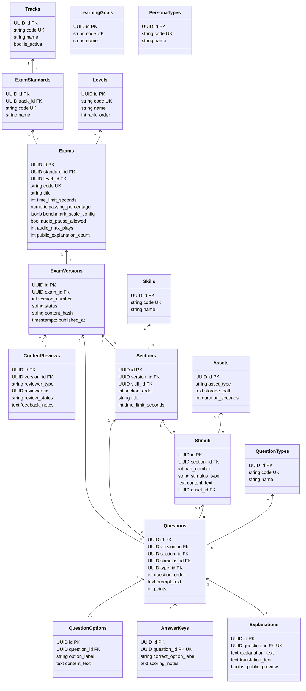
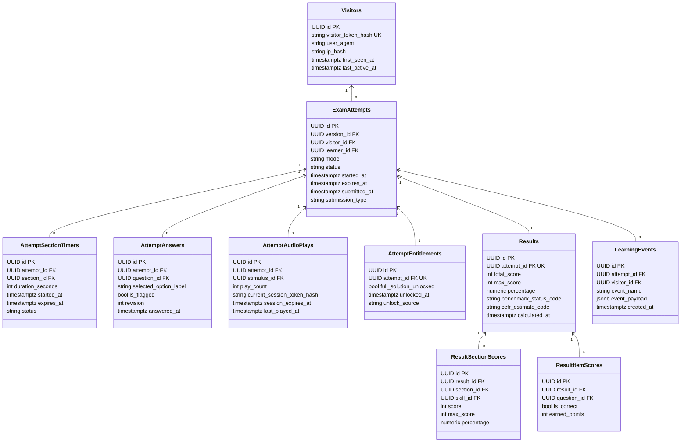
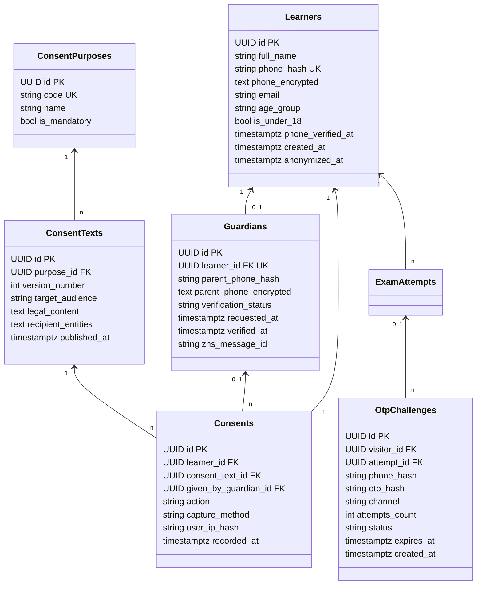
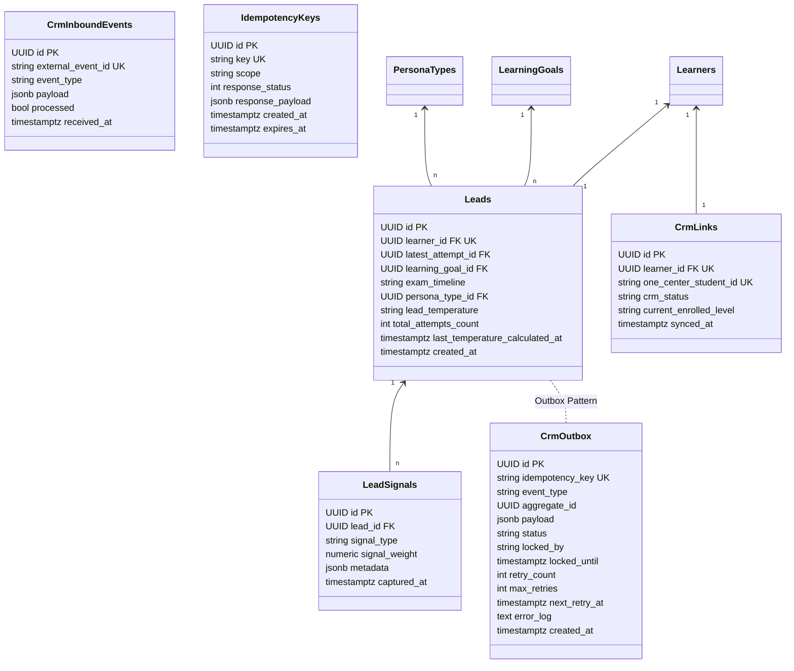
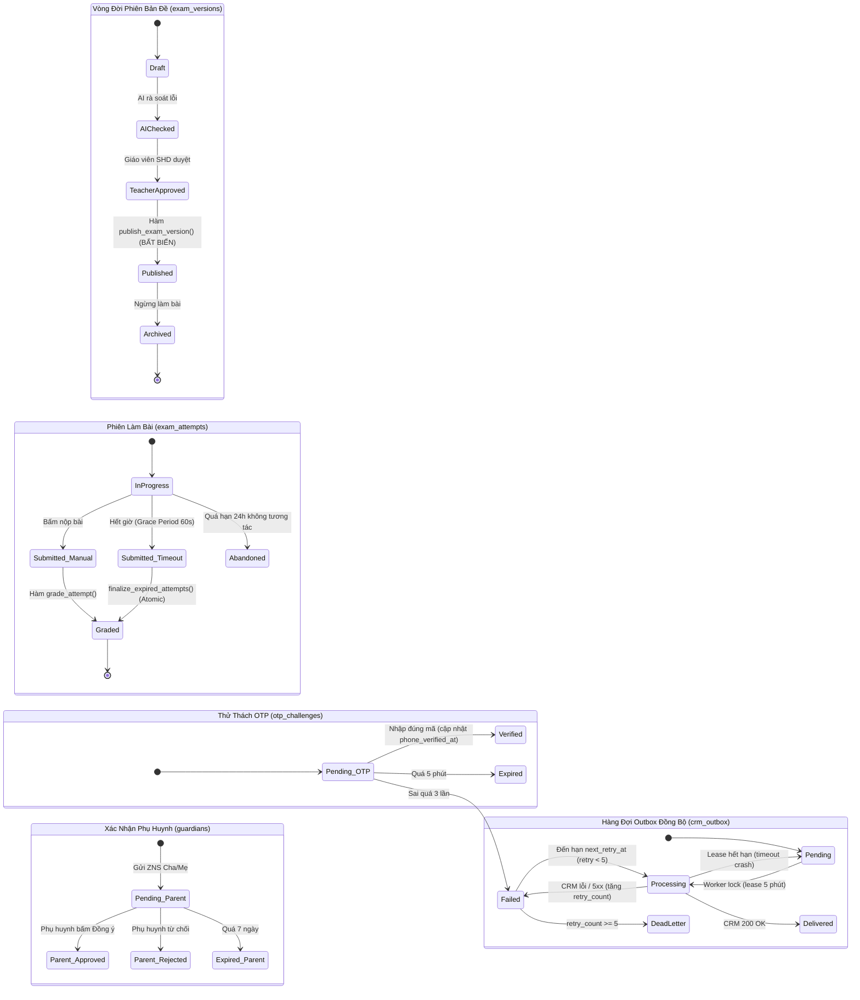

# Thiết Kế Kiến Trúc Dữ Liệu & Data Model (Data Architecture Specification)

> **Tài liệu:** `docs/architecture/02-data-model.md`  
> **Dự án:** Nền tảng tự học & luyện thi tiếng Đức miễn phí (`tuhoctiengduc.shdeducation.vn`)  
> **Phiên bản:** v1.2 (Hoàn thiện sau phiên rà soát Điểm dừng 1 lần 2 - Hard Gate 1)  
> **Vai trò:** Data Architect & Lead Systems Engineer  
> **Tài liệu đầu vào:** `docs/ux/00-assumptions.md`, `docs/ux/02-user-flows.md`, `docs/ux/03-screen-inventory.md`, `docs/ux/08-sample-exam-spec.md`, `docs/engineering-rules.md`.  
> **Trạng thái:** Chờ Duyệt (Điểm Dừng 1 - Hard Gate 1)

---

## 1. Tổng Quan Kiến Trúc & Các Quyết Định Bất Biến Đã Chốt

Mô hình dữ liệu của nền tảng được thiết kế xoay quanh 6 nguyên tắc kiến trúc cốt lõi:
1. **Server-Side Grading & Cô Lập Quyền Hạn Bằng Security Definer:** Bảng `answer_keys` lưu trữ đáp án đúng hoàn toàn độc lập với bảng câu hỏi. Role ứng dụng `shd_app` bị thu hồi quyền `SELECT` trên bảng `answer_keys` ở cấp độ PostgreSQL. Việc chấm điểm được thực thi thông qua hàm `SECURITY DEFINER` `grade_attempt(p_attempt_id)` thuộc sở hữu của role `shd_grader`, cố định `search_path = pg_catalog, public`. Role `shd_grader` phụ trách chấm thi biệt lập và hoàn toàn không có quyền đọc bảng dữ liệu định danh cá nhân (PII).
2. **Phiên Bản Đề Bất Biến (Immutable Exam Versions):** Đề thi được quản lý theo vòng đời phiên bản (`draft` $\rightarrow$ `ai_checked` $\rightarrow$ `teacher_approved` $\rightarrow$ `published` $\rightarrow$ `archived`). Khi đã chuyển sang `published`, toàn bộ cây nội dung (sections, stimuli, questions, options, answer_keys, explanations) bị khóa cứng bằng database trigger. Mọi thao tác chuyển trạng thái xuất bản bắt buộc thông qua hàm quản trị `publish_exam_version()`.
3. **Sổ Cái Đồng Ý Chỉ-Ghi-Thêm (Append-Only Consent Ledger):** Mọi hành vi cho phép hoặc rút lại sự đồng ý xử lý dữ liệu cá nhân đều được ghi thành dòng mới trong bảng `consents`. Trạng thái đồng ý hiện hành và khả năng liên hệ lead (`v_contactable_leads`) được suy ra thông qua database views, tuân thủ Luật Bảo vệ dữ liệu cá nhân số 91/2025/QH15 và Nghị định 356/2025/NĐ-CP.
4. **Bảo Mật PII & Mã Hóa Có Phong Bì (Envelope Encryption):** Số điện thoại và dữ liệu nhạy cảm được mã hóa đối xứng AES-256-GCM theo cấu trúc Envelope chứa `{v, kid, iv, tag, ct}` hỗ trợ xoay khóa không downtime. Số điện thoại, địa chỉ IP, mã token khách vãng lai (`visitor_token`) và token phiên phát audio (`current_session_token`) đều được lưu dạng băm HMAC-SHA256 với các khóa bí mật riêng biệt (`PHONE_HASH_PEPPER`, `IP_HASH_PEPPER`, `TOKEN_HASH_PEPPER`, `AUDIO_TOKEN_PEPPER`) để tra cứu chống trùng lặp mà không lộ dữ liệu thô.
5. **Khả Năng Mở Rộng Đa Ngôn Ngữ & Lookup Data (Non-German Hardcoded):** Không dùng enum cố định gắn với tiếng Đức. Các trục phân loại Ngôn ngữ (`tracks`), Chuẩn khảo thí (`exam_standards`), Cấp độ CEFR (`levels`), Kỹ năng (`skills`), Dạng câu hỏi (`question_types`), Mục tiêu học (`learning_goals`), và Nhóm đối tượng (`persona_types`) đều được quản lý bằng bảng tra cứu (lookup tables) có ràng buộc toàn vẹn.
6. **Đồng Hồ Tổng Luôn Thắng & Quản Lý Cột Nghiêm Ngặt:** Thời điểm kết thúc phiên làm bài tổng (`exam_attempts.expires_at`) luôn cưỡng chế nộp bài bất kể section timer. Mọi cột bảo mật nhạy cảm (`expires_at`, `play_count`, `full_solution_unlocked`, `phone_verified_at`, `is_under_18`) cấm role `shd_app` cập nhật trực tiếp mà bắt buộc thông qua các hàm `SECURITY DEFINER` có kiểm tra điều kiện nghiệp vụ chặt chẽ.

---

## 2. Sơ Đồ Thực Thể - Mối Quan Hệ (Entity-Relationship Diagrams v1.2)

Hệ thống bao gồm **43 bảng logic** được chia thành 5 phân hệ dữ liệu:



### 2.1. Phân Hệ 2: Làm Bài & Chấm Điểm (Attempts, Section Timers & Results)



### 2.2. Phân Hệ 3: Người Học, Phụ Huynh, Xác Thực OTP & Sổ Cái Đồng Ý



### 2.3. Phân Hệ 4: Lead Tuyển Sinh, Tín Hiệu Điểm, CRM Outbox Có Lease & Khóa Idempotency



### 2.4. Phân Hệ 5: Quản Trị & Vận Hành (Staff, Audit Logs 5 Năm & Data Requests)

```mermaid
classDiagram
    direction TB
    class StaffUsers {
        UUID id PK
        string email UK
        string full_name
        string role
        bool is_active
        timestamptz created_at
    }
    class AuditLogs {
        UUID id PK
        UUID staff_user_id FK
        string action
        string target_entity
        UUID target_entity_id
        string ip_hash
        text details
        timestamptz created_at
    }
    class DataRequests {
        UUID id PK
        UUID learner_id FK
        string request_type
        string status
        timestamptz requested_at
        timestamptz completed_at
    }
    class AppSettings {
        UUID id PK
        string setting_key UK
        jsonb setting_value
        string description
        timestamptz updated_at
    }

    StaffUsers "1" <-- "n" AuditLogs
    Learners "1" <-- "n" DataRequests
```



---

## 3. Từ Điển Bảng Dữ Liệu Chi Tiết (Table Dictionary v1.2 - 43 Bảng)

### Nhóm 1: Nội Dung Đề Thi & Bảng Tra Cứu (17 Bảng)

#### 1. `tracks`
- **Mục đích:** Lưu trữ các đường đua ngôn ngữ (tiếng Đức, tiếng Hàn, tiếng Nhật...). Mở rộng không sửa cấu trúc.
- **Cột chính:** `id` (UUID PK), `code` (varchar(32) UK), `name` (varchar(128)), `is_active` (boolean default true), `created_at` (timestamptz UTC).
- **Mức nhạy cảm PII:** Không có.
- **Thời hạn lưu trữ:** Vĩnh viễn (Master Data).

#### 2. `exam_standards`
- **Mục đích:** Danh mục chuẩn khảo thí theo từng ngôn ngữ (TELC, Goethe-Institut, ÖSD, TestDaF...).
- **Cột chính:** `id` (UUID PK), `track_id` (UUID FK tracks), `code` (varchar(32) UK), `name` (varchar(128)), `is_active` (boolean default true).
- **Mức nhạy cảm PII:** Không có.
- **Thời hạn lưu trữ:** Vĩnh viễn (Master Data).

#### 3. `levels`
- **Mục đích:** Khung cấp độ năng lực ngôn ngữ theo CEFR (A1, A2, B1, B2, C1, C2).
- **Cột chính:** `id` (UUID PK), `code` (varchar(16) UK), `name` (varchar(64)), `rank_order` (int UK).
- **Mức nhạy cảm PII:** Không có.
- **Thời hạn lưu trữ:** Vĩnh viễn (Master Data).

#### 4. `skills`
- **Mục đích:** Kỹ năng ngôn ngữ (Lesen - Đọc, Hören - Nghe, Schreiben - Viết, Sprechen - Nói).
- **Cột chính:** `id` (UUID PK), `code` (varchar(32) UK), `name` (varchar(64)).
- **Mức nhạy cảm PII:** Không có.
- **Thời hạn lưu trữ:** Vĩnh viễn (Master Data).

#### 5. `question_types`
- **Mục đích:** Dạng thức câu hỏi trắc nghiệm (`single_choice`, `true_false`, `matching`).
- **Cột chính:** `id` (UUID PK), `code` (varchar(32) UK), `name` (varchar(64)).
- **Mức nhạy cảm PII:** Không có.
- **Thời hạn lưu trữ:** Vĩnh viễn (Master Data).

#### 6. `learning_goals`
- **Mục đích:** Danh mục mục tiêu học tập của người học (`cert`, `ausbildung`, `visa18b`, `comms`).
- **Cột chính:** `id` (UUID PK), `code` (varchar(32) UK), `name` (varchar(128)), `description` (text null), `is_active` (boolean default true).
- **Mức nhạy cảm PII:** Không có.
- **Thời hạn lưu trữ:** Vĩnh viễn (Master Data).

#### 7. `persona_types`
- **Mục đích:** Danh mục nhóm đối tượng người học (`student_under18`, `university`, `worker`, `parent`).
- **Cột chính:** `id` (UUID PK), `code` (varchar(32) UK), `name` (varchar(128)), `is_active` (boolean default true).
- **Mức nhạy cảm PII:** Không có.
- **Thời hạn lưu trữ:** Vĩnh viễn (Master Data).

#### 8. `exams`
- **Mục đích:** Thực thể bài thi cấp cao. Chứa cấu hình chung, ngưỡng điểm đạt và thang quy đổi CEFR.
- **Cột chính:** 
  - `id` (UUID PK), `standard_id` (UUID FK exam_standards), `level_id` (UUID FK levels).
  - `code` (varchar(64) UK), `title` (varchar(255)).
  - `time_limit_seconds` (int not null default 3900 - quy định 65 phút).
  - `passing_percentage` (numeric(5,2) not null default 60.00 - ngưỡng tham khảo).
  - `benchmark_scale_config` (jsonb not null - thang điểm và CEFR).
  - `audio_pause_allowed` (boolean not null default false).
  - `audio_max_plays` (int not null default 2 - số lần phát tối đa do server quản lý).
  - `public_explanation_count` (int not null default 2 - số câu mở trước lead gate, từ câu 1 đến N).
  - `is_active` (boolean default true), `created_at` (timestamptz UTC).
- **Mức nhạy cảm PII:** Không có.
- **Thời hạn lưu trữ:** Vĩnh viễn.

#### 9. `exam_versions`
- **Mục đích:** Quản lý vòng đời và tính bất biến của nội dung đề thi.
- **Cột chính:** `id` (UUID PK), `exam_id` (UUID FK exams), `version_number` (int not null), `status` (varchar(32) not null check in (`draft`, `ai_checked`, `teacher_approved`, `published`, `archived`)), `content_hash` (varchar(64) null), `published_at` (timestamptz null), `created_at` (timestamptz UTC).
- **Ràng buộc:** `UNIQUE(exam_id, version_number)`; Partial Unique Index: `CREATE UNIQUE INDEX uq_exam_published_version ON exam_versions(exam_id) WHERE status = 'published'`.
- **Mức nhạy cảm PII:** Không có.
- **Thời hạn lưu trữ:** Vĩnh viễn.

#### 10. `content_reviews`
- **Mục đích:** Lưu lịch sử phê duyệt chất lượng đề thi của AI và giáo viên bản ngữ SHD.
- **Cột chính:** `id` (UUID PK), `version_id` (UUID FK exam_versions), `reviewer_type` (varchar(16) check in (`ai`, `teacher`)), `reviewer_id` (UUID null), `review_status` (varchar(32) check in (`approved`, `rejected`, `needs_revision`)), `feedback_notes` (text), `created_at` (timestamptz UTC).
- **Mức nhạy cảm PII:** Không có.
- **Thời hạn lưu trữ:** 5 năm (kiểm định học thuật).

#### 11. `sections`
- **Mục đích:** Các phần thi thành phần trong phiên bản đề (Section 1 = Lesen, Section 2 = Hören).
- **Cột chính:** `id` (UUID PK), `version_id` (UUID FK exam_versions), `skill_id` (UUID FK skills), `section_order` (int not null), `title` (varchar(128)), `instructions` (text), `time_limit_seconds` (int null).
- **Mức nhạy cảm PII:** Không có.
- **Thời hạn lưu trữ:** Theo vòng đời `exam_versions`.

#### 12. `stimuli`
- **Mục đích:** Ngữ liệu bài thi: bài đọc hoặc audio track dùng chung cho một nhóm câu hỏi (Teil).
- **Cột chính:** `id` (UUID PK), `section_id` (UUID FK sections), `part_number` (int not null default 1), `stimulus_type` (varchar(16) check in (`text`, `audio`, `image`)), `title` (varchar(255)), `content_text` (text null), `asset_id` (UUID FK assets null).
- **Ràng buộc:** `CONSTRAINT chk_stimulus_audio_asset CHECK ((stimulus_type = 'audio' AND asset_id IS NOT NULL) OR (stimulus_type != 'audio'))`.
- **Mức nhạy cảm PII:** Không có.
- **Thời hạn lưu trữ:** Theo vòng đời `exam_versions`.

#### 13. `assets`
- **Mục đích:** Lưu trữ đường dẫn tệp âm thanh nghe Hören và hình ảnh trên cloud storage.
- **Cột chính:** `id` (UUID PK), `asset_type` (varchar(16) check in (`audio_mp3`, `image_png`, `image_webp`)), `storage_path` (text not null), `file_size_bytes` (bigint), `duration_seconds` (int null), `mime_type` (varchar(64)), `created_at` (timestamptz UTC).
- **Mức nhạy cảm PII:** Không có.
- **Thời hạn lưu trữ:** Vĩnh viễn.

#### 14. `questions`
- **Mục đích:** Định nghĩa các câu hỏi trắc nghiệm (từ Câu 1 đến 30).
- **Cột chính:** `id` (UUID PK), `version_id` (UUID FK exam_versions not null), `section_id` (UUID FK sections not null), `stimulus_id` (UUID FK stimuli null), `type_id` (UUID FK question_types not null), `question_order` (int not null), `prompt_text` (text not null), `points` (int not null default 1).
- **Ràng buộc:** `UNIQUE(version_id, question_order)`.
- **Mức nhạy cảm PII:** Không có.
- **Thời hạn lưu trữ:** Theo vòng đời `exam_versions`.

#### 15. `question_options`
- **Mục đích:** Các lựa chọn phương án của từng câu hỏi (A, B, C hoặc Richtig/Falsch).
- **Cột chính:** `id` (UUID PK), `question_id` (UUID FK questions), `option_label` (varchar(8) not null), `content_text` (text not null), `option_order` (int not null).
- **Ràng buộc:** `UNIQUE(question_id, option_label)`.
- **Mức nhạy cảm PII:** Không có.
- **Thời hạn lưu trữ:** Theo vòng đời `exam_versions`.

#### 16. `answer_keys` (BẢNG BẢO MẬT TỐI CAO - CÔ LẬP ROLE)
- **Mục đích:** Lưu đáp án đúng của từng câu hỏi. Bảng độc lập hoàn toàn.
- **Cột chính:** `id` (UUID PK), `question_id` (UUID FK questions UK), `correct_option_label` (varchar(8) not null), `scoring_notes` (text null), `created_at` (timestamptz UTC).
- **Phân quyền bảo vệ:** `REVOKE ALL ON answer_keys FROM PUBLIC; GRANT SELECT ON answer_keys TO shd_grader; REVOKE ALL ON answer_keys FROM shd_app;`. Role `shd_app` chỉ có thể gọi hàm `grade_attempt` (SECURITY DEFINER) chứ không thể SELECT bảng này.
- **Mức nhạy cảm PII:** Không chứa PII nhưng là dữ liệu tối mật kinh doanh (Business Critical).
- **Thời hạn lưu trữ:** Theo vòng đời `exam_versions`.

#### 17. `explanations`
- **Mục đích:** Lời giải thích sư phạm chi tiết bằng tiếng Việt, phân tích từ vựng và dịch bài đọc.
- **Cột chính:** `id` (UUID PK), `question_id` (UUID FK questions UK), `explanation_text` (text not null), `translation_text` (text null), `vocabulary_notes` (jsonb null), `is_public_preview` (boolean not null default false).
- **Phân quyền:** Role `shd_app` không SELECT trực tiếp bảng này mà truy cập qua view `v_public_explanations` hoặc view kiểm tra entitlement.
- **Mức nhạy cảm PII:** Không có.
- **Thời hạn lưu trữ:** Theo vòng đời `exam_versions`.

---

### Nhóm 2: Làm Bài & Chấm Điểm (10 Bảng)

#### 18. `visitors`
- **Mục đích:** Định danh khách vãng lai ẩn danh truy cập qua Cookie / LocalStorage.
- **Cột chính:** `id` (UUID PK), `visitor_token_hash` (varchar(64) UK not null - HMAC-SHA256 kèm `TOKEN_HASH_PEPPER`), `user_agent` (text null), `ip_hash` (varchar(64) null - HMAC-SHA256 kèm `IP_HASH_PEPPER`), `first_seen_at` (timestamptz UTC), `last_active_at` (timestamptz UTC).
- **Mức nhạy cảm PII:** Định danh gián tiếp / Dữ liệu hành vi.
- **Thời hạn lưu trữ:** 90 ngày kể từ lần hoạt động cuối [DEC-ARCH-01].

#### 19. `exam_attempts`
- **Mục đích:** Phiên làm bài thi thử của người học. Nguồn sự thật duy nhất về thời gian và kết quả nộp bài.
- **Cột chính:** `id` (UUID PK), `version_id` (UUID FK exam_versions), `visitor_id` (UUID FK visitors not null), `learner_id` (UUID FK learners null), `mode` (varchar(16) not null default 'exam' check in (`exam`, `practice`)), `status` (varchar(32) not null check in (`in_progress`, `submitted`, `graded`, `abandoned`)), `started_at` (timestamptz UTC not null), `expires_at` (timestamptz UTC not null), `submitted_at` (timestamptz UTC null), `submission_type` (varchar(16) null check in (`manual`, `timeout`)).
- **Quy tắc bảo vệ cột:** Role `shd_app` **chỉ được UPDATE các cột:** `submitted_at`, `submission_type`, `visitor_id`, `learner_id`. Tuyệt đối **CẤM UPDATE trực tiếp** cột `status` và `expires_at`.
- **Mức nhạy cảm PII:** Hành vi học tập.
- **Thời hạn lưu trữ:** 3 năm phục vụ báo cáo năng lực [DEC-ARCH-01].

#### 20. `attempt_section_timers`
- **Mục đích:** Quản lý thời gian độc lập cho từng phần thi (Section) do server giám sát và cưỡng chế.
- **Cột chính:** `id` (UUID PK), `attempt_id` (UUID FK exam_attempts), `section_id` (UUID FK sections), `duration_seconds` (int not null), `started_at` (timestamptz UTC null), `expires_at` (timestamptz UTC null), `status` (varchar(16) not null default 'not_started' check in (`not_started`, `in_progress`, `completed`, `expired`)).
- **Ràng buộc:** `UNIQUE(attempt_id, section_id)`.
- **Quy tắc bảo vệ cột:** Role `shd_app` **chỉ được UPDATE** cột `status` thành `'completed'` khi người dùng chủ động nộp phần thi. Cột `started_at` và `expires_at` **CẤM UPDATE trực tiếp**, chỉ được gán thông qua hàm `SECURITY DEFINER` `enter_section(attempt_id, section_id)`.
- **Mức nhạy cảm PII:** Dữ liệu thời gian làm bài.
- **Thời hạn lưu trữ:** Theo vòng đời `exam_attempts`.

#### 21. `attempt_answers`
- **Mục đích:** Ghi nhận phương án người học lựa chọn cho từng câu hỏi (Optimistic Concurrency Control).
- **Cột chính:** `id` (UUID PK), `attempt_id` (UUID FK exam_attempts), `question_id` (UUID FK questions), `selected_option_label` (varchar(8) null), `is_flagged` (boolean default false), `revision` (int not null default 1), `answered_at` (timestamptz UTC).
- **Ràng buộc:** `UNIQUE(attempt_id, question_id)`.
- **Cơ chế xung đột:** Server chỉ chấp nhận nếu `revision_client == revision_db`, sau đó tăng `revision = revision + 1`. Nếu không khớp, trả về lỗi `REVISION_CONFLICT` (HTTP 409).
- **Mức nhạy cảm PII:** Hành vi học tập.
- **Thời hạn lưu trữ:** Theo vòng đời `exam_attempts`.

#### 22. `attempt_audio_plays`
- **Mục đích:** SERVER-AUTHORITATIVE AUDIOPLAY COUNTER VỚI PHIÊN PHÁT CÓ TOKEN BĂM. Kiểm soát số lần nghe Hören theo quy định. Tải lại trang không bị trừ thêm lượt.
- **Cột chính:** `id` (UUID PK), `attempt_id` (UUID FK exam_attempts), `stimulus_id` (UUID FK stimuli), `play_count` (int not null default 0 check (play_count >= 0)), `current_session_token_hash` (varchar(64) null - HMAC-SHA256 kèm `AUDIO_TOKEN_PEPPER`), `session_expires_at` (timestamptz UTC null), `last_played_at` (timestamptz UTC).
- **Ràng buộc:** `UNIQUE(attempt_id, stimulus_id)`.
- **Loại bỏ CHECK cứng:** Bỏ ràng buộc `play_count <= 2` khỏi DDL; số lượt tối đa được đối soát động với `exams.audio_max_plays` trong hàm `start_audio_play()`.
- **Quy tắc bảo vệ cột:** Role `shd_app` **CẤM UPDATE trực tiếp** bảng này! Bắt buộc gọi hàm `SECURITY DEFINER` `start_audio_play(attempt_id, stimulus_id)`.
- **Mức nhạy cảm PII:** Hành vi học tập.
- **Thời hạn lưu trữ:** Theo vòng đời `exam_attempts`.

#### 23. `attempt_entitlements`
- **Mục đích:** Quyền lợi xem lời giải chi tiết gắn với phiên làm bài.
- **Cột chính:** `id` (UUID PK), `attempt_id` (UUID FK exam_attempts UK), `full_solution_unlocked` (boolean not null default false), `unlocked_at` (timestamptz UTC null), `unlock_source` (varchar(32) null).
- **Quy tắc bảo vệ cột:** Role `shd_app` **CẤM UPDATE trực tiếp** cột `full_solution_unlocked`! Bắt buộc gọi hàm `SECURITY DEFINER` `unlock_full_solution(attempt_id, otp_code)`.
- **Mức nhạy cảm PII:** Quyền lợi dịch vụ.
- **Thời hạn lưu trữ:** Theo vòng đời `exam_attempts`.

#### 24. `results`
- **Mục đích:** Bảng điểm tổng quan sau khi nộp bài.
- **Cột chính:** `id` (UUID PK), `attempt_id` (UUID FK exam_attempts UK), `total_score` (int not null), `max_score` (int not null default 30), `percentage` (numeric(5,2) not null), `benchmark_status_code` (varchar(32) not null - `passed_reference`, `below_reference`), `cefr_estimate_code` (varchar(16) not null - `B1`, `B1_MINUS`, `A2`), `calculated_at` (timestamptz UTC).
- **Mức nhạy cảm PII:** Kết quả học tập.
- **Thời hạn lưu trữ:** 3 năm [DEC-ARCH-01].

#### 25. `result_section_scores`
- **Mục đích:** Điểm chi tiết từng kỹ năng/phần thi đa ngôn ngữ (thay thế cột hardcode `lesen_score`/`hoeren_score`).
- **Cột chính:** `id` (UUID PK), `result_id` (UUID FK results), `section_id` (UUID FK sections), `skill_id` (UUID FK skills), `score` (int not null), `max_score` (int not null), `percentage` (numeric(5,2) not null).
- **Ràng buộc:** `UNIQUE(result_id, section_id)`.
- **Mức nhạy cảm PII:** Kết quả học tập.
- **Thời hạn lưu trữ:** Theo vòng đời `results`.

#### 26. `result_item_scores`
- **Mục đích:** Điểm chi tiết từng câu do hàm `grade_attempt` tính toán đối chiếu với `answer_keys`.
- **Cột chính:** `id` (UUID PK), `result_id` (UUID FK results), `question_id` (UUID FK questions), `is_correct` (boolean not null), `earned_points` (int not null).
- **Ràng buộc:** `UNIQUE(result_id, question_id)`.
- **Phân quyền:** Role `shd_app` không SELECT trực tiếp mà thông qua view kiểm tra `attempt_entitlements`.
- **Mức nhạy cảm PII:** Kết quả học tập.
- **Thời hạn lưu trữ:** Theo vòng đời `results`.

#### 27. `learning_events` (SỔ CÁI HÀNH VI CHỈ-GHI-THÊM)
- **Mục đích:** Nhật ký phân tích hành vi học tập (Analytics Event Log). CẤM UPDATE/DELETE.
- **Cột chính:** `id` (UUID PK), `attempt_id` (UUID FK exam_attempts null), `visitor_id` (UUID FK visitors null), `event_name` (varchar(64) not null), `event_payload` (jsonb not null), `created_at` (timestamptz UTC).
- **Mức nhạy cảm PII:** Dữ liệu hành vi.
- **Thời hạn lưu trữ:** 12 tháng.

---

### Nhóm 3: Người Học, Phụ Huynh, Xác Thực & Đồng Ý (6 Bảng)

#### 28. `learners`
- **Mục đích:** Hồ sơ học viên sau khi điền thông tin Lead Gate.
- **Cột chính:** `id` (UUID PK), `full_name` (varchar(128) not null), `phone_hash` (varchar(64) not null UK - HMAC-SHA256 tra cứu), `phone_encrypted` (text not null - Envelope JSON AES-256-GCM), `email` (varchar(255) null), `age_group` (varchar(32) not null check in (`student_under18`, `university`, `worker`, `parent`)), `is_under_18` (boolean not null default false), `phone_verified_at` (timestamptz UTC null - **NGUỒN SỰ THẬT DUY NHẤT VỀ XÁC THỰC SĐT**), `created_at` (timestamptz UTC), `anonymized_at` (timestamptz UTC null).
- **Ràng buộc:** `CONSTRAINT chk_learner_under18_age CHECK ((is_under_18 = true AND age_group = 'student_under18') OR (is_under_18 = false AND age_group != 'student_under18'))`.
- **Quy tắc bảo vệ cột:** Role `shd_app` **chỉ được UPDATE** `full_name`, `email`, `age_group`. Tuyệt đối **CẤM UPDATE trực tiếp** `phone_verified_at` và `is_under_18`. Cột `phone_verified_at` chỉ được cập nhật qua hàm `SECURITY DEFINER` `mark_phone_verified(learner_id, otp_challenge_id)`.
- **Mức nhạy cảm PII:** **ĐỊNH DANH TRỰC TIẾP (Direct PII)**.
- **Thời hạn lưu trữ:** Lưu trữ đến khi có yêu cầu xóa hoặc 3 năm không tương tác [DEC-ARCH-01].

#### 29. `guardians`
- **Mục đích:** Thông tin cha mẹ/người giám hộ bắt buộc đối với học viên dưới 18 tuổi theo Luật 91/2025/QH15.
- **Cột chính:** `id` (UUID PK), `learner_id` (UUID FK learners UK), `parent_phone_hash` (varchar(64) not null - HMAC tra cứu), `parent_phone_encrypted` (text not null - Envelope JSON AES-256-GCM), `verification_status` (varchar(32) not null default 'pending' check in (`pending`, `approved`, `rejected`, `expired`)), `requested_at` (timestamptz UTC), `verified_at` (timestamptz UTC null), `zns_message_id` (varchar(64) null).
- **Mức nhạy cảm PII:** **ĐỊNH DANH TRỰC TIẾP (Direct PII)**.
- **Thời hạn lưu trữ:** Theo vòng đời tài khoản học viên vị thành niên.

#### 30. `otp_challenges`
- **Mục đích:** Quản lý vòng đời mã xác thực OTP gửi qua Zalo ZNS / SMS.
- **Cột chính:** `id` (UUID PK), `visitor_id` (UUID FK visitors), `attempt_id` (UUID FK exam_attempts null), `phone_hash` (varchar(64) not null), `otp_hash` (varchar(64) not null - HMAC băm với `OTP_HASH_PEPPER`), `channel` (varchar(16) not null default 'zalo_zns' check in (`zalo_zns`, `sms`)), `attempts_count` (int not null default 0 check(attempts_count <= 3)), `status` (varchar(16) not null default 'pending' check in (`pending`, `verified`, `expired`, `failed`)), `expires_at` (timestamptz UTC not null - 5 phút sau khi tạo), `created_at` (timestamptz UTC not null).
- **Loại bỏ nhánh 30 ngày:** Bảng này chỉ lưu phiên thử thách OTP. Nguồn sự thật duy nhất xác nhận SĐT đã xác thực là `learners.phone_verified_at IS NOT NULL`.
- **Mức nhạy cảm PII:** Dữ liệu xác thực.
- **Thời hạn lưu trữ:** 7 ngày (đối soát chi phí viễn thông).

#### 31. `consent_purposes`
- **Mục đích:** Danh mục các mục đích xử lý dữ liệu cá nhân theo Luật 91/2025/QH15.
- **Cột chính:** `id` (UUID PK), `code` (varchar(32) UK - `scoring_history`, `course_consulting`, `study_abroad_18b`), `name` (varchar(128)), `is_mandatory` (boolean not null), `is_active` (boolean default true).
- **Mức nhạy cảm PII:** Không có.
- **Thời hạn lưu trữ:** Vĩnh viễn.

#### 32. `consent_texts`
- **Mục đích:** Văn bản pháp lý chi tiết của từng điều khoản đồng ý (phân tách học viên và phụ huynh).
- **Cột chính:** `id` (UUID PK), `purpose_id` (UUID FK consent_purposes), `version_number` (int not null), `target_audience` (varchar(16) not null default 'learner' check in (`learner`, `guardian`)), `legal_content` (text not null), `recipient_entities` (text not null), `published_at` (timestamptz UTC).
- **Ràng buộc:** `UNIQUE(purpose_id, version_number, target_audience)`.
- **Mức nhạy cảm PII:** Không có.
- **Thời hạn lưu trữ:** Vĩnh viễn.

#### 33. `consents` (SỔ CÁI ĐỒNG Ý CHỈ-GHI-THÊM)
- **Mục đích:** Sổ cái ghi nhận hành vi đồng ý hoặc rút lại đồng ý của người học và phụ huynh. CẤM UPDATE/DELETE.
- **Cột chính:** `id` (UUID PK), `learner_id` (UUID FK learners), `consent_text_id` (UUID FK consent_texts), `given_by_guardian_id` (UUID FK guardians null - lưu ID phụ huynh nếu con <18 tuổi), `action` (varchar(16) not null check in (`granted`, `revoked`)), `capture_method` (varchar(32) not null - 'web_checkbox', 'zalo_button'), `user_ip_hash` (varchar(64) null - HMAC), `recorded_at` (timestamptz UTC not null).
- **Ràng buộc trẻ em (INV-29):** Nếu học viên dưới 18 tuổi, bắt buộc `given_by_guardian_id IS NOT NULL` và phụ huynh phải có trạng thái `approved` tại thời điểm ghi nhận.
- **Mức nhạy cảm PII:** Bằng chứng pháp lý gắn với định danh.
- **Thời hạn lưu trữ:** 5 năm sau khi kết thúc tương tác [DEC-ARCH-01, DEC-ARCH-07].

---

### Nhóm 4: Lead Tuyển Sinh, Tín Hiệu Điểm, CRM Outbox & Khóa Idempotency (6 Bảng)

#### 34. `leads`
- **Mục đích:** Thực thể Lead phục vụ đội ngũ tuyển sinh. Thiết kế theo quan hệ **1 Lead duy nhất cho mỗi Học viên (Lead per Learner)**, cập nhật theo thời gian.
- **Cột chính:** `id` (UUID PK), `learner_id` (UUID FK learners UK), `latest_attempt_id` (UUID FK exam_attempts), `learning_goal_id` (UUID FK learning_goals not null), `exam_timeline` (varchar(32) not null - '1m', '1_3m', '3_6m', 'unknown'), `persona_type_id` (UUID FK persona_types not null), `lead_temperature` (varchar(16) not null check in (`hot`, `warm`, `nurture`)), `total_attempts_count` (int not null default 1), `last_temperature_calculated_at` (timestamptz UTC), `created_at` (timestamptz UTC).
- **Mức nhạy cảm PII:** Định danh thương mại.
- **Thời hạn lưu trữ:** 2 năm [DEC-ARCH-01].

#### 35. `lead_signals` (BẢNG MỚI - GHI NHẬN TÍN HIỆU THEO THỜI ĐIỂM)
- **Mục đích:** Ghi vết các tín hiệu hành vi, điểm số, đăng ký test 1-1 theo thời điểm để tính toán nhiệt độ lead khách quan và có thể truy vết.
- **Cột chính:** 
  - `id` (UUID PK), `lead_id` (UUID FK leads not null).
  - `signal_type` (varchar(64) not null check in (`registered_1on1_test`, `timeline_urgent`, `score_extreme_low`, `score_near_pass`, `goal_ausbildung_18b`, `full_exam_completed`, `multiple_replays`)).
  - `signal_weight` (numeric(4,2) not null - ví dụ: 2.0 cho test 1-1, 1.5 cho timeline 1m).
  - `metadata` (jsonb null - ví dụ: `{ "attempt_id": "...", "score": 21 }`).
  - `captured_at` (timestamptz UTC not null default clock_timestamp()).
- **Quy tắc tính lại `lead_temperature`:** Tự động kích hoạt khi có tín hiệu mới được chèn vào `lead_signals` hoặc khi `results` được tạo.
- **Mức nhạy cảm PII:** Dữ liệu hành vi thương mại.
- **Thời hạn lưu trữ:** Theo vòng đời `leads`.

#### 36. `crm_outbox` (TRANSACTIONAL OUTBOX PATTERN VỚI KHÓA LEASE ĐỒNG BỘ)
- **Mục đích:** Hàng đợi transactional outbox gửi dữ liệu sang One Center CRM. Hỗ trợ khóa thuê (Lease) cho worker chạy song song an toàn bằng `FOR UPDATE SKIP LOCKED`.
- **Cột chính:** 
  - `id` (UUID PK), `idempotency_key` (varchar(128) not null UK).
  - `event_type` (varchar(64) not null - 'lead.created', 'parent.verified').
  - `aggregate_id` (UUID not null).
  - `payload` (jsonb not null - **CHỈ CHỨA ID VÀ TRƯỜNG TỐI THIỂU**, tuyệt đối không lưu SĐT thô trong DB!).
  - `status` (varchar(16) not null default 'pending' check in (`pending`, `processing`, `delivered`, `failed`, `dead_letter`)).
  - `locked_by` (varchar(64) null - ID instance worker).
  - `locked_until` (timestamptz UTC null - thời hạn lease 5 phút).
  - `retry_count` (int not null default 0), `max_retries` (int not null default 5).
  - `next_retry_at` (timestamptz UTC not null default clock_timestamp()).
  - `error_log` (text null), `created_at` (timestamptz UTC).
- **Ràng buộc trạng thái thống nhất:** `CHECK (status IN ('pending', 'processing', 'delivered', 'failed', 'dead_letter'))`.
- **Mức nhạy cảm PII:** Payload chỉ chứa ID; không chứa PII dạng rõ.
- **Thời hạn lưu trữ:** Xóa dữ liệu thành công sau 30 ngày; giữ log lỗi 90 ngày.

#### 37. `crm_links`
- **Mục đích:** Lưu trữ liên kết học viên giữa hệ thống thi thử và One Center CRM.
- **Cột chính:** `id` (UUID PK), `learner_id` (UUID FK learners UK), `one_center_student_id` (varchar(64) not null UK), `crm_status` (varchar(32)), `current_enrolled_level` (varchar(16) null), `synced_at` (timestamptz UTC).
- **Mức nhạy cảm PII:** Liên kết mã định danh ngoài.
- **Thời hạn lưu trữ:** Theo vòng đời học viên.

#### 38. `crm_inbound_events`
- **Mục đích:** Tiếp nhận webhook từ One Center CRM (học viên nhập học, đóng học phí).
- **Cột chính:** `id` (UUID PK), `external_event_id` (varchar(64) not null UK), `event_type` (varchar(64) not null), `payload` (jsonb not null), `processed` (boolean not null default false), `received_at` (timestamptz UTC).
- **Mức nhạy cảm PII:** Sự kiện nghiệp vụ.
- **Thời hạn lưu trữ:** 90 ngày.

#### 39. `idempotency_keys`
- **Mục đích:** Kiểm soát chống xử lý trùng lặp cho các yêu cầu API và giao tiếp liên dịch vụ.
- **Cột chính:** `id` (UUID PK), `key` (varchar(128) not null UK), `scope` (varchar(32) not null check in (`api_request`, `crm_outbox`, `crm_inbound`)), `response_status` (int null), `response_payload` (jsonb null), `created_at` (timestamptz UTC), `expires_at` (timestamptz UTC not null).
- **Mức nhạy cảm PII:** Không có.
- **Thời hạn lưu trữ:** 7 ngày (tự động dọn dẹp khi hết hạn).

---

### Nhóm 5: Quản Trị & Vận Hành (4 Bảng)

#### 40. `staff_users`
- **Mục đích:** Tài khoản cán bộ tuyển sinh, giáo viên duyệt đề và quản trị viên SHD.
- **Cột chính:** `id` (UUID PK), `email` (varchar(255) not null UK), `full_name` (varchar(128)), `role` (varchar(32) check in (`admin`, `teacher`, `advisor`, `dpo`, `auditor`)), `is_active` (boolean default true), `created_at` (timestamptz UTC).
- **Mức nhạy cảm PII:** PII nội bộ nhân sự.
- **Thời hạn lưu trữ:** Vĩnh viễn hoặc theo hợp đồng lao động.

#### 41. `audit_logs` (SỔ CÁI AUDIT CHỈ-GHI-THÊM - BẮT BUỘC 5 NĂM)
- **Mục đích:** Ghi vết mọi hành vi truy cập PII (giải mã SĐT) và thao tác quản trị viên. CẤM UPDATE/DELETE.
- **Cột chính:** `id` (UUID PK), `staff_user_id` (UUID FK staff_users null), `action` (varchar(64) not null - 'decrypt_phone', 'approve_exam_version', 'anonymize_learner'), `target_entity` (varchar(64) not null), `target_entity_id` (UUID not null), `ip_hash` (varchar(64)), `details` (text null), `created_at` (timestamptz UTC not null).
- **Mức nhạy cảm PII:** Nhật ký giám sát an ninh.
- **Thời hạn lưu trữ:** **BẮT BUỘC 5 NĂM** (tuân thủ quy định an toàn thông tin mạng).

#### 42. `data_requests`
- **Mục đích:** Tiếp nhận và theo dõi xử lý quyền của chủ thể dữ liệu (Rút đồng ý, Xóa dữ liệu, Xuất PII) theo Luật 91/2025/QH15.
- **Cột chính:** `id` (UUID PK), `learner_id` (UUID FK learners), `request_type` (varchar(32) check in (`export_data`, `delete_data`, `revoke_consent`)), `status` (varchar(16) default 'pending' check in (`pending`, `processing`, `completed`, `rejected`)), `requested_at` (timestamptz UTC), `completed_at` (timestamptz UTC null).
- **Phân quyền xử lý:** Chỉ cán bộ DPO/Admin được cập nhật `status = 'completed'` sau khi chạy thủ tục `anonymize_learner()`.
- **Mức nhạy cảm PII:** Yêu cầu quyền riêng tư.
- **Thời hạn lưu trữ:** 3 năm phục vụ kiểm toán tuân thủ.

#### 43. `app_settings`
- **Mục đích:** Lưu trữ cấu hình toàn cục không cần build lại mã nguồn.
- **Cột chính:** `id` (UUID PK), `setting_key` (varchar(64) not null UK), `setting_value` (jsonb not null), `description` (text), `updated_at` (timestamptz UTC).
- **Mức nhạy cảm PII:** Không có.
- **Thời hạn lưu trữ:** Vĩnh viễn.

---

## 4. Máy Trạng Thái Cốt Lõi (State Machines v1.2)



---

## 5. Đường Chấm Điểm & Các Hàm Security Definer Trọng Yếu

### 5.1. Hàm Chấm Điểm Biệt Lập `grade_attempt` (Owner: `shd_grader`)

- **Owner & Security:** Hàm thuộc sở hữu của role `shd_grader`. Khai báo với cờ `SECURITY DEFINER`.
- **Cố định đường dẫn tìm kiếm:** `SET search_path = pg_catalog, public` (chống lỗ hổng leo thang search_path).
- **Phân quyền thực thi:**
  ```sql
  REVOKE ALL ON FUNCTION grade_attempt(UUID) FROM PUBLIC;
  GRANT EXECUTE ON FUNCTION grade_attempt(UUID) TO shd_app, shd_worker;
  ```
- **Kiểm tra quyền sở hữu & trạng thái:**
  1. Kiểm tra bản ghi `exam_attempts` tồn tại.
  2. Nếu được gọi bởi `shd_app`: kiểm tra `attempt.visitor_id` hoặc `attempt.learner_id` khớp với ngữ cảnh phiên làm việc của người dùng hiện tại (tránh chấm trộm attempt của người khác).
  3. Kiểm tra trạng thái: chỉ chấm nếu `status = 'submitted'` (hoặc được gọi nội bộ từ `finalize_expired_attempts`). Nếu `status = 'in_progress'`, ném ngoại lệ `CANNOT_GRADE_IN_PROGRESS_ATTEMPT`.
- **Bảo đảm Idempotency khi gọi lại:**
  Nếu attempt đã ở trạng thái `'graded'` và đã có bản ghi trong bảng `results`, hàm trả về kết quả hiện tại mà KHÔNG tính toán lại, không chèn trùng lặp dữ liệu vào `result_item_scores` hay `results`.
- **Luồng nộp và chấm điểm:**
  1. Học viên bấm nộp bài: `shd_app` cập nhật `status = 'submitted'`, `submitted_at = clock_timestamp()`.
  2. `shd_app` gọi `grade_attempt(attempt_id)`.
  3. Hàm đọc `answer_keys`, tính điểm chi tiết, chèn `result_item_scores`, tính tổng điểm chèn `results` và `result_section_scores`.
  4. Cập nhật `status = 'graded'`. Kết quả trả về cho client hiển thị SCR-05.

### 5.2. Hàm Đóng Bài Thi Hết Hạn `finalize_expired_attempts()` (Role: `shd_worker`)

- **Mục đích:** Xử lý các bài thi đã quá hạn thời gian server mà client không bấm nộp bài (do rớt mạng hoặc tắt trình duyệt).
- **Quy định khoảng ân hạn (Grace Period):** Cấu hình `grace_period = interval '60 seconds'`. Cho phép client có 60 giây gửi request nộp bài cuối cùng qua đường truyền trễ.
- **Nguyên tắc thực thi Atomic trong cùng Transaction:**
  ```sql
  -- Chạy định kỳ mỗi phút bởi shd_worker:
  FOR r IN (
      SELECT id, expires_at FROM exam_attempts
      WHERE status = 'in_progress'
        AND expires_at + interval '60 seconds' < clock_timestamp()
      FOR UPDATE SKIP LOCKED
  ) LOOP
      -- 1. Cưỡng chế nộp bài do timeout:
      UPDATE exam_attempts
      SET status = 'submitted',
          submission_type = 'timeout',
          submitted_at = r.expires_at
      WHERE id = r.id;

      -- 2. Chấm điểm ngay lập tức trong cùng transaction:
      PERFORM grade_attempt(r.id);
  END LOOP;
  ```
- Đảm bảo tuyệt đối không có bài thi nào bị treo ở trạng thái dở dang (`submitted` mà không có `results`).

### 5.3. Các Hàm Security Definer Bảo Vệ Cột Cấm Role `shd_app` Update

Nhằm ngăn chặn client qua mặt giao diện để tự ý sửa đổi quyền lợi hoặc thời gian:

1. **`enter_section(p_attempt_id UUID, p_section_id UUID)`:**
   - Kiểm tra `exam_attempts.status = 'in_progress'`.
   - Lấy `duration_seconds` từ bảng `sections`.
   - Tính toán `expires_at = LEAST(clock_timestamp() + duration_seconds * interval '1 second', exam_attempts.expires_at)` (đồng hồ tổng luôn khống chế).
   - Chèn hoặc cập nhật bản ghi trong `attempt_section_timers`: `started_at = clock_timestamp()`, `status = 'in_progress'`.
2. **`start_audio_play(p_attempt_id UUID, p_stimulus_id UUID, p_raw_token_hash VARCHAR)`:**
   - Kiểm tra `attempt_section_timers` của phần thi Hören đang `in_progress` và chưa hết giờ.
   - Đối chiếu số lượt nghe hiện tại với cấu hình `exams.audio_max_plays` (mặc định 2).
   - Nếu token hiện tại (`current_session_token_hash`) còn trong hạn `session_expires_at`: cho phép tiếp tục nghe, KHÔNG tăng `play_count`.
   - Nếu bắt đầu lượt mới hợp lệ: tăng `play_count = play_count + 1`, lưu `current_session_token_hash = p_raw_token_hash`, cấp hạn phiên nghe `session_expires_at = clock_timestamp() + interval '5 minutes'`.
   - Nếu `play_count >= exams.audio_max_plays`: từ chối và ném lỗi `AUDIO_PLAY_LIMIT_EXCEEDED`.
3. **`unlock_full_solution(p_attempt_id UUID, p_otp_challenge_id UUID)`:**
   - Kiểm tra bản ghi `otp_challenges` tương ứng có trạng thái `'verified'`.
   - Ghi nhận `attempt_entitlements`: `full_solution_unlocked = true`, `unlocked_at = clock_timestamp()`, `unlock_source = 'lead_gate_otp'`.
4. **`mark_phone_verified(p_learner_id UUID, p_otp_challenge_id UUID)`:**
   - Kiểm tra mã OTP đã khớp và trạng thái `otp_challenges.status = 'verified'`.
   - Cập nhật trực tiếp `learners.phone_verified_at = clock_timestamp()`.
5. **`publish_exam_version(p_version_id UUID, p_staff_user_id UUID)`:**
   - Kiểm tra `staff_users` có quyền `admin`.
   - Kiểm tra phiên bản đề đã có tối thiểu 1 đánh giá AI và 1 phê duyệt của giáo viên bản ngữ SHD (`content_reviews.review_status = 'approved'`).
   - Kiểm tra quy tắc câu công khai (INV-20: phải là dãy liên tục từ 1 đến N).
   - Cập nhật `exam_versions.status = 'published'`, `published_at = clock_timestamp()`. Kích hoạt trigger khóa bất biến toàn bộ nội dung đề.

### 5.4. Truy Vấn Lấy Việc Outbox Worker Chuẩn Hóa

```sql
UPDATE crm_outbox
SET status = 'processing',
    locked_by = :worker_instance_id,
    locked_until = clock_timestamp() + interval '5 minutes'
WHERE id = (
    SELECT id FROM crm_outbox
    WHERE (
        status = 'pending'
        OR (status = 'failed' AND retry_count < max_retries AND next_retry_at <= clock_timestamp())
        OR (status = 'processing' AND locked_until < clock_timestamp())
    )
    ORDER BY created_at ASC
    FOR UPDATE SKIP LOCKED
    LIMIT 1
)
RETURNING *;
```

---

## 6. Ma Trận Phân Quyền Theo Role Cơ Sở Dữ Liệu (Role Privilege Matrix v1.2)

> **Lưu ý cấu trúc Role:**  
> - `shd_migrator`: Role sở hữu schema (DDL Owner), được cấu hình `NOLOGIN` trong vận hành thực tế; chỉ các phiên chạy CI/Migration chuyên biệt mới kích hoạt.  
> - `shd_readonly`: Bị TƯỚC BỎ hoàn toàn quyền SELECT trên các bảng PII gốc (`learners`, `guardians`, `leads`), chỉ được cấp quyền SELECT trên các View che PII (`v_masked_learners`, `v_masked_guardians`, `v_masked_leads`).  
> - `shd_app`: Bị giới hạn cột UPDATE trên các bảng nghiệp vụ nhạy cảm, chỉ được cập nhật qua các hàm `SECURITY DEFINER`.

| Bảng / View / Hàm | `shd_migrator` (DDL Owner - NOLOGIN) | `shd_app` (Web API Server) | `shd_grader` (Chấm Thi Biệt Lập) | `shd_worker` (Outbox & CRM Sync) | `shd_readonly` (Báo Cáo & Audit) |
| :--- | :---: | :---: | :---: | :---: | :---: |
| **`tracks, exam_standards, levels, skills, question_types`** | ALL + DDL | SELECT | SELECT | SELECT | SELECT |
| **`learning_goals, persona_types`** | ALL + DDL | SELECT | SELECT | SELECT | SELECT |
| **`exams, exam_versions, sections, stimuli, assets, questions, question_options`** | ALL + DDL | SELECT | SELECT | SELECT | SELECT |
| **`content_reviews`** | ALL + DDL | SELECT, INSERT | NONE | NONE | SELECT |
| **`answer_keys` (ĐÁP ÁN ĐÚNG)** | ALL + DDL | **NONE (CẤM SELECT)** | **SELECT** | **NONE (CẤM)** | **NONE (CẤM)** |
| **`explanations` (BẢNG GỐC)** | ALL + DDL | **NONE (CẤM SELECT)** | SELECT | NONE | SELECT |
| **View `v_public_explanations` & `v_unlocked_explanations`** | ALL + DDL | **SELECT** | SELECT | NONE | SELECT |
| **`visitors`** | ALL + DDL | SELECT, INSERT, UPDATE | NONE | NONE | SELECT |
| **`exam_attempts`** | ALL + DDL | SELECT, INSERT, UPDATE *(chỉ cột cho phép)* | SELECT | SELECT | SELECT |
| **`attempt_section_timers`** | ALL + DDL | SELECT, INSERT, UPDATE *(chỉ cột status)* | SELECT | NONE | SELECT |
| **`attempt_answers`** | ALL + DDL | SELECT, INSERT, UPDATE | SELECT | NONE | SELECT |
| **`attempt_audio_plays`** | ALL + DDL | SELECT *(CẤM UPDATE)* | NONE | NONE | SELECT |
| **`attempt_entitlements`** | ALL + DDL | SELECT *(CẤM UPDATE)* | NONE | NONE | SELECT |
| **`results, result_section_scores`** | ALL + DDL | SELECT | SELECT, INSERT, UPDATE | NONE | SELECT |
| **`result_item_scores` (BẢNG GỐC)** | ALL + DDL | **NONE (CẤM SELECT)** | SELECT, INSERT, UPDATE | NONE | SELECT |
| **View `v_attempt_item_scores` (Kiểm tra quyền)** | ALL + DDL | **SELECT** | SELECT | NONE | SELECT |
| **`learning_events` (Sổ cái)** | ALL + DDL | INSERT | NONE | NONE | SELECT |
| **`learners, guardians` (PII GỐC)** | ALL + DDL | SELECT, INSERT, UPDATE *(chỉ cột cho phép)* | **NONE (CẤM)** | **SELECT (để sync CRM)** | **NONE (CẤM)** |
| **View `v_masked_learners`, `v_masked_guardians`** | ALL + DDL | SELECT | NONE | SELECT | **SELECT** |
| **`otp_challenges`** | ALL + DDL | SELECT, INSERT, UPDATE | NONE | NONE | SELECT |
| **`consent_purposes, consent_texts`** | ALL + DDL | SELECT | NONE | SELECT | SELECT |
| **`consents` (SỔ CÁI)** | ALL + DDL | SELECT, INSERT | NONE | SELECT | SELECT |
| **`leads` (BẢNG GỐC)** | ALL + DDL | SELECT, INSERT, UPDATE | NONE | SELECT, UPDATE | **NONE (CẤM)** |
| **`lead_signals`** | ALL + DDL | SELECT, INSERT | NONE | SELECT, INSERT | SELECT |
| **View `v_masked_leads`** | ALL + DDL | SELECT | NONE | SELECT | **SELECT** |
| **`crm_outbox`** | ALL + DDL | INSERT | NONE | SELECT, UPDATE, DELETE | SELECT |
| **`crm_links, crm_inbound_events`** | ALL + DDL | SELECT | NONE | SELECT, INSERT, UPDATE | SELECT |
| **`idempotency_keys`** | ALL + DDL | SELECT, INSERT, UPDATE | NONE | SELECT, INSERT, UPDATE | SELECT |
| **`staff_users`** | ALL + DDL | SELECT | NONE | NONE | SELECT |
| **`audit_logs` (Sổ cái 5 năm)** | ALL + DDL | **INSERT** | NONE | **INSERT** | SELECT |
| **`data_requests`** | ALL + DDL | **INSERT, SELECT** | NONE | NONE | SELECT |
| **`app_settings`** | ALL + DDL | SELECT | SELECT | SELECT | SELECT |
| **Hàm `grade_attempt(UUID)`** | ALL + DDL | **EXECUTE** | **OWNER** | **EXECUTE** | NONE |
| **Hàm `finalize_expired_attempts()`** | ALL + DDL | NONE | NONE | **EXECUTE** | NONE |
| **Hàm `start_audio_play()`** | ALL + DDL | **EXECUTE** | NONE | NONE | NONE |
| **Hàm `enter_section()`** | ALL + DDL | **EXECUTE** | NONE | NONE | NONE |
| **Hàm `unlock_full_solution()`** | ALL + DDL | **EXECUTE** | NONE | NONE | NONE |
| **Hàm `mark_phone_verified()`** | ALL + DDL | **EXECUTE** | NONE | NONE | NONE |
| **Hàm `publish_exam_version()`** | ALL + DDL | **EXECUTE (Admin)**| NONE | NONE | NONE |
| **View `v_contactable_leads`** | ALL + DDL | SELECT | **NONE (CẤM)** | **SELECT** | SELECT |

---

## 7. Danh Sách 33 Bất Biến Bắt Buộc Kiểm Chứng (Invariants Inventory v1.2)

1. **`INV-01` (Bảo mật Đáp án cấp độ Role):** Bảng `answer_keys` lưu đáp án đúng độc lập; role cơ sở dữ liệu `shd_app` bị từ chối truy cập (Permission Denied 42501) khi thực hiện lệnh `SELECT` trên bảng `answer_keys`.
2. **`INV-02` (Tính Bất Biến của Đề đã Xuất Bản):** Sau khi `exam_versions.status = 'published'`, mọi thao tác `INSERT`, `UPDATE`, `DELETE` trên bảng `sections`, `stimuli`, `questions`, `question_options`, `answer_keys`, `explanations` thuộc phiên bản đó đều bị chặn bởi database trigger.
3. **`INV-03` (Phiên Bản Xuất Bản Duy Nhất):** Mỗi đề thi (`exams`) tại bất kỳ thời điểm nào chỉ được phép có tối đa MỘT phiên bản ở trạng thái `published` (bảo đảm bằng partial unique index `WHERE status = 'published'`).
4. **`INV-04` (Toàn Vẹn Phiên Làm Bài):** Mỗi phiên làm bài `exam_attempts` bắt buộc phải tham chiếu tới một `exam_versions` đang có trạng thái `published`.
5. **`INV-05` (Quyền Mở Khóa Lời Giải Lưu Trong DB):** Trạng thái mở khóa đầy đủ lời giải (`full_solution_unlocked`) được xác định bởi bản ghi trong bảng `attempt_entitlements`, tuyệt đối không tin cậy tham số boolean do client gửi lên.
6. **`INV-06` (Quản Lý Lượt Nghe Audio Bằng Token Băm Không Trừ Lượt Khi Reload):** Lượt nghe audio Hören được cấp quyền thông qua `current_session_token_hash`; hành động tải lại trang (reload) hoặc ngắt kết nối mạng trong khi token phiên còn hiệu lực không làm tăng `play_count`; server từ chối cấp token phát mới khi `play_count >= exams.audio_max_plays`.
7. **`INV-07` (Đồng Hồ Server Là Nguồn Sự Thật Tuyệt Đối):** Thời điểm hết hạn `exam_attempts.expires_at` do server ấn định khi khởi tạo; mọi bài thi nộp khi `clock_timestamp() > expires_at` bắt buộc bị đánh dấu `submission_type = 'timeout'`.
8. **`INV-08` (Tạm Dừng Audio Không Dừng Giờ Đề):** Trạng thái tạm dừng âm thanh (`audio_pause_allowed = true`) không làm thay đổi giá trị của `expires_at` trên phiên làm bài tổng.
9. **`INV-09` (Sổ Cái Đồng Ý Chỉ-Ghi-Thêm):** Bảng `consents` là cấu trúc Append-Only; mọi thao tác `UPDATE` hoặc `DELETE` đều bị chặn bởi database trigger.
10. **`INV-10` (Trạng Thái Đồng Ý Suy Ra Từ Bản Ghi Mới Nhất):** Trạng thái đồng ý của một người học đối với một mục đích xử lý dữ liệu được tính toán dựa trên bản ghi có `recorded_at` mới nhất trong bảng `consents`.
11. **`INV-11` (Điều Kiện Lọc Lead Đủ Quyền Liên Hệ):** Database view `v_contactable_leads` chỉ xuất ra các lead thỏa mãn đồng thời 3 điều kiện: (a) SĐT đã xác thực (`learners.phone_verified_at IS NOT NULL`), (b) có đồng ý tư vấn hiện hành (`purpose = 'course_consulting'`, `action = 'granted'`), và (c) nếu `is_under_18 = true` thì bắt buộc phải có `guardians.verification_status = 'approved'`.
12. **`INV-12` (Băm Chuẩn Hóa Số Điện Thoại Tra Cứu):** Cột `phone_hash` được tính bằng thuật toán HMAC-SHA256 trên số điện thoại chuẩn hóa E.164 kèm khóa bí mật `PHONE_HASH_PEPPER`; chống trùng lặp không cần lưu SĐT thô.
13. **`INV-13` (Băm Mã Xác Thực OTP):** Cột `otp_hash` trong `otp_challenges` được băm bằng HMAC-SHA256 với `OTP_HASH_PEPPER`; cơ sở dữ liệu hoàn toàn không lưu trữ mã OTP dạng số thô.
14. **`INV-14` (Ràng Buộc Thời Gian & Lần Thử OTP):** Bản ghi `otp_challenges` hết hạn sau đúng 300 giây (`expires_at = created_at + interval '5 minutes'`); số lần thử tối đa không vượt quá 3 (`attempts_count <= 3`).
15. **`INV-15` (Chống Xử Lý Lặp Outbox Bằng Khóa Idempotency):** Cột `crm_outbox.idempotency_key` có ràng buộc duy nhất `UNIQUE`; hệ thống từ chối chèn hai sự kiện cùng khóa.
16. **`INV-16` (Xử Lý Outbox Không Xung Đột Bằng Skip Locked):** Truy vấn lấy việc của worker tác vụ nền bắt buộc sử dụng mệnh đề `FOR UPDATE SKIP LOCKED` để đảm bảo không bị khóa chết khi nhiều worker chạy song song.
17. **`INV-17` (Idempotent Webhook CRM Đến):** Bảng `crm_inbound_events` có ràng buộc duy nhất trên `external_event_id`; từ chối ghi nhận trùng lặp sự kiện gửi từ One Center CRM.
18. **`INV-18` (Sổ Cái Audit Giám Sát Truy Cập PII):** Mọi hành động truy xuất bản mã số điện thoại (`decrypt_phone`) bắt buộc phải ghi nhận vào bảng `audit_logs` trong cùng một database transaction.
19. **`INV-19` (Thủ Tục Ẩn Danh Hóa Xóa PII Đầy Đủ & Thay Băm Ngẫu Nhiên):** Thủ tục `anonymize_learner(p_learner_id)` cập nhật chính xác: `learners.full_name = 'ANONYMIZED'`, `learners.email = NULL`, `learners.phone_encrypted = NULL`, thay `learners.phone_hash = 'anon_' || encode(gen_random_bytes(16), 'hex')`; xóa `guardians.parent_phone_encrypted = NULL`, thay `guardians.parent_phone_hash = 'anon_g_' || encode(gen_random_bytes(16), 'hex')`, `guardians.zns_message_id = NULL`; xóa `consents.user_ip_hash = NULL`; thay `visitors.visitor_token_hash = 'anon_v_' || encode(gen_random_bytes(16), 'hex')`, `visitors.user_agent = NULL`, `visitors.ip_hash = NULL`; thay `otp_challenges.phone_hash = 'anon_otp_' || encode(gen_random_bytes(16), 'hex')`; cập nhật `data_requests.status = 'completed'`; bảo lưu nguyên vẹn điểm số trong `results`, `result_section_scores`, `result_item_scores` và `exam_attempts`.
20. **`INV-20` (Số Lượng Lời Giải Mở Khóa Động Liên Tục Từ 1 Đến N):** Số câu hỏi có `explanations.is_public_preview = true` trên mỗi đề thi được xác thực tự động bằng database trigger khi xuất bản: bắt buộc phải là dãy câu hỏi liên tục bắt đầu từ 1 đến N (`question_order` từ $1$ đến $N$, với $N = \text{exams.public_explanation_count}$, mặc định $N = 2$). Không cho phép mở ngắt quãng.
21. **`INV-21` (Độc Lập Ngôn Ngữ Bằng Lookup Data):** Không có cột nào sử dụng Postgres Enum cứng gắn với tiếng Đức. Các trục phân loại được cấu hình linh hoạt qua bảng tra cứu `tracks`, `exam_standards`, `levels`, `skills`, `learning_goals`, `persona_types`.
22. **`INV-22` (Ràng Buộc Thời Gian Cấp Phần Thi):** Nếu phần thi có cấu hình `sections.time_limit_seconds` riêng, giá trị này không được lớn hơn `exams.time_limit_seconds` của bài thi tổng.
23. **`INV-23` (Quyền Thực Thi Hàm Chấm Điểm Biệt Lập):** Hàm `grade_attempt(UUID)` là hàm `SECURITY DEFINER` với `search_path = pg_catalog, public`; chỉ cấp quyền `EXECUTE` cho role `shd_app` (và `shd_worker`), role `shd_app` tuyệt đối không có quyền `SELECT` trực tiếp trên `answer_keys`.
24. **`INV-24` (Khóa Thuê Lease Outbox Chống Đụng Độ Worker):** Bản ghi `crm_outbox` khi được worker xử lý bắt buộc phải được gán `locked_by` và `locked_until` (tối đa 5 phút); các worker khác bỏ qua bản ghi này trừ khi lease đã hết hạn (`locked_until < clock_timestamp()`).
25. **`INV-25` (Kiểm Soát Xung Đột Ghi Nháp Bằng Revision):** Bảng `attempt_answers` quản lý xung đột đồng thời bằng cột `revision`; server từ chối cập nhật và trả về mã lỗi `REVISION_CONFLICT` (HTTP 409) nếu `revision` gửi lên không khớp với cơ sở dữ liệu.
26. **`INV-26` (Đồng Hồ Tổng Luôn Cưỡng Chế Nộp Bài):** Thời điểm hết hạn của phiên làm bài tổng (`exam_attempts.expires_at`) luôn có quyền ưu tiên cao nhất so với `attempt_section_timers.expires_at`. Khi đồng hồ tổng chạm 0, bài thi bị cưỡng chế kết thúc ngay lập tức.
27. **`INV-27` (Cưỡng Chế Thời Gian Từng Phần Thi Tại Server):** Server từ chối mọi thao tác ghi nhận câu trả lời cho một section khi `clock_timestamp() > attempt_section_timers.expires_at`.
28. **`INV-28` (Bảo Mật Băm Token Khách & IP):** Các bảng `visitors`, `attempt_audio_plays` và `consents` chỉ lưu trữ chuỗi băm HMAC-SHA256 kèm muối bí mật (`TOKEN_HASH_PEPPER`, `AUDIO_TOKEN_PEPPER`, `IP_HASH_PEPPER`), không bao giờ lưu trữ token thô hoặc địa chỉ IP thô.
29. **`INV-29` (Bảo Vệ Đồng Ý Học Viên Vị Thành Niên):** Đối với học viên dưới 18 tuổi (`learners.is_under_18 = true`), mọi bản ghi đồng ý trong bảng `consents` bắt buộc phải có `given_by_guardian_id IS NOT NULL`, và người giám hộ đó bắt buộc phải có `guardians.verification_status = 'approved'` tại thời điểm ghi nhận đồng ý. Mọi hành vi tự cấp consent từ tài khoản vị thành niên mà không có xác nhận hợp lệ của phụ huynh đều bị chặn bởi database trigger.
30. **`INV-30` (Sổ Cái Audit & Learning Events Chỉ-Ghi-Thêm):** Bảng `audit_logs` và `learning_events` là cấu trúc Append-Only; mọi thao tác `UPDATE` hoặc `DELETE` đều bị chặn hoàn toàn bởi database trigger ở cấp độ cơ sở dữ liệu.
31. **`INV-31` (Cấm Update Trực Tiếp Cột Bảo Mật Nhạy Cảm):** Các cột `expires_at`, `play_count`, `full_solution_unlocked`, `phone_verified_at`, `is_under_18` bị cấm `UPDATE` trực tiếp bởi role `shd_app`; bắt buộc phải thông qua các hàm `SECURITY DEFINER` chuyên trách (`start_audio_play`, `enter_section`, `unlock_full_solution`, `mark_phone_verified`).
32. **`INV-32` (Tính Idempotent Của Hàm Chấm Điểm Biệt Lập):** Hàm `grade_attempt(UUID)` kiểm tra trạng thái và chỉ thực thi chấm khi `exam_attempts.status = 'submitted'`. Nếu attempt đã ở trạng thái `'graded'`, hàm trả về kết quả hiện tại mà không tính toán lại, bảo đảm tính idempotent.
33. **`INV-33` (Đóng Bài Thi Quá Hạn Nguyên Tử):** Hàm `finalize_expired_attempts()` tự động nộp và chấm điểm các bài thi quá hạn (`expires_at + 60s < clock_timestamp()`) trong cùng một transaction, đảm bảo không có bài thi nào bị treo ở trạng thái dở dang.

---

## 8. Bảng Truy Vết Toàn Diện Yêu Cầu ↔ Bảng Dữ Liệu (Traceability Matrix v1.2)

Toàn bộ **43 bảng** trong cơ sở dữ liệu đều có nguồn gốc rõ ràng từ: (1) Màn hình giao diện người dùng, (2) Yêu cầu pháp lý & quyền riêng tư, hoặc (3) Cơ chế vận hành & kiến trúc nền tảng. Không có bất kỳ bảng mồ côi nào.

### 8.1. Truy Vết Từ Màn Hình Giao Diện Wireframe (SCR-01 Đến SCR-10)

| Mã Màn Hình | Trường hiển thị trên Wireframe | Bảng & Cột dữ liệu tương ứng trong Database | Loại dữ liệu |
| :--- | :--- | :--- | :---: |
| **SCR-01** (Catalog) | Tên đề thi, Badge kỳ thi, Trình độ | `exams.title`, `exam_standards.name`, `levels.code` | Trực tiếp |
| **SCR-01** (Catalog) | Thời gian làm bài, Số lượng câu hỏi | `exams.time_limit_seconds`, `COUNT(questions.id)` | Trực tiếp / Suy ra |
| **SCR-01** (Catalog) | Bộ lọc: Kỳ thi, Trình độ, Kỹ năng | `exam_standards.code`, `levels.code`, `skills.code` | Bảng tra cứu |
| **SCR-02** (Phòng thi Đọc) | Đồng hồ đếm ngược server bài thi & phần thi | `exam_attempts.expires_at`, `attempt_section_timers.expires_at` | Dữ liệu suy ra |
| **SCR-02** (Phòng thi Đọc) | Văn bản bài đọc tiếng Đức (Beispieltext) | `stimuli.content_text` (nơi `stimulus_type = 'text'`) | Trực tiếp |
| **SCR-02** (Phòng thi Đọc) | Danh sách câu hỏi 1–15 & Các lựa chọn A, B, C | `questions.prompt_text`, `question_options.content_text` | Trực tiếp |
| **SCR-02** (Phòng thi Đọc) | Trạng thái đã chọn, Cờ gắn lại & Revision nháp | `attempt_answers.selected_option_label`, `is_flagged`, `revision` | Trực tiếp |
| **SCR-03** (Phòng thi Nghe) | Trình phát Hören & File âm thanh | `assets.storage_path`, `stimuli.title` | Trực tiếp |
| **SCR-03** (Phòng thi Nghe) | Đếm số lượt nghe còn lại ("Lượt 1/2") & Token băm | `attempt_audio_plays.play_count`, `current_session_token_hash` | Trực tiếp / Suy ra |
| **SCR-03** (Phòng thi Nghe) | Cấu hình bật/tắt nút Pause | `exams.audio_pause_allowed` (boolean) | Cấu hình đề |
| **SCR-04** (Xác nhận nộp) | Số câu đã làm, số câu chưa làm, gắn cờ | `COUNT(attempt_answers)` theo nhóm `is_flagged`, `selected` | Dữ liệu suy ra |
| **SCR-05** (Trang kết quả) | Điểm tổng 21/30, % Đúng 70% | `results.total_score`, `results.percentage` | Trực tiếp |
| **SCR-05** (Trang kết quả) | Đạt ngưỡng tham khảo, Gần mức B1 | `results.benchmark_status_code`, `results.cefr_estimate_code` | Trực tiếp |
| **SCR-05** (Trang kết quả) | Điểm Lesen (12/15) & Điểm Hören (9/15) | `result_section_scores.score`, `result_section_scores.max_score` | Trực tiếp |
| **SCR-06** (Lời giải & Khóa)| Lời giải Câu 1 & 2 mở công khai | View `v_public_explanations` nơi `is_public_preview = true` | Trực tiếp |
| **SCR-06** (Lời giải & Khóa)| Khối khóa Câu 3–30 (Mờ sau Lead Gate) | Kiểm tra `attempt_entitlements.full_solution_unlocked` | Quyền dữ liệu |
| **SCR-07** (Lead Gate Form)| Họ và tên, SĐT/Zalo, Email | `learners.full_name`, `phone_encrypted`, `email` | Trực tiếp (PII) |
| **SCR-07** (Lead Gate Form)| Mục tiêu học, Thời gian thi, Đối tượng | `leads.learning_goal_id`, `exam_timeline`, `persona_type_id` | Bảng tra cứu |
| **SCR-07** (Lead Gate Form)| Nhánh < 18 tuổi: SĐT Cha/Mẹ | `guardians.parent_phone_encrypted` | Trực tiếp (PII) |
| **SCR-07** (Lead Gate Form)| 3 Checkbox đồng ý pháp lý | `consents.action = 'granted'` gắn với `consent_texts.id` | Sổ cái pháp lý |
| **SCR-08** (OTP Modal) | Mã OTP gửi Zalo ZNS / SMS | `otp_challenges.otp_hash`, `channel`, `expires_at` | Trực tiếp |
| **SCR-09** (Thành công) | Mở khóa 30 câu giải thích & Tặng Ebook | `attempt_entitlements.full_solution_unlocked = true` | Trực tiếp |

### 8.2. Truy Vết Từ Yêu Cầu Pháp Lý & Bảo Vệ Quyền Riêng Tư (Luật 91/2025/QH15)

| Nguồn Yêu Cầu Pháp Lý | Điều Khoản & Quy Định Căn Cứ | Bảng Dữ Liệu & Cơ Chế Phục Vụ |
| :--- | :--- | :--- |
| **Sổ cái đồng ý có thể chứng minh** | Điều 13, Luật 91/2025/QH15 & Nghị định 356/2025/NĐ-CP | `consent_purposes`, `consent_texts`, `consents` (Append-Only) |
| **Bảo vệ trẻ em (<18 tuổi)** | Điều 19, Luật 91/2025/QH15: Bắt buộc cha mẹ đồng ý | `guardians`, `consent_texts` (guardian), `consents.given_by_guardian_id` (INV-29) |
| **Quyền của chủ thể dữ liệu** | Điều 14, Luật 91/2025/QH15: Quyền rút đồng ý, xóa, xuất PII | `data_requests`, thủ tục `anonymize_learner` |
| **Giám sát truy cập PII** | Tiêu chuẩn kiểm toán bảo vệ dữ liệu cá nhân | `audit_logs` (Lưu trữ bắt buộc 5 năm, INV-30) |
| **Bảo mật kênh truyền & lưu trữ** | Mã hóa dữ liệu định danh trực tiếp | `learners.phone_encrypted` (Envelope AES-256-GCM) |

### 8.3. Truy Vết Từ Yêu Cầu Vận Hành, Hệ Thống & CRM Outbox

| Nguồn Yêu Cầu Kỹ Thuật | Mục Đích Kỹ Thuật & Vận Hành | Bảng Dữ Liệu & Cơ Chế Phục Vụ |
| :--- | :--- | :--- |
| **Chống lộ đề thi & đáp án** | Server-Side Grading, cô lập Role DB | `answer_keys`, hàm `grade_attempt` (SECURITY DEFINER) |
| **Đóng bài thi quá hạn tự động** | Grace period 60s, chấm bài atomic trong cùng transaction | Hàm `finalize_expired_attempts()` (INV-33) |
| **Cưỡng chế thời gian phần thi** | Server-authoritative section timers | `attempt_section_timers`, hàm `enter_section()` |
| **Kiểm soát nghe Hören linh hoạt** | Token băm phiên phát, loại bỏ CHECK cứng count | `attempt_audio_plays`, hàm `start_audio_play()` |
| **Kiểm định chất lượng đề thi** | Đảm bảo đề qua AI & Giáo viên SHD duyệt | `content_reviews`, hàm `publish_exam_version()` |
| **Transactional Outbox sang CRM** | Eventual Consistency, chống mất lead, worker song song | `crm_outbox` (Lease pattern), `crm_links`, `crm_inbound_events` |
| **Chống xử lý lặp toàn hệ thống** | Idempotency cho Webhook và API requests | `idempotency_keys` |
| **Đánh giá nhiệt độ Lead đa tín hiệu** | Ghi nhận tín hiệu theo thời điểm để tính nhiệt độ lead | `leads`, `lead_signals` |
| **Phân loại phễu tuyển sinh động** | Tra cứu mục tiêu và chân dung học viên không hardcode | `learning_goals`, `persona_types` |
| **Phân tích hành vi & CRO** | Theo dõi tương tác nút bấm, audio, drop-off rate | `learning_events` (Append-Only, INV-30) |
| **Tài khoản quản trị & Cấu hình** | Nhân sự SHD quản trị và cấu hình tham số toàn cục | `staff_users`, `app_settings` |

---

## 9. Mục Cần Duyệt & Các Giả Định Chờ Quyết Định (Decisions Needing Approval v1.2)

| Mã | Nội dung đề xuất | Căn cứ & Rủi ro | Tác động schema nếu thay đổi | Trạng thái |
| :---: | :--- | :--- | :--- | :--- |
| **DEC-ARCH-01** (C1) | **Thời hạn lưu trữ PII & Sổ cái** | Đề xuất: PII học viên lưu đến khi yêu cầu xóa hoặc 3 năm không tương tác; `audit_logs` bắt buộc 5 năm; sổ cái `consents` giữ 5 năm. Cần pháp chế SHD xác nhận chính thức theo Luật 91/2025/QH15. | Chỉ ảnh hưởng chính sách worker dọn dẹp, không đổi cấu trúc bảng. | **[CẦN DUYỆT]** |
| **DEC-ARCH-02** (C2) | **Lưu Hash HMAC cho IP, Visitor Token và Audio Token** | `visitors`, `attempt_audio_plays` và `consents` chỉ lưu `ip_hash`, `visitor_token_hash` và `current_session_token_hash` (băm HMAC-SHA256 kèm pepper bí mật) nhằm triệt tiêu rủi ro rò rỉ định danh gián tiếp nếu DB bị lộ. | Đã chuẩn hóa kiểu varchar(64). | **[CẦN DUYỆT]** |
| **DEC-ARCH-03** (C3) | **Tạm dừng Audio không dừng giờ làm bài tổng** | Nút tạm dừng của file âm thanh Hören (nếu đề cho phép) chỉ dừng phát băng, không dừng đồng hồ đếm ngược của phòng thi. | Khóa cứng `expires_at` của attempt không đổi. | **[CẦN DUYỆT]** |
| **DEC-ARCH-04** (C4) | **Đồng hồ tổng luôn thắng (Master Clock Precedence)** | Nếu cả đồng hồ tổng và đồng hồ từng phần (`attempt_section_timers`) cùng chạy: khi đồng hồ tổng chạm 0, toàn bộ bài thi cưỡng chế nộp ngay lập tức bất kể section còn giờ hay không. | Cưỡng chế tại logic server và database validation. | **[CẦN DUYỆT]** |
| **DEC-ARCH-05** (C5) | **Số câu giải thích công khai mặc định 2 câu (1..N)** | Đặt mặc định là `2` câu trong cấu hình đề (`exams.public_explanation_count = 2`). Quy tắc bắt buộc là dãy liên tục từ câu 1 đến N. | Đã tích hợp kiểm tra trong trigger xuất bản đề. | **[CẦN DUYỆT]** |
| **DEC-ARCH-06** (C6) | **Quy trình kích hoạt Lead của người dưới 18 tuổi** | View `v_contactable_leads` loại bỏ hoàn toàn học viên dưới 18 tuổi nếu phụ huynh chưa bấm đồng ý xác nhận qua Zalo ZNS. Đội ngũ telesale SHD tuyệt đối không được phân bổ các lead này. | Cấu trúc View đã lọc cứng điều kiện `guardians.verification_status = 'approved'`. | **[CẦN DUYỆT]** |
| **DEC-ARCH-07** (C7) | **Xung đột Pháp lý: Lưu Sổ cái Consent 5 năm vs Quyền được xóa PII** | Luật 91/2025/QH15 quy định quyền được xóa PII của người học, nhưng cũng yêu cầu doanh nghiệp phải lưu vết chứng minh đã có sự đồng ý xử lý dữ liệu trong quá khứ (5 năm). Đề xuất: Khi ẩn danh hóa (`anonymize_learner`), thay `phone_hash` bằng UUID ngẫu nhiên và xóa `user_ip_hash`, bảo lưu dòng log consent dưới dạng ẩn danh (pseudonymized audit trail). Cần pháp chế SHD chốt phương án. | Thủ tục `anonymize_learner` thực thi theo đề xuất. | **[CẦN DUYỆT]** |
| **DEC-ARCH-08** (C8) | **Cơ chế Quản lý Khóa Mã hóa (Key Management Service)** | Đề xuất sử dụng Cloud KMS (AWS KMS hoặc GCP Cloud KMS) với chu kỳ tự động xoay khóa 12 tháng/lần. Trường `kid` trong JSON envelope cho phép hỗ trợ giải mã đa thế hệ khóa. Cần IT SHD duyệt nền tảng Cloud KMS được phép dùng. | Cấu trúc JSON envelope `{v, kid, iv, tag, ct}` đã sẵn sàng. | **[CẦN DUYỆT]** |
| **DEC-ARCH-09** (C9) | **Vị trí Địa lý One Center CRM & Chuyển Dữ Liệu Ra Nước Ngoài** | Nếu máy chủ One Center CRM đặt tại nước ngoài, việc đồng bộ PII qua `crm_outbox` sẽ kích hoạt Điều 25 Luật 91/2025/QH15 (Đánh giá tác động chuyển dữ liệu cá nhân ra nước ngoài). Cần Ban Công nghệ SHD xác nhận vị trí đặt máy chủ của One Center CRM. | Không đổi cấu trúc bảng `crm_outbox`. | **[CẦN DUYỆT]** |
| **DEC-ARCH-10** | **Trọng số & Ma trận tính điểm Hot Lead (lead_signals)** | Đề xuất bảng trọng số: Test 1-1 (+3.0 điểm), Timeline 1m (+2.5 điểm), Mục tiêu Ausbildung/Visa 18b (+2.0 điểm), Điểm thi <50% hoặc >70% (+1.5 điểm), Timeline 1-3m (+1.5 điểm). Tổng điểm $\ge 5.0$ là Hot, $3.0 - 4.9$ là Warm, $<3.0$ là Nurture. Cần Giám đốc Tuyển sinh SHD chốt trọng số phân bổ. | Lưu trong `app_settings` và tính toán qua `lead_signals`. | **[CẦN DUYỆT]** |
| **DEC-ARCH-11** | **Cơ chế Đăng Nhập Quản Trị Viên / Giáo Viên Duyệt Đề** | Đề xuất xác thực tài khoản nội bộ SHD (`staff_users`) thông qua Google Workspace SSO (`@shdeducation.vn`) kết hợp phân quyền RBAC thay vì lưu mật khẩu cục bộ. Cần IT SHD duyệt phương án SSO. | Bảng `staff_users` không cần lưu cột password_hash. | **[CẦN DUYỆT]** |
| **DEC-ARCH-12** | **Mô hình Quan hệ Lead: Lead per Learner vs Lead per Attempt** | Đề xuất chọn mô hình **1 Lead / Học viên duy nhất** (`UNIQUE(learner_id)` trong bảng `leads`), lượt thi mới sẽ cập nhật `latest_attempt_id` và ghi tín hiệu vào `lead_signals`. Cần Giám đốc Tuyển sinh duyệt: có muốn mỗi lần thi sinh ra một Lead độc lập hay gom chung theo học viên. | Bảng `leads` hiện để `UNIQUE(learner_id)`. | **[CẦN DUYỆT]** |
