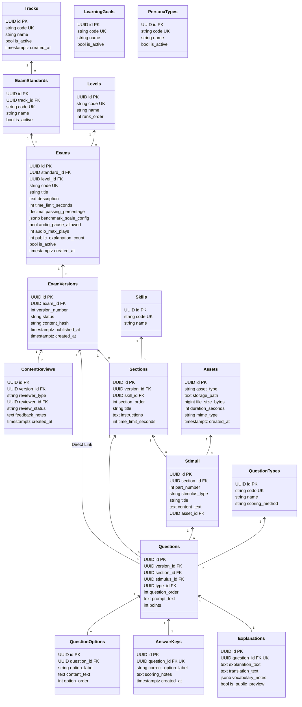
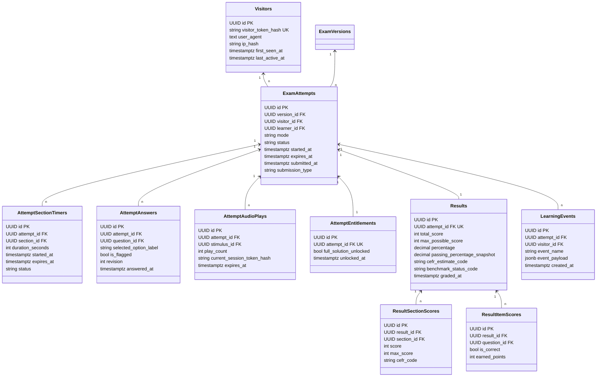
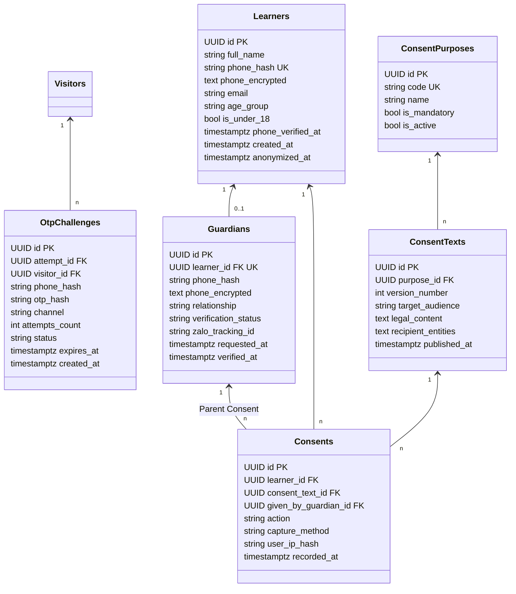
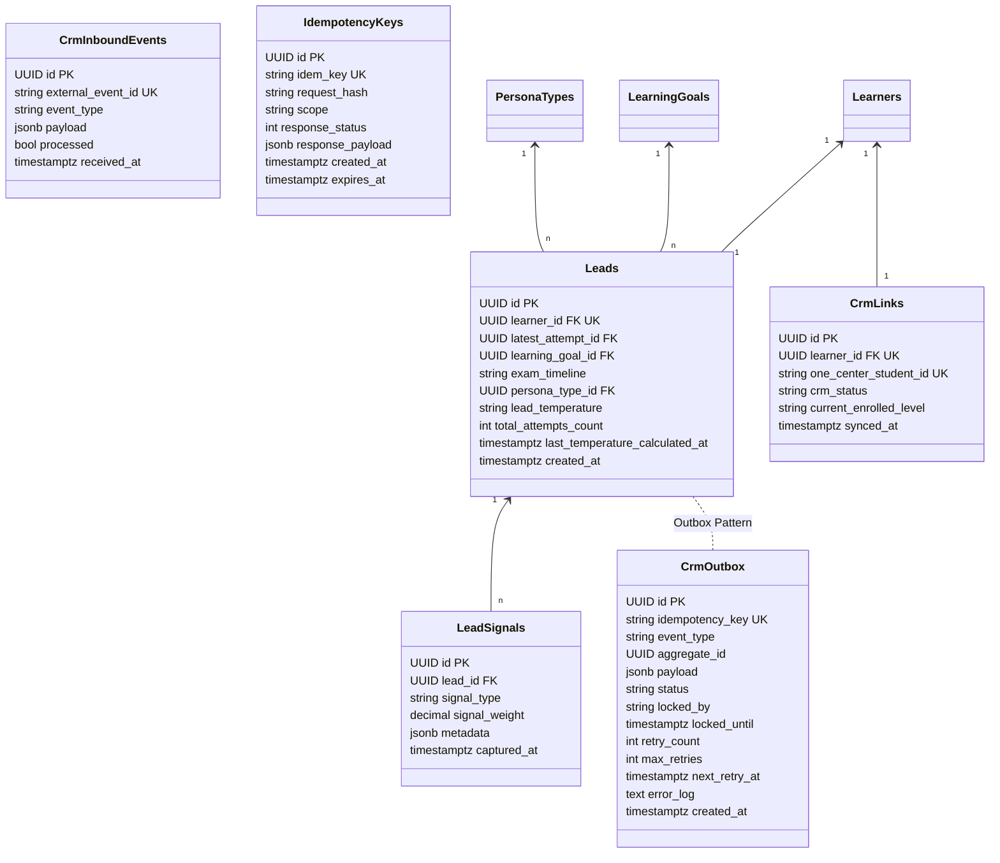
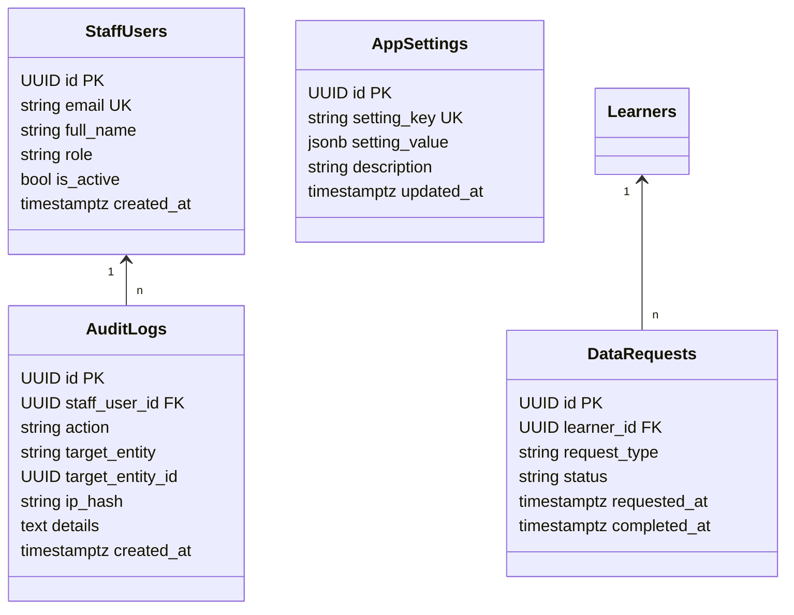
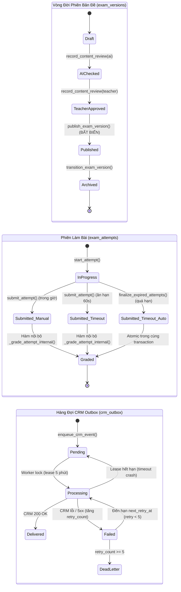

# Thiết Kế Kiến Trúc Dữ Liệu & Data Model (Data Architecture Specification)

> **Tài liệu:** `docs/architecture/02-data-model.md`  
> **Dự án:** Nền tảng tự học & luyện thi tiếng Đức miễn phí (`tuhoctiengduc.shdeducation.vn`)  
> **Phiên bản:** v1.7 (Chuẩn hóa cơ chế ngoại lệ làm sạch PII, hoàn thiện ma trận quyền liên owner và đồng bộ đường chấm điểm - Hard Gate 1)  
> **Vai trò:** Data Architect & Lead Systems Engineer  
> **Tài liệu đầu vào:** `docs/ux/00-assumptions.md`, `docs/ux/02-user-flows.md`, `docs/ux/03-screen-inventory.md`, `docs/ux/08-sample-exam-spec.md`, `docs/engineering-rules.md`.  
> **Trạng thái:** Chờ Duyệt (Điểm Dừng 1 - Hard Gate 1)

---

## 1. Tổng Quan Kiến Trúc & Các Quyết Định Bất Biến Đã Chốt

Mô hình dữ liệu của nền tảng được thiết kế xoay quanh 7 nguyên tắc kiến trúc cốt lõi:
1. **Server-Side Grading & Đường Chấm Điểm Biệt Lập Nội Bộ (INV-01, INV-41):** Bảng `answer_keys` lưu trữ đáp án đúng hoàn toàn độc lập với bảng câu hỏi. Role ứng dụng công khai `shd_app` bị thu hồi quyền `SELECT` trên bảng `answer_keys` ở cấp độ PostgreSQL. Việc chấm điểm được đóng kín trong hàm nội bộ `_grade_attempt_internal(p_attempt_id)` thuộc sở hữu của role `shd_grader` (`NOLOGIN`), cố định `search_path = pg_catalog, public`. Hàm này **chỉ cấp quyền `EXECUTE` duy nhất cho `shd_attempt_mgr`**, thu hồi quyền `EXECUTE` đối với `shd_worker`, `shd_app`, `shd_staff_api` và PUBLIC. Khi học viên nộp bài, hàm `submit_attempt()` (thuộc `shd_attempt_mgr`) gọi `_grade_attempt_internal()` trong cùng transaction. Khi worker dọn bài quá hạn, worker gọi `finalize_expired_attempts()` (thuộc `shd_grader`), hàm này tự gọi `_grade_attempt_internal()` nội bộ vì cùng chung owner `shd_grader` mà không cần cấp quyền thực thi cho worker. Việc ghi nhận tín hiệu điểm vào `lead_signals` được thực thi bằng **INSERT trực tiếp của `shd_grader`** trong cùng transaction chấm thi (không qua hàm trung gian). Role `shd_grader` phụ trách chấm thi biệt lập và hoàn toàn không có quyền đọc bảng dữ liệu định danh cá nhân (PII).
2. **Nguyên Tắc Zero-Direct-Write Tuyệt Đối (INV-34, INV-38, INV-41):** Toàn bộ các connecting roles (`shd_app`, `shd_staff_api`, `shd_worker`) **hoàn toàn không có quyền `INSERT`, `UPDATE`, `DELETE` trực tiếp** trên các bảng bảo mật, quyền lợi, sổ cái hoặc trạng thái (`visitors`, `exam_attempts`, `attempt_section_timers`, `attempt_answers`, `attempt_audio_plays`, `attempt_entitlements`, `learners`, `guardians`, `otp_challenges`, `consents`, `leads`, `lead_signals`, `content_reviews`, `exam_versions`, `data_requests`, `app_settings`, `idempotency_keys`...). Mọi thao tác ghi hoặc chuyển trạng thái bắt buộc phải đi qua các hàm `SECURITY DEFINER` do các role chuyên trách `NOLOGIN` sở hữu (`shd_grader`, `shd_auth_admin`, `shd_attempt_mgr`, `shd_exam_admin`, `shd_privacy_admin`), với `search_path = pg_catalog, public` cố định, và **tự xác minh danh tính người gọi** từ token phiên đã băm (cho học viên/khách qua bảng `visitors`/`learners`) hoặc claim SSO nội bộ (cho nhân viên qua bảng `staff_users`), tuyệt đối không nhận danh tính từ tham số tự do.
3. **Mô Hình Tin Cậy (Trust Model & Security Boundaries):** Tầng ứng dụng (`shd_app`) chịu trách nhiệm xác thực người dùng vãng lai và học viên thông qua Cookie bảo mật (HttpOnly, Secure, SameSite=Strict), tính toán chuỗi băm HMAC của token phiên (`visitor_token_hash` / `caller_token_hash`) và truyền vào các hàm `SECURITY DEFINER`. Cơ sở dữ liệu đóng vai trò là hàng rào phòng thủ bảo vệ tính toàn vẹn và cô lập dữ liệu giữa các người dùng với nhau (chống người này ghi đè bài thi, đọc câu trả lời nháp hoặc gian lận kết quả của người khác). Cơ sở dữ liệu **không có khả năng bảo vệ trong trường hợp chính tầng ứng dụng (`shd_app`) bị xâm nhập hoàn toàn (compromised server)**, vì kẻ tấn công có quyền thực thi mã trên server ứng dụng có thể giả mạo việc tính hash token. Đây là ranh giới phân định trách nhiệm bảo mật phân lớp tiêu chuẩn giữa App Layer và Database Layer.
4. **Phân Quyền Cổng Nhân Viên (`shd_staff_api`), Worker & Cấm Đọc Trực Tiếp PII Gốc (INV-39, INV-40):** Tách biệt hoàn toàn role kết nối của học viên (`shd_app`), cổng quản trị nội bộ (`shd_staff_api`) và tiến trình ngầm (`shd_worker`). Cả `shd_staff_api` và `shd_worker` **bị cấm hoàn toàn quyền `SELECT` trực tiếp trên bảng `learners` và `guardians`**. Nhân viên chỉ được đọc dữ liệu đã che qua `v_masked_learners`, `v_masked_guardians` và `v_contactable_leads` (chỉ chứa `full_name_masked`, loại bỏ hoàn toàn `full_name`, `email`, `phone_encrypted`). Worker chỉ đọc qua view tối thiểu `v_worker_contactable_leads` chỉ chứa ID (`lead_id`, `learner_id`). Mọi thao tác giải mã PII gốc bắt buộc thông qua hàm `decrypt_phone` có kiểm tra mục đích đóng (`p_purpose`) và ghi vết `staff_user_id` vào `audit_logs` trong cùng transaction.
5. **Sổ Cái Đồng Ý Chỉ-Ghi-Thêm & Cơ Chế Ngoại Lệ Làm Sạch PII (INV-09, INV-10, INV-38):** Mọi hành vi cho phép hoặc rút lại sự đồng ý xử lý dữ liệu cá nhân đều được ghi qua hàm `record_consent()`. Bảng `consents` là cấu trúc Append-Only; trigger cấm tuyệt đối mọi thao tác UPDATE/DELETE ngoại trừ NGOẠI LỆ DUY NHẤT: thủ tục `anonymize_learner()` được phép `UPDATE user_ip_hash = NULL` khi có cờ phiên giao dịch hợp lệ và ghi vết `audit_logs` bắt buộc trong cùng transaction. Trạng thái đồng ý hiện hành và khả năng liên hệ lead (`v_contactable_leads`) được suy ra thông qua database views có cờ `security_barrier`, lấy bản ghi mới nhất theo `(learner_id, purpose)`, tuân thủ Luật Bảo vệ dữ liệu cá nhân số 91/2025/QH15 và Nghị định 356/2025/NĐ-CP.
6. **Bảo Mật PII & Mã Hóa Có Phong Bì (Envelope Encryption - INV-12, INV-13, INV-28):** Số điện thoại và dữ liệu nhạy cảm được mã hóa đối xứng AES-256-GCM theo cấu trúc Envelope chứa `{v, kid, iv, tag, ct}` hỗ trợ xoay khóa không downtime. Số điện thoại, địa chỉ IP, mã token khách vãng lai (`visitor_token`) và token phiên phát audio (`current_session_token`) đều được lưu dạng băm HMAC-SHA256 với các khóa bí mật riêng biệt (`PHONE_HASH_PEPPER`, `IP_HASH_PEPPER`, `TOKEN_HASH_PEPPER`, `AUDIO_TOKEN_PEPPER`) để tra cứu chống trùng lặp mà không lộ dữ liệu thô.
7. **Đồng Hồ Tổng Luôn Thắng & Quản Lý Cưỡng Chế Server (INV-07, INV-33, DEC-ARCH-04):** Thời điểm kết thúc phiên làm bài tổng (`exam_attempts.expires_at`) luôn cưỡng chế nộp bài bất kể section timer. Mọi bài thi quá hạn tự động được đóng nguyên tử bởi hàm `finalize_expired_attempts()` của worker sau khoảng ân hạn 60 giây. Loại bỏ hoàn toàn trạng thái `abandoned` để mọi bài thi bắt đầu đều được chấm điểm.

---

## 2. Sơ Đồ Thực Thể - Mối Quan Hệ (Entity-Relationship Diagrams v1.7)

Hệ thống bao gồm **43 bảng logic** được chia thành 5 phân hệ dữ liệu. Toàn bộ tên trường trong sơ đồ Mermaid đều đồng bộ 100% với Từ điển bảng:



### 2.1. Phân Hệ 2: Làm Bài & Chấm Điểm (Exam Attempts, Timers, Answers, Scores)



### 2.2. Phân Hệ 3: Người Học, Đồng Ý & Xác Thực (Learners, Guardians, Consents, OTP)



### 2.3. Phân Hệ 4: Lead Tuyển Sinh, CRM Outbox & Idempotency Keys



### 2.4. Phân Hệ 5: Quản Trị & Vận Hành (Staff, Audit Logs 5 Năm & Data Requests)



---

## 3. Từ Điển Bảng Dữ Liệu Chi Tiết (Table Dictionary v1.7 - 43 Bảng)

### Nhóm 1: Nội Dung Đề Thi & Bảng Tra Cứu (17 Bảng)

#### 1. `tracks`
- **Mục đích:** Lưu trữ các đường đua ngôn ngữ (tiếng Đức, tiếng Hàn, tiếng Nhật...). Mở rộng không sửa cấu trúc.
- **Nguồn yêu cầu:** Kiến trúc nền tảng đa ngôn ngữ (Non-German hardcoded).
- **Cột chính:** `id` (UUID PK), `code` (varchar(32) UK), `name` (varchar(128)), `is_active` (boolean default true), `created_at` (timestamptz UTC).
- **Mức nhạy cảm PII:** Không có.
- **Thời hạn lưu trữ:** Vĩnh viễn (Master Data).

#### 2. `exam_standards`
- **Mục đích:** Danh mục chuẩn khảo thí theo từng ngôn ngữ (TELC, Goethe-Institut, ÖSD, TestDaF...).
- **Nguồn yêu cầu:** SCR-01 (Bộ lọc danh mục đề thi theo kỳ thi).
- **Cột chính:** `id` (UUID PK), `track_id` (UUID FK tracks), `code` (varchar(32) UK), `name` (varchar(128)), `is_active` (boolean default true).
- **Mức nhạy cảm PII:** Không có.
- **Thời hạn lưu trữ:** Vĩnh viễn (Master Data).

#### 3. `levels`
- **Mục đích:** Khung cấp độ năng lực ngôn ngữ theo CEFR (A1, A2, B1, B2, C1, C2).
- **Nguồn yêu cầu:** SCR-01 (Bộ lọc trình độ), SCR-05 (Ước lượng CEFR).
- **Cột chính:** `id` (UUID PK), `code` (varchar(16) UK), `name` (varchar(64)), `rank_order` (int UK).
- **Mức nhạy cảm PII:** Không có.
- **Thời hạn lưu trữ:** Vĩnh viễn (Master Data).

#### 4. `skills`
- **Mục đích:** Kỹ năng ngôn ngữ (Lesen - Đọc, Hören - Nghe, Schreiben - Viết, Sprechen - Nói).
- **Nguồn yêu cầu:** SCR-01 (Bộ lọc kỹ năng), SCR-02, SCR-03 (Phân tách phòng thi Đọc và Nghe).
- **Cột chính:** `id` (UUID PK), `code` (varchar(32) UK), `name` (varchar(64)).
- **Mức nhạy cảm PII:** Không có.
- **Thời hạn lưu trữ:** Vĩnh viễn (Master Data).

#### 5. `question_types`
- **Mục đích:** Danh mục dạng câu hỏi trắc nghiệm (`multiple_choice_3`, `true_false`, `matching`...).
- **Nguồn yêu cầu:** Quy chuẩn hiển thị giao diện trắc nghiệm phòng thi.
- **Cột chính:** `id` (UUID PK), `code` (varchar(32) UK), `name` (varchar(64)), `scoring_method` (varchar(32) not null default 'exact_match').
- **Mức nhạy cảm PII:** Không có.
- **Thời hạn lưu trữ:** Vĩnh viễn (Master Data).

#### 6. `learning_goals`
- **Mục đích:** Danh mục tra cứu mục tiêu học tiếng Đức (Ausbildung, Du học đại học, Định cư tay nghề 18b, Đoàn tụ gia đình, Khác).
- **Nguồn yêu cầu:** SCR-07 (Dropdown Chọn mục tiêu học tập trên Lead Gate).
- **Cột chính:** `id` (UUID PK), `code` (varchar(32) UK), `name` (varchar(128)), `is_active` (boolean default true).
- **Mức nhạy cảm PII:** Không có.
- **Thời hạn lưu trữ:** Vĩnh viễn (Master Data).

#### 7. `persona_types`
- **Mục đích:** Danh mục phân loại đối tượng người học (Học sinh cấp 3, Sinh viên, Người đi làm, Phụ huynh tìm hiểu cho con).
- **Nguồn yêu cầu:** SCR-07 (Dropdown Bạn đang là... trên Lead Gate).
- **Cột chính:** `id` (UUID PK), `code` (varchar(32) UK), `name` (varchar(128)), `is_active` (boolean default true).
- **Mức nhạy cảm PII:** Không có.
- **Thời hạn lưu trữ:** Vĩnh viễn (Master Data).

#### 8. `exams`
- **Mục đích:** Thông tin định danh của một đề thi mô phỏng.
- **Nguồn yêu cầu:** SCR-01 (Catalog hiển thị thẻ đề thi), `docs/ux/08-sample-exam-spec.md`.
- **Cột chính:** 
  - `id` (UUID PK), `standard_id` (UUID FK exam_standards), `level_id` (UUID FK levels).
  - `code` (varchar(64) UK - ví dụ: `TELC_B1_MOCK_01`).
  - `title` (varchar(255) not null), `description` (text).
  - `time_limit_seconds` (int not null - **mặc định 3900s = 65 phút**, khớp với tài liệu `docs/ux/08-sample-exam-spec.md`).
  - `passing_percentage` (decimal(5,2) not null default 60.00 - ngưỡng đạt tham khảo).
  - `benchmark_scale_config` (jsonb not null - thang điểm và CEFR).
  - `audio_pause_allowed` (boolean not null default false).
  - `audio_max_plays` (int not null default 2 - số lần phát tối đa do server quản lý).
  - `public_explanation_count` (int not null default 2 - số câu mở trước lead gate, từ câu 1 đến N).
  - `is_active` (boolean default true), `created_at` (timestamptz UTC).
- **Mức nhạy cảm PII:** Không có.
- **Thời hạn lưu trữ:** Vĩnh viễn.

#### 9. `exam_versions`
- **Mục đích:** Quản lý vòng đời và tính bất biến của nội dung đề thi.
- **Nguồn yêu cầu:** Kiểm soát chất lượng nội dung và tính bất biến khảo thí.
- **Cột chính:** `id` (UUID PK), `exam_id` (UUID FK exams), `version_number` (int not null), `status` (varchar(32) not null check in (`draft`, `ai_checked`, `teacher_approved`, `published`, `archived`)), `content_hash` (varchar(64) null), `published_at` (timestamptz null), `created_at` (timestamptz UTC).
- **Ràng buộc:** `UNIQUE(exam_id, version_number)`; Partial Unique Index: `CREATE UNIQUE INDEX uq_exam_published_version ON exam_versions(exam_id) WHERE status = 'published'`.
- **Chuyển trạng thái:** Chỉ được cập nhật thông qua hàm `SECURITY DEFINER` `transition_exam_version()` và `publish_exam_version()`.
- **Mức nhạy cảm PII:** Không có.
- **Thời hạn lưu trữ:** Vĩnh viễn.

#### 10. `content_reviews`
- **Mục đích:** Lưu lịch sử phê duyệt chất lượng đề thi của AI và giáo viên bản ngữ SHD.
- **Nguồn yêu cầu:** Quy trình kiểm định học thuật trước khi xuất bản đề.
- **Cột chính:** 
  - `id` (UUID PK), `version_id` (UUID FK exam_versions).
  - `reviewer_type` (varchar(16) check in (`ai`, `teacher`)).
  - `reviewer_id` (UUID FK staff_users null - **Ràng buộc:** bắt buộc NOT NULL khi `reviewer_type = 'teacher'`).
  - `review_status` (varchar(32) check in (`approved`, `rejected`, `needs_revision`)).
  - `feedback_notes` (text), `created_at` (timestamptz UTC).
- **Ràng buộc:** `CONSTRAINT chk_content_reviews_teacher CHECK ((reviewer_type = 'teacher' AND reviewer_id IS NOT NULL) OR (reviewer_type = 'ai'))`.
- **Quy tắc Zero-Direct-Write (Task B3):** Role `shd_staff_api` **CẤM INSERT trực tiếp**! Thao tác ghi review bắt buộc qua hàm `SECURITY DEFINER` `record_content_review()`.
- **Mức nhạy cảm PII:** Không có.
- **Thời hạn lưu trữ:** 5 năm (kiểm định học thuật).

#### 11. `sections`
- **Mục đích:** Các phần thi thành phần trong phiên bản đề (Section 1 = Lesen, Section 2 = Hören).
- **Nguồn yêu cầu:** SCR-02, SCR-03 (Phân tách kỹ năng Đọc và Nghe).
- **Cột chính:** `id` (UUID PK), `version_id` (UUID FK exam_versions), `skill_id` (UUID FK skills), `section_order` (int not null), `title` (varchar(128)), `instructions` (text), `time_limit_seconds` (int null).
- **Mức nhạy cảm PII:** Không có.
- **Thời hạn lưu trữ:** Theo vòng đời `exam_versions`.

#### 12. `stimuli`
- **Mục đích:** Ngữ liệu bài thi: bài đọc hoặc audio track dùng chung cho một nhóm câu hỏi (Teil).
- **Nguồn yêu cầu:** SCR-02 (Văn bản bài đọc), SCR-03 (Đoạn băng âm thanh Hören).
- **Cột chính:** `id` (UUID PK), `section_id` (UUID FK sections), `part_number` (int not null default 1), `stimulus_type` (varchar(16) check in (`text`, `audio`, `image`)), `title` (varchar(255)), `content_text` (text null), `asset_id` (UUID FK assets null).
- **Ràng buộc:** `CONSTRAINT chk_stimulus_audio_asset CHECK ((stimulus_type = 'audio' AND asset_id IS NOT NULL) OR (stimulus_type != 'audio'))`.
- **Mức nhạy cảm PII:** Không có.
- **Thời hạn lưu trữ:** Theo vòng đời `exam_versions`.

#### 13. `assets`
- **Mục đích:** Lưu trữ đường dẫn tệp âm thanh nghe Hören và hình ảnh trên cloud storage.
- **Nguồn yêu cầu:** SCR-03 (Trình phát âm thanh Hören).
- **Cột chính:** `id` (UUID PK), `asset_type` (varchar(16) check in (`audio_mp3`, `image_png`, `image_webp`)), `storage_path` (text not null), `file_size_bytes` (bigint), `duration_seconds` (int null), `mime_type` (varchar(64)), `created_at` (timestamptz UTC).
- **Mức nhạy cảm PII:** Không có.
- **Thời hạn lưu trữ:** Vĩnh viễn.

#### 14. `questions`
- **Mục đích:** Định nghĩa các câu hỏi trắc nghiệm (từ Câu 1 đến 30).
- **Nguồn yêu cầu:** SCR-02, SCR-03 (Danh sách câu hỏi 1-30).
- **Cột chính:** `id` (UUID PK), `version_id` (UUID FK exam_versions not null), `section_id` (UUID FK sections not null), `stimulus_id` (UUID FK stimuli null), `type_id` (UUID FK question_types not null), `question_order` (int not null), `prompt_text` (text not null), `points` (int not null default 1).
- **Ràng buộc:** `UNIQUE(version_id, question_order)`.
- **Mức nhạy cảm PII:** Không có.
- **Thời hạn lưu trữ:** Theo vòng đời `exam_versions`.

#### 15. `question_options`
- **Mục đích:** Các lựa chọn phương án của từng câu hỏi (A, B, C hoặc Richtig/Falsch).
- **Nguồn yêu cầu:** SCR-02, SCR-03 (Các phương án lựa chọn A, B, C).
- **Cột chính:** `id` (UUID PK), `question_id` (UUID FK questions), `option_label` (varchar(8) not null), `content_text` (text not null), `option_order` (int not null).
- **Ràng buộc:** `UNIQUE(question_id, option_label)`.
- **Mức nhạy cảm PII:** Không có.
- **Thời hạn lưu trữ:** Theo vòng đời `exam_versions`.

#### 16. `answer_keys` (BẢNG BẢO MẬT TỐI CAO - CÔ LẬP ROLE)
- **Mục đích:** Lưu đáp án đúng của từng câu hỏi. Bảng độc lập hoàn toàn.
- **Nguồn yêu cầu:** Server-Side Grading, cô lập đáp án chống gian lận.
- **Cột chính:** `id` (UUID PK), `question_id` (UUID FK questions UK), `correct_option_label` (varchar(8) not null), `scoring_notes` (text null), `created_at` (timestamptz UTC).
- **Phân quyền bảo vệ:** `REVOKE ALL ON answer_keys FROM PUBLIC; GRANT SELECT ON answer_keys TO shd_grader; REVOKE ALL ON answer_keys FROM shd_app, shd_staff_api;`. Role `shd_app` hoàn toàn không có quyền SELECT trên bảng này.
- **Mức nhạy cảm PII:** Không chứa PII nhưng là dữ liệu tối mật kinh doanh (Business Critical).
- **Thời hạn lưu trữ:** Theo vòng đời `exam_versions`.

#### 17. `explanations`
- **Mục đích:** Lời giải thích sư phạm chi tiết bằng tiếng Việt, phân tích từ vựng và dịch bài đọc.
- **Nguồn yêu cầu:** SCR-06 (Lời giải thích & bản dịch bài đọc).
- **Cột chính:** `id` (UUID PK), `question_id` (UUID FK questions UK), `explanation_text` (text not null), `translation_text` (text null), `vocabulary_notes` (jsonb null), `is_public_preview` (boolean not null default false).
- **Phân quyền:** Role `shd_app` không SELECT trực tiếp bảng này mà truy cập qua view `v_public_explanations` (có `security_barrier`) hoặc qua view kiểm tra entitlement.
- **Mức nhạy cảm PII:** Không có.
- **Thời hạn lưu trữ:** Theo vòng đời `exam_versions`.

---

### Nhóm 2: Làm Bài & Chấm Điểm (10 Bảng)

#### 18. `visitors`
- **Mục đích:** Định danh khách vãng lai ẩn danh truy cập qua Cookie / LocalStorage trước khi điền Lead Gate.
- **Nguồn yêu cầu:** SCR-01, SCR-02 (Lưu vết tiến trình làm bài của khách vãng lai).
- **Cột chính:** `id` (UUID PK), `visitor_token_hash` (varchar(64) UK not null - HMAC-SHA256 kèm `TOKEN_HASH_PEPPER`, **BẤT BIẾN SAU KHI TẠO**), `user_agent` (text null), `ip_hash` (varchar(64) null - HMAC-SHA256 kèm `IP_HASH_PEPPER`), `first_seen_at` (timestamptz UTC), `last_active_at` (timestamptz UTC).
- **Ràng buộc bất biến:** Database trigger chặn mọi thao tác UPDATE trên cột `visitor_token_hash`.
- **Quy tắc Zero-Direct-Write (Task A2):** Role `shd_app` **CẤM INSERT/UPDATE trực tiếp** bảng này! Bắt buộc thông qua hàm `SECURITY DEFINER` `create_visitor()`.
- **Mức nhạy cảm PII:** Định danh gián tiếp / Dữ liệu hành vi.
- **Thời hạn lưu trữ:** 90 ngày kể từ lần hoạt động cuối [DEC-ARCH-01].

#### 19. `exam_attempts`
- **Mục đích:** Phiên làm bài thi thử của người học. Nguồn sự thật duy nhất về thời gian và kết quả nộp bài.
- **Nguồn yêu cầu:** SCR-02, SCR-03, SCR-04, SCR-05 (Vòng đời phiên thi).
- **Cột chính:** `id` (UUID PK), `version_id` (UUID FK exam_versions), `visitor_id` (UUID FK visitors not null), `learner_id` (UUID FK learners null), `mode` (varchar(16) not null default 'exam' check in (`exam`, `practice`)), `status` (varchar(32) not null check in (`in_progress`, `submitted`, `graded`)), `started_at` (timestamptz UTC not null), `expires_at` (timestamptz UTC not null), `submitted_at` (timestamptz UTC null), `submission_type` (varchar(16) null check in (`manual`, `timeout`)).
- **Loại bỏ Abandoned:** Trạng thái chỉ còn `in_progress`, `submitted`, `graded`. Mọi bài thi quá hạn đều được `finalize_expired_attempts()` nộp và chấm điểm.
- **Quy tắc Zero-Direct-Write (INV-34):** Role `shd_app` **CẤM INSERT/UPDATE/DELETE trực tiếp** bảng này!
  - Khởi tạo phiên qua `start_attempt()`.
  - Nộp bài qua `submit_attempt()`.
  - Gắn hồ sơ qua `mark_phone_verified()`.
  - Đóng bài quá hạn qua `finalize_expired_attempts()`.
- **Mức nhạy cảm PII:** Hành vi học tập.
- **Thời hạn lưu trữ:** 3 năm phục vụ báo cáo năng lực [DEC-ARCH-01].

#### 20. `attempt_section_timers`
- **Mục đích:** Quản lý thời gian độc lập cho từng phần thi (Section) do server giám sát và cưỡng chế.
- **Nguồn yêu cầu:** SCR-02, SCR-03 (Đồng hồ đếm ngược riêng từng phần Đọc/Nghe).
- **Cột chính:** `id` (UUID PK), `attempt_id` (UUID FK exam_attempts), `section_id` (UUID FK sections), `duration_seconds` (int not null), `started_at` (timestamptz UTC null), `expires_at` (timestamptz UTC null), `status` (varchar(16) not null default 'not_started' check in (`not_started`, `in_progress`, `completed`, `expired`)).
- **Ràng buộc:** `UNIQUE(attempt_id, section_id)`.
- **Quy tắc Zero-Direct-Write:** Role `shd_app` **CẤM INSERT/UPDATE trực tiếp**. Bắt đầu phần thi qua `enter_section()`.
- **Mức nhạy cảm PII:** Dữ liệu thời gian làm bài.
- **Thời hạn lưu trữ:** Theo vòng đời `exam_attempts`.

#### 21. `attempt_answers`
- **Mục đích:** Ghi nhận phương án người học lựa chọn cho từng câu hỏi (Optimistic Concurrency Control).
- **Nguồn yêu cầu:** SCR-02, SCR-03 (Lưu nháp câu trả lời, gắn cờ xem lại).
- **Cột chính:** `id` (UUID PK), `attempt_id` (UUID FK exam_attempts), `question_id` (UUID FK questions), `selected_option_label` (varchar(8) null), `is_flagged` (boolean default false), `revision` (int not null default 1), `answered_at` (timestamptz UTC).
- **Ràng buộc:** `UNIQUE(attempt_id, question_id)`.
- **Quy tắc Zero-Direct-Write (INV-34):** Role `shd_app` **CẤM INSERT/UPDATE trực tiếp**! Lưu nháp qua hàm `SECURITY DEFINER` `save_answers()`.
- **Mức nhạy cảm PII:** Bài làm học tập.
- **Thời hạn lưu trữ:** Theo vòng đời `exam_attempts`.

#### 22. `attempt_audio_plays`
- **Mục đích:** Kiểm soát số lượt nghe audio Hören bằng token phiên phát bảo mật.
- **Nguồn yêu cầu:** SCR-03 (Đếm số lượt nghe "Lượt 1/2", chặn tua, reload không trừ lượt).
- **Cột chính:** `id` (UUID PK), `attempt_id` (UUID FK exam_attempts), `stimulus_id` (UUID FK stimuli), `play_count` (int not null default 0), `current_session_token_hash` (varchar(64) null - HMAC-SHA256 kèm `AUDIO_TOKEN_PEPPER`), `expires_at` (timestamptz UTC null).
- **Ràng buộc:** `UNIQUE(attempt_id, stimulus_id)`.
- **Quy tắc Zero-Direct-Write:** Role `shd_app` **CẤM INSERT/UPDATE trực tiếp**. Bắt đầu phát âm thanh qua hàm `start_audio_play()`.
- **Mức nhạy cảm PII:** Dữ liệu hành vi.
- **Thời hạn lưu trữ:** Theo vòng đời `exam_attempts`.

#### 23. `attempt_entitlements`
- **Mục đích:** Lưu trữ quyền truy cập lời giải chi tiết của bài thi. Nguồn sự thật duy nhất về việc mở khóa.
- **Nguồn yêu cầu:** SCR-06 (Khóa đáp án chi tiết phía sau Lead Gate).
- **Cột chính:** `id` (UUID PK), `attempt_id` (UUID FK exam_attempts UK), `full_solution_unlocked` (boolean not null default false), `unlocked_at` (timestamptz UTC null).
- **Quy tắc Zero-Direct-Write:** Role `shd_app` **CẤM INSERT/UPDATE trực tiếp**. Mở khóa chỉ thông qua hàm `unlock_full_solution()`.
- **Mức nhạy cảm PII:** Quyền dữ liệu học tập.
- **Thời hạn lưu trữ:** Theo vòng đời `exam_attempts`.

#### 24. `results`
- **Mục đích:** Kết quả tổng quan của phiên làm bài sau khi chấm điểm server-side.
- **Nguồn yêu cầu:** SCR-05 (Bảng điểm tổng quan: 21/30 câu, 70%, Đạt B1).
- **Cột chính:** `id` (UUID PK), `attempt_id` (UUID FK exam_attempts UK), `total_score` (int not null), `max_possible_score` (int not null default 30), `percentage` (decimal(5,2) not null), `passing_percentage_snapshot` (decimal(5,2) not null default 60.00), `cefr_estimate_code` (varchar(16) not null), `benchmark_status_code` (varchar(32) not null check in (`pass`, `near_pass`, `not_pass`)), `graded_at` (timestamptz UTC not null).
- **Phân quyền:** Chỉ ghi bởi hàm nội bộ `_grade_attempt_internal` (owner `shd_grader`).
- **Mức nhạy cảm PII:** Điểm số học tập.
- **Thời hạn lưu trữ:** 3 năm [DEC-ARCH-01].

#### 25. `result_section_scores`
- **Mục đích:** Lưu điểm số chi tiết từng phần thi (Section) cấu thành bài thi (Lesen: 12/15, Hören: 9/15).
- **Nguồn yêu cầu:** SCR-05 (Bảng điểm thành phần từng kỹ năng).
- **Cột chính:** `id` (UUID PK), `result_id` (UUID FK results), `section_id` (UUID FK sections), `score` (int not null), `max_score` (int not null), `cefr_code` (varchar(16) not null).
- **Ràng buộc:** `UNIQUE(result_id, section_id)`.
- **Mức nhạy cảm PII:** Điểm số học tập.
- **Thời hạn lưu trữ:** Theo vòng đời `results`.

#### 26. `result_item_scores`
- **Mục đích:** Lưu kết quả chấm chi tiết từng câu hỏi (1 = đúng, 0 = sai).
- **Nguồn yêu cầu:** SCR-06 (Icon đúng/sai và điểm từng câu hỏi).
- **Cột chính:** `id` (UUID PK), `result_id` (UUID FK results), `question_id` (UUID FK questions), `is_correct` (boolean not null), `earned_points` (int not null).
- **Ràng buộc:** `UNIQUE(result_id, question_id)`.
- **Phân quyền bảo vệ:** `shd_app` **CẤM SELECT trực tiếp** bảng này! Phải đọc qua `v_attempt_item_scores` (security_barrier trả NULL câu 3–30 khi chưa mở khóa).
- **Mức nhạy cảm PII:** Kết quả học tập.
- **Thời hạn lưu trữ:** Theo vòng đời `results`.

#### 27. `learning_events` (SỔ CÁI HÀNH VI CHỈ-GHI-THÊM)
- **Mục đích:** Nhật ký phân tích hành vi học tập (Analytics Event Log). CẤM UPDATE/DELETE.
- **Nguồn yêu cầu:** Phân tích hành vi, đo lường tỷ lệ rớt (Drop-off Rate), tối ưu CRO.
- **Cột chính:** `id` (UUID PK), `attempt_id` (UUID FK exam_attempts null), `visitor_id` (UUID FK visitors null), `event_name` (varchar(64) not null), `event_payload` (jsonb not null), `created_at` (timestamptz UTC).
- **Quy tắc Append-Only & Ngoại Lệ Làm Sạch PII (Task R1, INV-30):** Bảng là cấu trúc Append-Only, trigger cấm UPDATE/DELETE ngoại trừ NGOẠI LỆ DUY NHẤT: thủ tục `anonymize_learner()` được phép UPDATE cột `event_payload` để loại bỏ các khóa PII (`phone`, `email`, `full_name`) khi có cờ giao dịch `shd.anonymizing_learner_id` và ghi `audit_logs` bắt buộc trong cùng transaction.
- **Mức nhạy cảm PII:** Dữ liệu hành vi.
- **Thời hạn lưu trữ:** 12 tháng.

---

### Nhóm 3: Người Học, Phụ Huynh, Xác Thực & Đồng Ý (6 Bảng)

#### 28. `learners`
- **Mục đích:** Hồ sơ học viên sau khi điền thông tin Lead Gate.
- **Nguồn yêu cầu:** SCR-07 (Thu thập thông tin học viên để mở khóa và tư vấn).
- **Cột chính:** 
  - `id` (UUID PK), `full_name` (varchar(128) not null).
  - `phone_hash` (varchar(64) not null UK - HMAC-SHA256 tra cứu).
  - `phone_encrypted` (text not null - Envelope JSON AES-256-GCM).
  - `email` (varchar(255) null).
  - `age_group` (varchar(32) not null check in (`student_under18`, `university`, `worker`, `parent`)).
  - `is_under_18` (boolean not null default false).
  - `phone_verified_at` (timestamptz UTC null - **NGUỒN SỰ THẬT DUY NHẤT VỀ XÁC THỰC SĐT**).
  - `created_at` (timestamptz UTC), `anonymized_at` (timestamptz UTC null).
- **Ràng buộc:** `CONSTRAINT chk_learner_under18_age CHECK ((is_under_18 = true AND age_group = 'student_under18') OR (is_under_18 = false AND age_group != 'student_under18'))`.
- **Quy tắc Zero-Direct-Write & Khóa PII Toàn Diện (Task A1, N4, INV-40):** 
  - Role `shd_app` **CẤM INSERT/UPDATE trực tiếp**! Tạo qua `create_learner()`, xác thực qua `mark_phone_verified()`.
  - Cả `shd_staff_api` và `shd_worker` **CẤM SELECT trực tiếp** bảng này (Permission Denied 42501). Nhân viên chỉ đọc qua view che `v_masked_learners`. Worker chỉ dùng view tối thiểu `v_worker_contactable_leads`. Giải mã SĐT bắt buộc qua `decrypt_phone` có audit log cùng transaction.
- **Mức nhạy cảm PII:** **ĐỊNH DANH TRỰC TIẾP (Direct PII)**.
- **Thời hạn lưu trữ:** Lưu trữ đến khi có yêu cầu xóa hoặc 3 năm không tương tác [DEC-ARCH-01].

#### 29. `guardians`
- **Mục đích:** Lưu thông tin phụ huynh đối với học viên dưới 18 tuổi.
- **Nguồn yêu cầu:** SCR-07 (Nhánh phụ huynh cho học sinh cấp 3), Điều 19 Luật 91/2025/QH15.
- **Cột chính:** 
  - `id` (UUID PK), `learner_id` (UUID FK learners UK not null).
  - `phone_hash` (varchar(64) not null - HMAC-SHA256).
  - `phone_encrypted` (text not null - Envelope JSON AES-256-GCM).
  - `relationship` (varchar(32) not null default 'parent' check in (`father`, `mother`, `legal_guardian`, `parent`)).
  - `verification_status` (varchar(32) not null default 'pending' check in (`pending`, `approved`, `rejected`, `expired`)).
  - `zalo_tracking_id` (varchar(128) null), `requested_at` (timestamptz UTC not null), `verified_at` (timestamptz UTC null).
- **Quy tắc Zero-Direct-Write & Khóa PII Staff/Worker (Task N4, INV-40):** Role `shd_staff_api` và `shd_worker` **CẤM SELECT trực tiếp**, nhân viên chỉ đọc qua view che `v_masked_guardians`.
- **Mức nhạy cảm PII:** **ĐỊNH DANH TRỰC TIẾP (Direct PII)**.
- **Thời hạn lưu trữ:** Theo vòng đời `learners`.

#### 30. `otp_challenges`
- **Mục đích:** Quản lý các thử thách mã OTP gửi qua SMS/Zalo ZNS để xác thực SĐT.
- **Nguồn yêu cầu:** SCR-07 (Modal nhập mã OTP 6 số, đếm ngược 60s, hiệu lực 5 phút).
- **Cột chính:** 
  - `id` (UUID PK), `attempt_id` (UUID FK exam_attempts not null), `visitor_id` (UUID FK visitors not null).
  - `phone_hash` (varchar(64) not null - HMAC).
  - `otp_hash` (varchar(64) not null - HMAC-SHA256 kèm `OTP_HASH_PEPPER`).
  - `channel` (varchar(16) not null check in (`sms`, `zalo_zns`)).
  - `attempts_count` (int not null default 0 - tối đa 3 lần thử).
  - `status` (varchar(16) not null default 'pending' check in (`pending`, `verified`, `failed`, `expired`)).
  - `expires_at` (timestamptz UTC not null - 5 phút kể từ lúc tạo).
  - `created_at` (timestamptz UTC not null).
- **Quy tắc Zero-Direct-Write (INV-34):** Role `shd_app` **CẤM INSERT/UPDATE trực tiếp**! Khởi tạo qua `issue_otp()`, xác minh qua `verify_otp()`.
- **Mức nhạy cảm PII:** Xác thực bảo mật.
- **Thời hạn lưu trữ:** 24 giờ.

#### 31. `consent_purposes`
- **Mục đích:** Danh mục các mục đích thu thập và xử lý dữ liệu cá nhân theo quy định pháp luật.
- **Nguồn yêu cầu:** Điều 13, Luật 91/2025/QH15 & Nghị định 356/2025/NĐ-CP.
- **Cột chính:** `id` (UUID PK), `code` (varchar(32) UK - `scoring_history`, `course_consulting`, `study_abroad_18b`), `name` (varchar(128)), `is_mandatory` (boolean not null), `is_active` (boolean default true).
- **Mức nhạy cảm PII:** Không có.
- **Thời hạn lưu trữ:** Vĩnh viễn.

#### 32. `consent_texts`
- **Mục đích:** Văn bản pháp lý chi tiết của từng điều khoản đồng ý (phân tách học viên và phụ huynh).
- **Nguồn yêu cầu:** SCR-07 (Nội dung pháp lý hiển thị cạnh 3 checkbox đồng ý).
- **Cột chính:** `id` (UUID PK), `purpose_id` (UUID FK consent_purposes), `version_number` (int not null), `target_audience` (varchar(16) not null default 'learner' check in (`learner`, `guardian`)), `legal_content` (text not null), `recipient_entities` (text not null), `published_at` (timestamptz UTC).
- **Ràng buộc:** `UNIQUE(purpose_id, version_number, target_audience)`.
- **Mức nhạy cảm PII:** Không có.
- **Thời hạn lưu trữ:** Vĩnh viễn.

#### 33. `consents` (SỔ CÁI ĐỒNG Ý CHỈ-GHI-THÊM)
- **Mục đích:** Sổ cái ghi nhận hành vi đồng ý hoặc rút lại đồng ý của người học và phụ huynh. CẤM UPDATE/DELETE.
- **Nguồn yêu cầu:** SCR-07, Điều 13 Luật 91/2025/QH15.
- **Cột chính:** `id` (UUID PK), `learner_id` (UUID FK learners), `consent_text_id` (UUID FK consent_texts), `given_by_guardian_id` (UUID FK guardians null - lưu ID phụ huynh nếu con <18 tuổi), `action` (varchar(16) not null check in (`granted`, `revoked`)), `capture_method` (varchar(32) not null - 'web_checkbox', 'zalo_button'), `user_ip_hash` (varchar(64) null - HMAC), `recorded_at` (timestamptz UTC not null).
- **Quy tắc Append-Only & Ngoại Lệ Làm Sạch PII (Task R1, INV-09, INV-38):** Role `shd_app` **CẤM INSERT trực tiếp**! Bắt buộc ghi nhận qua hàm `SECURITY DEFINER` `record_consent()`. Bảng là cấu trúc Append-Only, trigger cấm UPDATE/DELETE ngoại trừ NGOẠI LỆ DUY NHẤT: thủ tục `anonymize_learner()` được phép `UPDATE user_ip_hash = NULL` khi có cờ giao dịch `shd.anonymizing_learner_id` và ghi `audit_logs` bắt buộc trong cùng transaction.
- **Ràng buộc trẻ em (INV-29):** Nếu học viên dưới 18 tuổi, bắt buộc `given_by_guardian_id IS NOT NULL` và phụ huynh phải có trạng thái `approved` tại thời điểm ghi nhận.
- **Mức nhạy cảm PII:** Bằng chứng pháp lý gắn với định danh.
- **Thời hạn lưu trữ:** 5 năm sau khi kết thúc tương tác [DEC-ARCH-01, DEC-ARCH-07].

---

### Nhóm 4: Lead Tuyển Sinh, Tín Hiệu Điểm, CRM Outbox & Khóa Idempotency (6 Bảng)

#### 34. `leads`
- **Mục đích:** Thực thể Lead phục vụ đội ngũ tuyển sinh. Thiết kế theo quan hệ **1 Lead duy nhất cho mỗi Học viên (Lead per Learner)**, cập nhật theo thời gian.
- **Nguồn yêu cầu:** Phễu tuyển sinh khóa học trả phí và du học nghề.
- **Cột chính:** 
  - `id` (UUID PK), `learner_id` (UUID FK learners UK).
  - `latest_attempt_id` (UUID FK exam_attempts).
  - `learning_goal_id` (UUID FK learning_goals not null).
  - `exam_timeline` (varchar(32) not null check in (`1m`, `1_3m`, `3_6m`, `gt6m`, `unknown`)).
  - `persona_type_id` (UUID FK persona_types not null).
  - `lead_temperature` (varchar(16) not null check in (`hot`, `warm`, `nurture`)).
  - `total_attempts_count` (int not null default 1).
  - `last_temperature_calculated_at` (timestamptz UTC).
  - `created_at` (timestamptz UTC).
- **Luồng cập nhật Lead từ làm bài & chấm điểm (Task B2, N3, R4):** 
  - Khi học viên bắt đầu lượt thi mới qua `start_attempt()`, hàm (do `shd_attempt_mgr` sở hữu) tra cứu `leads` qua quyền SELECT và cập nhật `leads.latest_attempt_id = attempt_id`, `leads.total_attempts_count = leads.total_attempts_count + 1`. Quyền UPDATE được giới hạn chặt chẽ trên đúng 2 cột này (Mục 6.1).
  - Khi bài thi được chấm qua `_grade_attempt_internal()`, hàm thực hiện **INSERT trực tiếp vào `lead_signals`**, kích hoạt trigger tính lại nhiệt độ `lead_temperature`.
- **Quy tắc Zero-Direct-Write:** Role `shd_app` và `shd_worker` **CẤM UPDATE trực tiếp** bảng `leads`.
- **Mức nhạy cảm PII:** Định danh thương mại.
- **Thời hạn lưu trữ:** 2 năm [DEC-ARCH-01].

#### 35. `lead_signals` (BẢNG GHI NHẬN TÍN HIỆU THEO THỜI ĐIỂM)
- **Mục đích:** Ghi vết các tín hiệu hành vi, điểm số, đăng ký test 1-1 theo thời điểm để tính toán nhiệt độ lead khách quan và có thể truy vết.
- **Nguồn yêu cầu:** Cơ chế Lead Scoring đa chỉ báo phục vụ telesale.
- **Cột chính:** 
  - `id` (UUID PK), `lead_id` (UUID FK leads not null).
  - `signal_type` (varchar(64) not null check in (`registered_1on1_test`, `timeline_urgent_1m`, `timeline_1_3m`, `score_extreme_low`, `score_near_pass`, `goal_ausbildung_18b`, `full_exam_completed`, `multiple_replays`)).
  - `signal_weight` (numeric(4,2) not null - tự động gán bởi database trigger từ cấu hình `lead_signal_weights` trong `app_settings`).
  - `metadata` (jsonb null - ví dụ: `{ "attempt_id": "...", "score": 21 }`).
  - `captured_at` (timestamptz UTC not null default clock_timestamp()).
- **Quy tắc Zero-Direct-Write:** Role `shd_app` **CẤM INSERT trực tiếp** bảng này (phải qua `record_lead_interaction`). Role `shd_grader` được cấp quyền **INSERT trực tiếp các tín hiệu điểm thi** từ hàm nội bộ `_grade_attempt_internal()` (Mục 6.1).
- **Mức nhạy cảm PII:** Dữ liệu hành vi thương mại.
- **Thời hạn lưu trữ:** Theo vòng đời `leads`.

#### 36. `crm_outbox` (TRANSACTIONAL OUTBOX PATTERN VỚI KHÓA LEASE ĐỒNG BỘ)
- **Mục đích:** Hàng đợi transactional outbox gửi dữ liệu sang One Center CRM. Hỗ trợ khóa thuê (Lease) cho worker chạy song song an toàn bằng `FOR UPDATE SKIP LOCKED`.
- **Nguồn yêu cầu:** Đồng bộ Eventual Consistency sang CRM One Center, chống mất lead.
- **Cột chính:** 
  - `id` (UUID PK), `idempotency_key` (varchar(128) not null UK).
  - `event_type` (varchar(64) not null - 'lead.created', 'parent.verified').
  - `aggregate_id` (UUID not null).
  - `payload` (jsonb not null - **CHỈ CHỨA ID VÀ TRƯỜNG TỐI THIỂU**, tuyệt đối không lưu SĐT thô trong DB!).
  - `status` (varchar(16) not null default 'pending' check in (`pending`, `processing`, `delivered`, `failed`, `dead_letter`)).
  - `locked_by` (varchar(64) null - ID instance worker).
  - `locked_until` (timestamptz UTC null - thời hạn lease 5 phút).
  - `retry_count` (int not null default 0), `max_retries` (int not null default 5).
  - `next_retry_at` (timestamptz UTC not null default clock_timestamp()).
  - `error_log` (text null), `created_at` (timestamptz UTC).
- **Ràng buộc chống rò rỉ PII toàn diện (Task C, B5):**  
  `CONSTRAINT chk_crm_outbox_payload_no_pii CHECK (NOT (payload ?| ARRAY['phone', 'phone_raw', 'phone_encrypted', 'phone_decrypted', 'email', 'full_name', 'otp_code', 'password', 'parent_phone']))`.
  Payload chỉ chứa: `lead_id`, `learner_id`, `event_type`, `exam_timeline`, `learning_goal_code`, `lead_temperature`, `score_percentage`.
  Worker chỉ được phép giải mã SĐT qua `decrypt_phone` on-the-fly khi có task `aggregate_id = learner_id` đang giữ khóa lease hiệu lực (`locked_until > clock_timestamp()`).
- **Làm sạch PII khi ẩn danh (INV-19):** `error_log` được làm sạch thành `'[REDACTED_ANONYMIZED]'` khi học viên yêu cầu xóa dữ liệu.
- **Thao tác ghi:** Đi qua hàm `enqueue_crm_event()`.
- **Mức nhạy cảm PII:** Payload chỉ chứa ID; không chứa PII dạng rõ.
- **Thời hạn lưu trữ:** Xóa dữ liệu thành công sau 30 ngày; giữ log lỗi 90 ngày.

#### 37. `crm_links`
- **Mục đích:** Lưu trữ liên kết học viên giữa hệ thống thi thử và One Center CRM.
- **Nguồn yêu cầu:** Đồng bộ 2 chiều giữa Web thi thử và One Center CRM.
- **Cột chính:** `id` (UUID PK), `learner_id` (UUID FK learners UK), `one_center_student_id` (varchar(64) not null UK), `crm_status` (varchar(32)), `current_enrolled_level` (varchar(16) null), `synced_at` (timestamptz UTC).
- **Làm sạch PII khi ẩn danh (INV-19):** Xóa bản ghi liên kết (`DELETE FROM crm_links WHERE learner_id = p_learner_id`) khi học viên yêu cầu xóa dữ liệu cá nhân.
- **Mức nhạy cảm PII:** Liên kết mã định danh ngoài.
- **Thời hạn lưu trữ:** Theo vòng đời học viên.

#### 38. `crm_inbound_events`
- **Mục đích:** Tiếp nhận webhook từ One Center CRM (học viên nhập học, đóng học phí).
- **Nguồn yêu cầu:** Webhook tiếp nhận sự kiện từ One Center CRM.
- **Cột chính:** `id` (UUID PK), `external_event_id` (varchar(64) not null UK), `event_type` (varchar(64) not null), `payload` (jsonb not null), `processed` (boolean not null default false), `received_at` (timestamptz UTC).
- **Làm sạch PII khi ẩn danh (INV-19):** Cột `payload` (JSONB) được lọc sạch các khóa PII (`phone`, `email`, `full_name`) liên quan đến học viên bị xóa.
- **Mức nhạy cảm PII:** Sự kiện nghiệp vụ.
- **Thời hạn lưu trữ:** 90 ngày.

#### 39. `idempotency_keys`
- **Mục đích:** Kiểm soát chống xử lý trùng lặp cho các yêu cầu API và giao tiếp liên dịch vụ.
- **Nguồn yêu cầu:** Chống xử lý trùng lặp giao dịch (API Idempotency Pattern).
- **Cột chính:** 
  - `id` (UUID PK), `idem_key` (varchar(128) not null UK).
  - `request_hash` (varchar(64) not null - băm SHA256 của request payload để phát hiện sai lệch payload [INV-37]).
  - `scope` (varchar(32) not null check in (`api_request`, `crm_outbox`, `crm_inbound`)).
  - `response_status` (int null), `response_payload` (jsonb null).
  - `created_at` (timestamptz UTC), `expires_at` (timestamptz UTC not null).
- **Quy tắc Zero-Direct-Write (Task C, INV-41):** Role `shd_app` và `shd_worker` **CẤM INSERT/UPDATE trực tiếp**! Toàn bộ thao tác bắt buộc qua hai hàm `acquire_idempotency_key()` và `complete_idempotency_key()`.
- **Mức nhạy cảm PII:** Không có.
- **Thời hạn lưu trữ:** 7 ngày (tự động dọn dẹp khi hết hạn).

---

### Nhóm 5: Quản Trị & Vận Hành (4 Bảng)

#### 40. `staff_users`
- **Mục đích:** Tài khoản cán bộ tuyển sinh, giáo viên duyệt đề và quản trị viên SHD.
- **Nguồn yêu cầu:** Xác thực và phân quyền RBAC cổng nội bộ Staff Portal qua Google Workspace SSO.
- **Cột chính:** `id` (UUID PK), `email` (varchar(255) not null UK), `full_name` (varchar(128)), `role` (varchar(32) check in (`admin`, `teacher`, `advisor`, `dpo`, `auditor`)), `is_active` (boolean default true), `created_at` (timestamptz UTC).
- **Mức nhạy cảm PII:** PII nội bộ nhân sự.
- **Thời hạn lưu trữ:** Vĩnh viễn hoặc theo hợp đồng lao động.

#### 41. `audit_logs` (SỔ CÁI AUDIT CHỈ-GHI-THÊM - BẮT BUỘC 5 NĂM)
- **Mục đích:** Ghi vết mọi hành vi truy cập PII (giải mã SĐT), ngoại lệ làm sạch dữ liệu, và thao tác quản trị viên. CẤM UPDATE/DELETE TUYỆT ĐỐI.
- **Nguồn yêu cầu:** Tiêu chuẩn kiểm toán bảo vệ dữ liệu cá nhân (Luật 91/2025/QH15).
- **Cột chính:** `id` (UUID PK), `staff_user_id` (UUID FK staff_users null - được hàm tự động gán từ token SSO, không nhận từ tham số), `action` (varchar(64) not null - 'decrypt_phone', 'approve_exam_version', 'anonymize_learner', 'anonymize_learner_sanitize'), `target_entity` (varchar(64) not null), `target_entity_id` (UUID not null), `ip_hash` (varchar(64)), `details` (text null), `created_at` (timestamptz UTC not null).
- **Mức nhạy cảm PII:** Nhật ký giám sát an ninh.
- **Thời hạn lưu trữ:** **BẮT BUỘC 5 NĂM** (tuân thủ quy định an toàn thông tin mạng).

#### 42. `data_requests`
- **Mục đích:** Tiếp nhận và theo dõi xử lý quyền của chủ thể dữ liệu (Rút đồng ý, Xóa dữ liệu, Xuất PII) theo Luật 91/2025/QH15.
- **Nguồn yêu cầu:** Điều 14, Luật 91/2025/QH15 (Quyền của chủ thể dữ liệu).
- **Cột chính:** `id` (UUID PK), `learner_id` (UUID FK learners), `request_type` (varchar(32) check in (`export_data`, `delete_data`, `revoke_consent`)), `status` (varchar(16) default 'pending' check in (`pending`, `processing`, `completed`, `rejected`)), `requested_at` (timestamptz UTC), `completed_at` (timestamptz UTC null).
- **Quy tắc Zero-Direct-Write:** Tạo qua `create_data_request()`, xử lý hoàn tất qua `complete_data_request()`.
- **Mức nhạy cảm PII:** Yêu cầu quyền riêng tư.
- **Thời hạn lưu trữ:** 3 năm phục vụ kiểm toán tuân thủ.

#### 43. `app_settings`
- **Mục đích:** Lưu trữ cấu hình toàn cục không cần build lại mã nguồn (trọng số lead signals, thời gian OTP...).
- **Nguồn yêu cầu:** Cấu hình tham số hệ thống linh hoạt cho ban vận hành.
- **Cột chính:** `id` (UUID PK), `setting_key` (varchar(64) not null UK), `setting_value` (jsonb not null), `description` (text), `updated_at` (timestamptz UTC).
- **Cập nhật:** Chỉ cập nhật qua hàm `update_setting()`.
- **Mức nhạy cảm PII:** Không có.
- **Thời hạn lưu trữ:** Vĩnh viễn.

---

## 4. Máy Trạng Thái Cốt Lõi (State Machines v1.7)



---

## 5. Danh Mục Các Hàm Security Definer & Đặc Tả An Ninh

Toàn bộ các thao tác ghi dữ liệu nhạy cảm hoặc chuyển trạng thái nghiệp vụ bắt buộc phải thực thi qua các hàm `SECURITY DEFINER`. Mỗi hàm có một role `NOLOGIN` sở hữu riêng biệt, cố định `SET search_path = pg_catalog, public`, và **tự xác minh danh tính người gọi**:

### 5.1. Nhóm Hàm Khảo Thí, Khách Vãng Lai & Chấm Điểm Biệt Lập

| Tên Hàm & Tham Số | Role Sở Hữu (`NOLOGIN`) | Quyền EXECUTE Được Cấp | Hành Vi Nghiệp Vụ & Bảo Mật |
| :--- | :--- | :--- | :--- |
| **`create_visitor(p_visitor_token_hash, p_user_agent, p_ip_hash)`** | `shd_attempt_mgr` | `shd_app` | Chèn bản ghi mới vào `visitors` với `first_seen_at = clock_timestamp()`. Nếu token hash đã tồn tại, chỉ cập nhật `last_active_at` và trả về `visitor_id` hiện có. Cột `visitor_token_hash` bất biến sau khi tạo. |
| **`start_attempt(p_caller_token_hash, p_version_id, p_mode)`** | `shd_attempt_mgr` | `shd_app` | Tra cứu `p_caller_token_hash` trong `visitors`. Kiểm tra version đã `published`. Chèn `exam_attempts` (`in_progress`) và `attempt_entitlements` (`unlocked = false`). **Cập nhật Lead (Task N3, R2):** Tra cứu `leads (id, learner_id, latest_attempt_id)`. Nếu visitor đã có lead tương ứng, cập nhật `leads.latest_attempt_id = attempt_id` và tăng `leads.total_attempts_count = leads.total_attempts_count + 1`. (Chỉ cập nhật đúng 2 cột này). |
| **`enter_section(p_attempt_id, p_section_id, p_caller_token_hash)`** | `shd_attempt_mgr` | `shd_app` | Đối soát attempt thuộc về `visitors.id` của caller. Tính `expires_at = LEAST(started_at + duration, attempt.expires_at)`. Chèn/cập nhật `attempt_section_timers`. |
| **`save_answers(p_caller_token_hash, p_attempt_id, p_items)`** | `shd_attempt_mgr` | `shd_app` | Đối soát attempt thuộc về caller. Kiểm tra `status = 'in_progress'` và chưa hết giờ tổng. Với từng câu: kiểm tra section timer chưa hết hạn; kiểm tra OCC `revision`. Cập nhật nháp và tăng revision. |
| **`start_audio_play(p_attempt_id, p_stimulus_id, p_caller_token_hash)`** | `shd_attempt_mgr` | `shd_app` | Đối soát attempt thuộc về caller. Kiểm tra section Hören đang `in_progress`. Nếu token băm còn hạn thì giữ nguyên count; nếu bắt đầu lượt mới thì tăng `play_count` (chặn nếu `play_count >= max_plays`). |
| **`submit_attempt(p_attempt_id, p_caller_token_hash)`** | `shd_attempt_mgr` | `shd_app` | Đối soát attempt thuộc về caller. Đổi trạng thái sang `'submitted'` (gán `submission_type` là `manual` hoặc `timeout` nếu trong 60s ân hạn). **Kích hoạt chấm điểm:** Gọi ngay hàm nội bộ `_grade_attempt_internal(p_attempt_id)` trong cùng transaction! |
| **`_grade_attempt_internal(p_attempt_id)`** *(HÀM NỘI BỘ BIỆT LẬP)* | `shd_grader` | **CHỈ `shd_attempt_mgr`** *(CẤM `shd_worker`, `shd_app`, `shd_staff_api` - Task N2)* | `REVOKE EXECUTE FROM PUBLIC, shd_worker, shd_app, shd_staff_api`. Chỉ chấm khi `status = 'submitted'`. So khớp `attempt_answers` và `answer_keys`. Đọc thông tin câu hỏi `questions(id, points)` (Task R3). Chèn `result_item_scores`, `results`, `result_section_scores`. Cập nhật `status = 'graded'`. **Ghi tín hiệu Lead trực tiếp (Task R4):** Nếu attempt gắn với lead, hàm thực hiện **INSERT trực tiếp vào `lead_signals`** các tín hiệu điểm số (`score_extreme_low`, `score_near_pass`, `full_exam_completed`) thông qua quyền INSERT của `shd_grader` (Mục 6.1, không qua hàm trung gian). Database trigger trên `lead_signals` sẽ tự động tính lại nhiệt độ `lead_temperature`. Idempotent khi gọi lại. |
| **`finalize_expired_attempts()`** | `shd_grader` | `shd_worker` *(không tham số tự do)* | Quét attempt `in_progress` quá hạn + 60s ân hạn; cập nhật `status = 'submitted'`, `submission_type = 'timeout'`, rồi gọi `_grade_attempt_internal(attempt.id)` trong cùng transaction thông qua quyền owner `shd_grader` (vì cùng chung owner `shd_grader` nên không cần cấp EXECUTE cho worker). |
| **`unlock_full_solution(p_caller_token_hash, p_attempt_id, p_otp_challenge_id)`** | `shd_attempt_mgr` | `shd_app` | **Kiểm tra bắt buộc:** `otp_challenges.attempt_id = p_attempt_id` VÀ `otp_challenges.visitor_id = attempt.visitor_id` VÀ `status = 'verified'`. Cập nhật `attempt_entitlements.full_solution_unlocked = true`. |
| **`acquire_idempotency_key(p_idem_key, p_scope, p_request_hash, p_ttl_seconds)`** | `shd_attempt_mgr` | `shd_app`, `shd_worker` | Cấp khóa idempotency, phát hiện xung đột payload qua `request_hash`, trả về trạng thái `is_acquired` hoặc payload kết quả đã lưu. |
| **`complete_idempotency_key(p_idem_key, p_response_status, p_response_payload)`** | `shd_attempt_mgr` | `shd_app`, `shd_worker` | Ghi nhận kết quả phản hồi của transaction đã hoàn tất an toàn. |

### 5.2. Nhóm Hàm Xác Thực & Hồ Sơ Người Học

| Tên Hàm & Tham Số | Role Sở Hữu (`NOLOGIN`) | Quyền EXECUTE Được Cấp | Hành Vi Nghiệp Vụ & Bảo Mật |
| :--- | :--- | :--- | :--- |
| **`issue_otp(p_caller_token_hash, p_attempt_id, p_phone_raw, p_channel)`** | `shd_auth_admin` | `shd_app` | Xác minh caller tồn tại trong `visitors`. Chuẩn hóa SĐT, tính `phone_hash`, sinh OTP ngẫu nhiên, lưu `otp_hash` (HMAC), kiểm tra rate-limit theo ngày. Chèn `otp_challenges`. Trả về OTP thô cho gateway viễn thông. |
| **`verify_otp(p_caller_token_hash, p_challenge_id, p_otp_code_raw)`** | `shd_auth_admin` | `shd_app` | Đối soát `otp_challenges.visitor_id` khớp với caller. Đọc FOR UPDATE, tăng `attempts_count = attempts_count + 1`. So khớp HMAC của mã code. Nếu đúng gán `status = 'verified'`, nếu sai quá 3 lần gán `status = 'failed'`. |
| **`create_learner(p_caller_token_hash, p_full_name, p_phone_raw, p_email, p_age_group)`** | `shd_auth_admin` | `shd_app` | Xác minh caller tồn tại trong `visitors`. Chuẩn hóa SĐT, tính `phone_hash`, mã hóa Envelope AES-256-GCM. Gán `is_under_18 = (age_group == 'student_under18')`. Chèn `learners` (`phone_verified_at = NULL`) và `leads`. |
| **`mark_phone_verified(p_caller_token_hash, p_learner_id, p_otp_challenge_id, p_attempt_id)`** | `shd_auth_admin` | `shd_app` | **Kiểm tra bắt buộc:** `otp_challenges.phone_hash = learners.phone_hash`. Cập nhật `learners.phone_verified_at = clock_timestamp()`, đồng thời liên kết `exam_attempts.learner_id = p_learner_id` cho attempt tương ứng (chỉ cập nhật đúng cột `learner_id` theo Mục 6.1). |
| **`record_consent(p_caller_token_hash, p_learner_id, p_consent_text_id, p_action, p_capture_method, p_given_by_guardian_id)`** | `shd_auth_admin` | `shd_app` | Xác minh caller là chủ sở hữu learner. Kiểm tra `action IN ('granted', 'revoked')`. Nếu <18t bắt buộc phụ huynh đã `approved` (INV-29). Lấy `ip_hash`, chèn bản ghi vào `consents` (INV-38). |
| **`record_lead_interaction(p_caller_token_hash, p_lead_id, p_signal_type, p_metadata)`** | `shd_auth_admin` | **CHỈ `shd_app`** *(Task R4)* | Xác minh caller là chủ sở hữu lead qua `learners` (áp dụng cho các tương tác phía client: đăng ký test 1-1, nghe lại nhiều lần). Chèn `lead_signals`, trigger tự động đọc trọng số từ `app_settings` gán vào `signal_weight` và tính lại `lead_temperature`. |
| **`enqueue_crm_event(p_event_type, p_aggregate_id, p_idempotency_key, p_payload)`** | `shd_auth_admin` | Gọi nội bộ từ transaction nghiệp vụ | Kiểm tra ràng buộc payload không chứa mảng PII cấm (`chk_crm_outbox_payload_no_pii`). Chèn bản ghi vào `crm_outbox`. |

### 5.3. Nhóm Hàm Quản Trị, Bảo Mật PII & Cổng Nhân Viên (`shd_staff_api`)

| Tên Hàm & Tham Số | Role Sở Hữu (`NOLOGIN`) | Quyền EXECUTE Được Cấp | Hành Vi Nghiệp Vụ & Bảo Mật |
| :--- | :--- | :--- | :--- |
| **`record_content_review(p_sso_claim_token, p_version_id, p_reviewer_type, p_review_status, p_feedback_notes)`** | `shd_exam_admin` | `shd_staff_api` | Xác thực SSO claim đối chiếu với `staff_users`. Nếu `reviewer_type = 'teacher'`, kiểm tra `staff_users.role IN ('teacher', 'admin')` và gán `reviewer_id = staff_users.id`. Nếu `reviewer_type = 'ai'`, kiểm tra quyền `admin`. Chèn vào `content_reviews`. |
| **`decrypt_phone(p_learner_id, p_sso_claim_token, p_purpose)`** | `shd_privacy_admin` | `shd_staff_api`, `shd_worker` | **Giới hạn mục đích đóng (Task B5):** `p_purpose IN ('crm_sync', 'consultation_call', 'data_export')`.<br>**Xác minh Caller & Suy ra Actor ID (Task B6):**<br>- Nếu caller là `shd_worker`: Bắt buộc `p_purpose = 'crm_sync'`, kiểm tra tồn tại bản ghi trong `crm_outbox` có `aggregate_id = p_learner_id` đang `status = 'processing'` có lease hiệu lực. Gán `v_actor_id = '00000000-0000-0000-0000-000000000000'::uuid`.<br>- Nếu caller qua `shd_staff_api`: Giải mã `p_sso_claim_token`, đối chiếu `staff_users`, kiểm tra RBAC (`role IN ('advisor', 'admin', 'dpo')`), gán `v_actor_id = staff_users.id`.<br>Giải mã SĐT Envelope AES-256-GCM. **Ghi bắt buộc `v_actor_id`, `p_purpose` vào `audit_logs` trong cùng transaction!** |
| **`publish_exam_version(p_version_id, p_sso_claim_token)`** | `shd_exam_admin` | `shd_staff_api` | Xác thực `staff_users.role = 'admin'` từ SSO claim. Kiểm tra review approved của AI và Giáo viên SHD; kiểm tra câu công khai liên tục 1..N. Cập nhật `status = 'published'`, kích hoạt trigger khóa đề bất biến. |
| **`transition_exam_version(p_version_id, p_target_status, p_sso_claim_token)`** | `shd_exam_admin` | `shd_staff_api` | Xác thực role quản trị tương ứng qua `shd_staff_api`. Quản lý chuyển trạng thái vòng đời đề thi theo đúng máy trạng thái. |
| **`create_data_request(p_caller_token_hash, p_learner_id, p_request_type)`** | `shd_privacy_admin` | `shd_app` | Xác minh caller là chủ sở hữu learner. Chèn bản ghi yêu cầu quyền riêng tư vào `data_requests` với `status = 'pending'`. |
| **`complete_data_request(p_request_id, p_sso_claim_token)`** | `shd_privacy_admin` | `shd_staff_api` | Xác thực `staff_users.role IN ('admin', 'dpo')` qua `shd_staff_api`. Gọi hàm `anonymize_learner()`, cập nhật `data_requests.status = 'completed'`, ghi `audit_logs`. |
| **`anonymize_learner(p_learner_id)`** *(Nội bộ)* | `shd_privacy_admin` | Nội bộ từ `complete_data_request` | **Bao phủ toàn diện các bảng PII & Cơ chế ngoại lệ có kiểm soát (Task B4, N5, R1, INV-19, INV-09, INV-30):**<br>- Thiết lập cờ phiên `PERFORM set_config('shd.anonymizing_learner_id', p_learner_id::text, true)` để kích hoạt ngoại lệ cho phép UPDATE trên các bảng Append-Only.<br>- `learners`: gán tên ẩn danh, `phone_hash = 'anon_' \|\| encode(gen_random_bytes(16), 'hex')`, `phone_encrypted = '{"anonymized": true}'`, `email = NULL`, `phone_verified_at = NULL`.<br>- `guardians`: thay `phone_hash = 'anon_g_' \|\| encode(gen_random_bytes(16), 'hex')`, `phone_encrypted = '{"anonymized": true}'`.<br>- `visitors`: thay `visitor_token_hash = 'anon_v_' \|\| encode(gen_random_bytes(16), 'hex')`, xóa `ip_hash = NULL`, `user_agent = NULL`.<br>- `otp_challenges`: thay `phone_hash = 'anon_otp_' \|\| encode(gen_random_bytes(16), 'hex')`, `otp_hash = encode(gen_random_bytes(16), 'hex')`.<br>- `consents`: **UPDATE `user_ip_hash = NULL` (ngoại lệ kiểm soát qua cờ và ghi audit_logs trong cùng transaction)**.<br>- `crm_links`: xóa bản ghi liên kết (`DELETE FROM crm_links WHERE learner_id = p_learner_id`).<br>- `crm_inbound_events`: xóa sạch các trường PII trong `payload` JSONB.<br>- `crm_outbox`: làm sạch `error_log = '[REDACTED_ANONYMIZED]'`.<br>- `learning_events`: **UPDATE `event_payload = event_payload - 'phone' - 'email' - 'full_name'` (ngoại lệ kiểm soát qua cờ và ghi audit_logs trong cùng transaction)**.<br>- Ghi bắt buộc một bản ghi `audit_logs` (`action = 'anonymize_learner_sanitize'`) trong cùng transaction.<br>Bảo lưu điểm số thi khảo thí phục vụ phân vị tổng thể. |
| **`update_setting(p_key, p_value, p_sso_claim_token)`** | `shd_privacy_admin` | `shd_staff_api` | Xác thực `staff_users.role = 'admin'` từ SSO claim. Cập nhật `app_settings` và ghi nhật ký thao tác quản trị vào `audit_logs`. |

---

## 6. Ma Trận Phân Quyền Theo Role Cơ Sở Dữ Liệu (Role Privilege Matrix v1.7)

> **Cấu trúc Role Cơ sở Dữ liệu Phân tầng:**  
> - **DDL Owner:** `shd_migrator` (`NOLOGIN`).  
> - **Internal Function Owners (`NOLOGIN`):** `shd_grader`, `shd_attempt_mgr`, `shd_auth_admin`, `shd_exam_admin`, `shd_privacy_admin`.  
> - **Connecting Roles:**  
>   - `shd_app`: Role học viên công khai. **Zero-Direct-Write trên mọi bảng bảo mật.** Mọi thao tác ghi đi qua `EXECUTE` hàm học viên.  
>   - `shd_staff_api`: Role Cổng Nội Bộ Nhân Viên SHD. **Cấm SELECT trực tiếp trên `learners`, `guardians`. Role duy nhất có EXECUTE trên các hàm quản trị nội bộ.**  
>   - `shd_worker`: Role Background Outbox Worker & Timeout Job. **Cấm SELECT trực tiếp trên `learners`, `guardians`. Không có quyền EXECUTE trên `_grade_attempt_internal`.** Chỉ gọi `finalize_expired_attempts()`.  
>   - `shd_readonly`: Role Báo Cáo & Kiểm Toán. Bị tước 100% quyền SELECT trên bảng PII gốc, chỉ đọc qua masked views.

| Bảng / View / Nhóm Hàm | `shd_migrator` (DDL) | `shd_app` (Web Học Viên) | `shd_staff_api` (Cổng Nội Bộ) | `shd_worker` (Outbox/Job) | `shd_readonly` (Báo Cáo) | Owner Role (`NOLOGIN`) |
| :--- | :---: | :---: | :---: | :---: | :---: | :---: |
| **`tracks, exam_standards, levels, skills, question_types`** | ALL + DDL | SELECT | SELECT | SELECT | SELECT | `shd_exam_admin` |
| **`learning_goals, persona_types`** | ALL + DDL | SELECT | SELECT | SELECT | SELECT | `shd_exam_admin` |
| **`exams, exam_versions, sections, stimuli, assets, questions, question_options`** | ALL + DDL | SELECT | SELECT | SELECT | SELECT | `shd_exam_admin` |
| **`content_reviews`** | ALL + DDL | NONE | SELECT *(CẤM GHI trực tiếp)* | NONE | SELECT | `shd_exam_admin` |
| **`answer_keys` (ĐÁP ÁN ĐÚNG)** | ALL + DDL | **NONE (CẤM)** | **NONE (CẤM)** | **NONE (CẤM)** | **NONE (CẤM)** | `shd_grader` (SELECT) |
| **`explanations` (BẢNG GỐC)** | ALL + DDL | **NONE (CẤM)** | SELECT | NONE | SELECT | `shd_exam_admin` |
| **View `v_public_explanations` (security_barrier)** | ALL + DDL | **SELECT** | SELECT | NONE | SELECT | `shd_exam_admin` |
| **`visitors`** | ALL + DDL | SELECT *(CẤM GHI trực tiếp)* | NONE | NONE | SELECT | `shd_attempt_mgr` |
| **`exam_attempts`** | ALL + DDL | SELECT *(CẤM GHI)* | SELECT | SELECT | SELECT | `shd_attempt_mgr` (Owner), `shd_grader` (UPDATE: status, sub_type, sub_at) |
| **`attempt_section_timers`** | ALL + DDL | SELECT *(CẤM GHI)* | SELECT | NONE | SELECT | `shd_attempt_mgr` |
| **`attempt_answers`** | ALL + DDL | SELECT *(CẤM GHI)* | SELECT | NONE | SELECT | `shd_attempt_mgr` |
| **`attempt_audio_plays`** | ALL + DDL | SELECT *(CẤM GHI)* | NONE | NONE | SELECT | `shd_attempt_mgr` |
| **`attempt_entitlements`** | ALL + DDL | SELECT *(CẤM GHI)* | NONE | NONE | SELECT | `shd_attempt_mgr` |
| **`results, result_section_scores`** | ALL + DDL | SELECT | SELECT | NONE | SELECT | `shd_grader` (INSERT, UPDATE) |
| **`result_item_scores` (BẢNG GỐC)** | ALL + DDL | **NONE (CẤM)** | SELECT | NONE | SELECT | `shd_grader` (INSERT, UPDATE) |
| **View `v_attempt_item_scores` (security_barrier)** | ALL + DDL | **SELECT** | SELECT | NONE | SELECT | `shd_grader` |
| **`learning_events` (Sổ cái Append-Only)** | ALL + DDL | INSERT | NONE | NONE | SELECT | `shd_attempt_mgr` (Owner, UPDATE ngoại lệ qua anonymize_learner) |
| **`learners, guardians` (PII GỐC)** | ALL + DDL | SELECT *(CẤM GHI)* | **NONE (CẤM - INV-40)** | **NONE (CẤM - Task N4)** | **NONE (CẤM)** | `shd_auth_admin` |
| **View `v_masked_learners`, `v_masked_guardians`** | ALL + DDL | SELECT | **SELECT** | NONE | **SELECT** | `shd_auth_admin` |
| **`otp_challenges` (BẢNG GỐC)** | ALL + DDL | SELECT *(CẤM GHI)* | NONE | NONE | **NONE (CẤM)** | `shd_auth_admin` |
| **View `v_masked_otp_challenges`** | ALL + DDL | SELECT | SELECT | NONE | **SELECT** | `shd_auth_admin` |
| **`consent_purposes, consent_texts`** | ALL + DDL | SELECT | SELECT | SELECT | SELECT | `shd_auth_admin` |
| **`consents` (BẢNG GỐC)** | ALL + DDL | SELECT *(CẤM GHI)* | SELECT | SELECT | **NONE (CẤM)** | `shd_auth_admin` (Owner, UPDATE ngoại lệ qua anonymize_learner) |
| **View `v_masked_consents`** | ALL + DDL | SELECT | SELECT | SELECT | **SELECT** | `shd_auth_admin` |
| **`leads` (BẢNG GỐC)** | ALL + DDL | SELECT *(CẤM GHI)* | SELECT *(CẤM SỬA)* | **SELECT (BỎ UPDATE)**| **NONE (CẤM)** | `shd_auth_admin` |
| **`lead_signals`** | ALL + DDL | SELECT *(CẤM GHI)* | SELECT | SELECT | SELECT | `shd_auth_admin` (Owner, `shd_grader` INSERT trực tiếp) |
| **View `v_masked_leads` (security_barrier)** | ALL + DDL | SELECT | SELECT | SELECT | **SELECT** | `shd_auth_admin` |
| **`crm_outbox`** | ALL + DDL | NONE *(qua enqueue)*| NONE | SELECT, UPDATE, DELETE | SELECT | `shd_auth_admin` |
| **`crm_links, crm_inbound_events`** | ALL + DDL | SELECT | SELECT | SELECT, INSERT, UPDATE | SELECT | `shd_auth_admin` |
| **`idempotency_keys`** | ALL + DDL | SELECT *(CẤM GHI trực tiếp)* | NONE | SELECT *(CẤM GHI trực tiếp)* | SELECT | `shd_attempt_mgr` |
| **`staff_users`** | ALL + DDL | NONE | SELECT | NONE | SELECT | `shd_privacy_admin` |
| **`audit_logs` (Sổ cái 5 năm)** | ALL + DDL | **NONE (CẤM)** | **NONE (CẤM)** | **NONE (CẤM)** | SELECT | `shd_privacy_admin` (INSERT qua hàm) |
| **`data_requests`** | ALL + DDL | SELECT *(CẤM GHI)* | SELECT | NONE | SELECT | `shd_privacy_admin` |
| **`app_settings`** | ALL + DDL | SELECT | SELECT | SELECT | SELECT | `shd_privacy_admin` |
| **Hàm Khảo thí (`create_visitor`, `start_attempt`, `save_answers`, `submit_attempt`...)** | ALL + DDL | **EXECUTE** | NONE | NONE | NONE | `shd_attempt_mgr` |
| **Hàm Chấm thi nội bộ (`_grade_attempt_internal`)** | ALL + DDL | **NONE (CẤM - INV-41)**| NONE | **NONE (CẤM - Task N2)**| NONE | `shd_grader` (Owner, cấp `shd_attempt_mgr`) |
| **Hàm Dọn bài quá hạn (`finalize_expired_attempts`)** | ALL + DDL | NONE | NONE | **EXECUTE** | NONE | `shd_grader` |
| **Hàm Khóa Idempotency (`acquire_idempotency_key`, `complete_idempotency_key`)** | ALL + DDL | **EXECUTE** | NONE | **EXECUTE** | NONE | `shd_attempt_mgr` |
| **Hàm OTP & Learner (`issue_otp`, `verify_otp`, `create_learner`...)** | ALL + DDL | **EXECUTE** | NONE | NONE | NONE | `shd_auth_admin` |
| **Hàm Tương tác Lead (`record_lead_interaction`)** | ALL + DDL | **EXECUTE (Task R4)** | NONE | NONE | NONE | `shd_auth_admin` |
| **Hàm Đánh giá Đề thi (`record_content_review`)** | ALL + DDL | **NONE (CẤM)** | **EXECUTE** | NONE | NONE | `shd_exam_admin` |
| **Hàm Quản trị Nội bộ (`publish_exam`, `complete_data_request`, `update_setting`)** | ALL + DDL | **NONE (CẤM)** | **EXECUTE** | NONE | NONE | `shd_exam_admin`, `shd_privacy_admin` |
| **Hàm Giải mã PII (`decrypt_phone`)** | ALL + DDL | **NONE (CẤM)** | **EXECUTE (RBAC)** | **EXECUTE (Worker lock)**| NONE | `shd_privacy_admin` |
| **View `v_contactable_leads` (tên đã che, phi SĐT/Email)** | ALL + DDL | NONE | **SELECT (Task N1)** | **NONE (CẤM)** | **NONE (CẤM)** | `shd_auth_admin` |
| **View `v_worker_contactable_leads` (chỉ có ID tối thiểu)**| ALL + DDL | NONE | NONE | **SELECT (Task N1)** | NONE | `shd_auth_admin` |
| **View `v_readonly_contactable_leads` (phi PII)**| ALL + DDL | NONE | SELECT | NONE | **SELECT** | `shd_auth_admin` |

---

### 6.1. Bảng Quyền Liên Owner (Cross-Owner Permission Matrix - Task N3, R2, R3, R4)

Trong kiến trúc Zero-Direct-Write và cô lập quyền hạn phân tầng, các role `NOLOGIN` chỉ được cấp quyền tối thiểu cần thiết (Principle of Least Privilege) trên các bảng hoặc cột do role `NOLOGIN` khác sở hữu, tuân thủ bảng ma trận quyền chéo dưới đây:

| Role NOLOGIN Chủ Thể | Bảng / Hàm Được Cấp Quyền | Owner Của Đối Tượng | Loại Quyền Cấp | Danh Sách Cột Được Phép Thao Tác | Mục Đích Nghiệp Vụ & Ràng Buộc Bảo Mật |
| :--- | :--- | :--- | :---: | :--- | :--- |
| **`shd_attempt_mgr`** | **`leads`** *(Task R2)* | `shd_auth_admin` | `SELECT` | `id, learner_id, latest_attempt_id` | Hàm `start_attempt()` tra cứu xem visitor/learner hiện tại đã có hồ sơ lead hay chưa trước khi cập nhật. |
| **`shd_attempt_mgr`** | **`leads`** | `shd_auth_admin` | `UPDATE` | **ĐÚNG 2 CỘT:** `latest_attempt_id`, `total_attempts_count` | Hàm `start_attempt()` cập nhật tiến trình và số lần thi của lead khi học viên bắt đầu bài thi mới. CẤM UPDATE các cột khác (`learner_id`, `lead_temperature`...). |
| **`shd_attempt_mgr`** | **`_grade_attempt_internal(uuid)`** | `shd_grader` | `EXECUTE` | Không áp dụng (Hàm) | Hàm `submit_attempt()` nộp bài và kích hoạt chấm điểm trong cùng transaction. Là role duy nhất được cấp EXECUTE trên hàm nội bộ này. |
| **`shd_attempt_mgr`** | **`exam_versions, sections, stimuli, exams`** | `shd_exam_admin` | `SELECT` | Tất cả cột metadata | Kiểm tra trạng thái `published`, lấy thời lượng `time_limit_seconds`, cấu hình audio và câu hỏi. |
| **`shd_attempt_mgr`** | **`otp_challenges`** | `shd_auth_admin` | `SELECT` | `id, attempt_id, visitor_id, status` | Hàm `unlock_full_solution()` kiểm tra thử thách OTP đã verified và khớp với attempt. |
| **`shd_auth_admin`** | **`exam_attempts`** | `shd_attempt_mgr` | `UPDATE` | **ĐÚNG 1 CỘT:** `learner_id` | Hàm `mark_phone_verified()` liên kết bài thi với hồ sơ học viên sau khi OTP thành công. CẤM UPDATE các cột `status`, `expires_at`, `submitted_at`... |
| **`shd_auth_admin`** | **`visitors`** | `shd_attempt_mgr` | `SELECT` | `id, visitor_token_hash` | Hàm `issue_otp()`, `create_learner()` đối soát `visitor_id` của caller. |
| **`shd_auth_admin`** | **`exam_attempts`** | `shd_attempt_mgr` | `SELECT` | `id, visitor_id` | Hàm `issue_otp()`, `mark_phone_verified()` đối soát attempt thuộc về caller. |
| **`shd_auth_admin`** | **`app_settings`** | `shd_privacy_admin` | `SELECT` | `setting_key, setting_value` | Đọc cấu hình trọng số `lead_signal_weights` và tham số rate-limit OTP. |
| **`shd_grader`** | **`exam_attempts`** | `shd_attempt_mgr` | `SELECT` | Tất cả cột khảo thí | Đọc thông tin attempt để tính toán thời gian và điểm số. |
| **`shd_grader`** | **`exam_attempts`** | `shd_attempt_mgr` | `UPDATE` | **ĐÚNG 3 CỘT:** `status`, `submission_type`, `submitted_at` | Hàm `finalize_expired_attempts()` cập nhật trạng thái nộp bài quá hạn (`submitted`, `timeout`) và `_grade_attempt_internal()` cập nhật `status = 'graded'`. |
| **`shd_grader`** | **`attempt_answers`** | `shd_attempt_mgr` | `SELECT` | `attempt_id, question_id, selected_option_label` | Đọc phương án học viên đã chọn để so khớp với đáp án đúng `answer_keys`. |
| **`shd_grader`** | **`questions`** *(Task R3)* | `shd_exam_admin` | `SELECT` | `id, version_id, question_order, points` | Hàm `_grade_attempt_internal()` đọc thông tin câu hỏi, thứ tự và điểm tối đa để tính điểm chi tiết và tổng điểm. |
| **`shd_grader`** | **`sections, exams`** | `shd_exam_admin` | `SELECT` | `id, passing_percentage, benchmark_scale_config` | Lấy thang điểm và ngưỡng đạt snapshot để tính kết quả `results`. |
| **`shd_grader`** | **`leads`** | `shd_auth_admin` | `SELECT` | `id, learner_id` | Kiểm tra attempt có liên kết với lead không để tự động ghi tín hiệu điểm. |
| **`shd_grader`** | **`lead_signals`** *(Task R4)*| `shd_auth_admin` | `INSERT` | `lead_id, signal_type, signal_weight, metadata` | Hàm `_grade_attempt_internal()` tự động INSERT trực tiếp các tín hiệu điểm số (`score_extreme_low`, `score_near_pass`, `full_exam_completed`) sau khi hoàn tất chấm thi (không qua hàm trung gian). |
| **`shd_exam_admin`** | **`staff_users`** | `shd_privacy_admin` | `SELECT` | `id, role, is_active` | Hàm `record_content_review()` kiểm tra role `teacher`/`admin` và `publish_exam_version()` kiểm tra role `admin`. |
| **`shd_privacy_admin`**| **`learners`** *(Thủ tục ẩn danh)* | `shd_auth_admin` | `UPDATE` | `full_name, email, phone_hash, phone_encrypted, phone_verified_at, anonymized_at` | Thủ tục `anonymize_learner()` ghi đè tên ẩn danh, gán phone_hash `anon_...`, xóa PII. |
| **`shd_privacy_admin`**| **`guardians`** *(Thủ tục ẩn danh)* | `shd_auth_admin` | `UPDATE` | `phone_hash, phone_encrypted` | Thủ tục `anonymize_learner()` gán phone_hash `anon_g_...`, xóa PII phụ huynh. |
| **`shd_privacy_admin`**| **`visitors`** *(Thủ tục ẩn danh)* | `shd_attempt_mgr` | `UPDATE` | `visitor_token_hash, ip_hash, user_agent` | Thủ tục `anonymize_learner()` gán token băm ngẫu nhiên `anon_v_...`, xóa IP/User-Agent. |
| **`shd_privacy_admin`**| **`otp_challenges`** *(Thủ tục ẩn danh)* | `shd_auth_admin` | `UPDATE` | `phone_hash, otp_hash` | Thủ tục `anonymize_learner()` gán băm ngẫu nhiên `anon_otp_...`. |
| **`shd_privacy_admin`**| **`consents`** *(Ngoại lệ làm sạch PII - Task R1)* | `shd_auth_admin` | `UPDATE (Ngoại lệ)` | `user_ip_hash` | Thủ tục `anonymize_learner()` xóa `user_ip_hash = NULL` (kích hoạt ngoại lệ trigger có kiểm soát qua cờ giao dịch và ghi audit_logs). |
| **`shd_privacy_admin`**| **`crm_links`** *(Thủ tục ẩn danh)* | `shd_auth_admin` | `DELETE` | Toàn bộ dòng của learner | Thủ tục `anonymize_learner()` xóa liên kết CRM One Center của học viên bị xóa. |
| **`shd_privacy_admin`**| **`crm_inbound_events`** *(Thủ tục ẩn danh)* | `shd_auth_admin` | `UPDATE` | `payload` (JSONB) | Thủ tục `anonymize_learner()` lọc sạch các khóa PII (`phone`, `email`, `full_name`). |
| **`shd_privacy_admin`**| **`crm_outbox`** *(Thủ tục ẩn danh)* | `shd_auth_admin` | `UPDATE` | `error_log` | Thủ tục `anonymize_learner()` làm sạch `error_log = '[REDACTED_ANONYMIZED]'`. |
| **`shd_privacy_admin`**| **`learning_events`** *(Ngoại lệ làm sạch PII - Task R1)*| `shd_attempt_mgr` | `UPDATE (Ngoại lệ)` | `event_payload` | Thủ tục `anonymize_learner()` lọc sạch các khóa PII trong payload sự kiện (kích hoạt ngoại lệ trigger có kiểm soát qua cờ giao dịch và ghi audit_logs). |
| **`shd_privacy_admin`**| **`learners`** *(Hàm decrypt_phone)* | `shd_auth_admin` | `SELECT` | `id, phone_encrypted` | Hàm `decrypt_phone()` đọc ciphertext envelope để giải mã SĐT. |
| **`shd_privacy_admin`**| **`crm_outbox`** *(Hàm decrypt_phone)* | `shd_auth_admin` | `SELECT` | `aggregate_id, status, locked_by, locked_until` | Hàm `decrypt_phone()` kiểm tra worker có task outbox processing còn hạn lease. |
| **`shd_privacy_admin`**| **`staff_users`** *(Hàm decrypt_phone)* | `shd_privacy_admin` | `SELECT` | `id, role, is_active` | Hàm `decrypt_phone()` kiểm tra quyền RBAC của tư vấn viên (`advisor`, `admin`, `dpo`). |
| **`shd_privacy_admin`**| **`audit_logs`** *(Hàm decrypt_phone)* | `shd_privacy_admin` | `INSERT` | Tất cả các cột | Ghi vết truy cập SĐT vào sổ cái audit trong cùng transaction. |

---

## 7. Đặc Tả Danh Sách Cột Cho Các Security Barrier Views

Nhằm triệt tiêu nguy cơ rò rỉ dữ liệu qua các hàm độc hại trong mệnh đề WHERE, toàn bộ các View dưới đây bắt buộc khai báo `WITH (security_barrier = true)` và định nghĩa danh sách cột tường minh:

1. **`v_public_explanations`:**
   - Cột: `question_id`, `explanation_text`, `translation_text`, `vocabulary_notes`, `is_public_preview`.
   - Điều kiện: `WHERE is_public_preview = true`.
2. **`v_attempt_item_scores`:**
   - Cột: `result_id`, `question_id`, 
     `CASE WHEN e.is_public_preview = true OR ent.full_solution_unlocked = true THEN ris.is_correct ELSE NULL END AS is_correct`,
     `CASE WHEN e.is_public_preview = true OR ent.full_solution_unlocked = true THEN ris.earned_points ELSE NULL END AS earned_points`.
   - Quy tắc: Với các câu 3–30 khi chưa mở khóa, `is_correct` và `earned_points` trả về `NULL` (không trả về boolean để client không suy luận đáp án).
3. **`v_masked_learners`:**
   - Cột: `id`, `overlay(full_name placing '***' from 3 for 10) as full_name_masked`, `overlay(email placing '***' from 2 for position('@' in email)-2) as email_masked`, `age_group`, `is_under_18`, `phone_verified_at`, `created_at`.
4. **`v_masked_guardians`:**
   - Cột: `id`, `learner_id`, `verification_status`, `requested_at`, `verified_at`.
5. **`v_masked_leads`:**
   - Cột: `id`, `learning_goal_id`, `exam_timeline`, `persona_type_id`, `lead_temperature`, `total_attempts_count`, `last_temperature_calculated_at`, `created_at`.
6. **`v_masked_otp_challenges` (View cho readonly):**
   - Cột: `id`, `attempt_id`, `channel`, `attempts_count`, `status`, `expires_at`, `created_at`. (Che giấu `phone_hash` và `otp_hash`).
7. **`v_masked_consents` (View cho readonly):**
   - Cột: `id`, `learner_id`, `consent_text_id`, `action`, `capture_method`, `recorded_at`. (Che giấu `user_ip_hash`).
8. **`v_contactable_leads` (Dành riêng cho `shd_staff_api` - Task N1):**
   - Cột: `lead_id`, `learner_id`, `full_name_masked`, `lead_temperature`, `learning_goal_code`, `exam_timeline`.
   - **Hoàn toàn LOẠI BỎ `full_name`, `email`, `phone_encrypted` khỏi view này!**
   - Định nghĩa SQL đầy đủ:
     ```sql
     CREATE VIEW v_contactable_leads WITH (security_barrier = true) AS
     SELECT 
         l.id AS lead_id,
         lr.id AS learner_id,
         overlay(lr.full_name placing '***' from 3 for 10) AS full_name_masked,
         l.lead_temperature,
         lg.code AS learning_goal_code,
         l.exam_timeline
     FROM leads l
     JOIN learners lr ON l.learner_id = lr.id
     JOIN learning_goals lg ON l.learning_goal_id = lg.id
     WHERE lr.phone_verified_at IS NOT NULL
       AND (
         SELECT c.action
         FROM consents c
         JOIN consent_texts ct ON c.consent_text_id = ct.id
         JOIN consent_purposes cp ON ct.purpose_id = cp.id
         WHERE c.learner_id = lr.id AND cp.code = 'course_consulting'
         ORDER BY c.recorded_at DESC
         LIMIT 1
       ) = 'granted'
       AND (lr.is_under_18 = false OR EXISTS (
         SELECT 1 FROM guardians g WHERE g.learner_id = lr.id AND g.verification_status = 'approved'
       ));
     ```
9. **`v_worker_contactable_leads` (Dành riêng cho `shd_worker` - Task N1, không có PII):**
   - Cột: `lead_id`, `learner_id`. (Chỉ chứa ID tối thiểu để worker quét tiến trình mà không lộ bất kỳ dữ liệu cá nhân nào).
   - Định nghĩa SQL đầy đủ:
     ```sql
     CREATE VIEW v_worker_contactable_leads WITH (security_barrier = true) AS
     SELECT 
         l.id AS lead_id,
         lr.id AS learner_id
     FROM leads l
     JOIN learners lr ON l.learner_id = lr.id
     WHERE lr.phone_verified_at IS NOT NULL
       AND (
         SELECT c.action
         FROM consents c
         JOIN consent_texts ct ON c.consent_text_id = ct.id
         JOIN consent_purposes cp ON ct.purpose_id = cp.id
         WHERE c.learner_id = lr.id AND cp.code = 'course_consulting'
         ORDER BY c.recorded_at DESC
         LIMIT 1
       ) = 'granted'
       AND (lr.is_under_18 = false OR EXISTS (
         SELECT 1 FROM guardians g WHERE g.learner_id = lr.id AND g.verification_status = 'approved'
       ));
     ```
10. **`v_readonly_contactable_leads` (Dành cho `shd_readonly` - Báo cáo & phân tích, phi PII):**
   - Cột: `lead_id`, `age_group`, `is_under_18`, `lead_temperature`, `learning_goal_code`, `exam_timeline`, `guardian_verified`, `created_at`.
   - Định nghĩa SQL hoàn chỉnh:
     ```sql
     CREATE VIEW v_readonly_contactable_leads WITH (security_barrier = true) AS
     SELECT 
         l.id AS lead_id,
         lr.age_group,
         lr.is_under_18,
         l.lead_temperature,
         lg.code AS learning_goal_code,
         l.exam_timeline,
         CASE WHEN g.verification_status = 'approved' THEN true ELSE false END AS guardian_verified,
         l.created_at
     FROM leads l
     JOIN learners lr ON l.learner_id = lr.id
     JOIN learning_goals lg ON l.learning_goal_id = lg.id
     LEFT JOIN guardians g ON g.learner_id = lr.id
     WHERE lr.phone_verified_at IS NOT NULL
       AND (
         SELECT c.action
         FROM consents c
         JOIN consent_texts ct ON c.consent_text_id = ct.id
         JOIN consent_purposes cp ON ct.purpose_id = cp.id
         WHERE c.learner_id = lr.id AND cp.code = 'course_consulting'
         ORDER BY c.recorded_at DESC
         LIMIT 1
       ) = 'granted'
       AND (lr.is_under_18 = false OR EXISTS (
         SELECT 1 FROM guardians g2 WHERE g2.learner_id = lr.id AND g2.verification_status = 'approved'
       ));
     ```
   - Tuyệt đối không chứa `full_name`, `email`, `phone_encrypted`.

---

## 8. Danh Sách 41 Bất Biến Bắt Buộc Kiểm Chứng (Invariants Inventory v1.7)

1. **`INV-01` (Bảo mật Đáp án cấp độ Role):** Bảng `answer_keys` lưu đáp án đúng độc lập; role cơ sở dữ liệu `shd_app` bị từ chối truy cập (Permission Denied 42501) khi thực hiện lệnh `SELECT` trên bảng `answer_keys`.
2. **`INV-02` (Tính Bất Biến của Đề đã Xuất Bản):** Sau khi `exam_versions.status = 'published'`, mọi thao tác `INSERT`, `UPDATE`, `DELETE` trên bảng `sections`, `stimuli`, `questions`, `question_options`, `answer_keys`, `explanations` thuộc phiên bản đó đều bị chặn bởi database trigger.
3. **`INV-03` (Phiên Bản Xuất Bản Duy Nhất):** Mỗi đề thi (`exams`) tại bất kỳ thời điểm nào chỉ được phép có tối đa MỘT phiên bản ở trạng thái `published` (bảo đảm bằng partial unique index `WHERE status = 'published'`).
4. **`INV-04` (Toàn Vẹn Phiên Làm Bài):** Mỗi phiên làm bài `exam_attempts` bắt buộc phải tham chiếu tới một `exam_versions` đang có trạng thái `published`.
5. **`INV-05` (Quyền Mở Khóa Lời Giải Lưu Trong DB):** Trạng thái mở khóa đầy đủ lời giải (`full_solution_unlocked`) được xác định bởi bản ghi trong bảng `attempt_entitlements`, tuyệt đối không tin cậy tham số boolean do client gửi lên.
6. **`INV-06` (Quản Lý Lượt Nghe Audio Bằng Token Băm Không Trừ Lượt Khi Reload):** Lượt nghe audio Hören được cấp quyền thông qua `current_session_token_hash`; hành động tải lại trang (reload) hoặc ngắt kết nối mạng trong khi token phiên còn hiệu lực không làm tăng `play_count`; server từ chối cấp token phát mới khi `play_count >= exams.audio_max_plays`.
7. **`INV-07` (Đồng Hồ Server Là Nguồn Sự Thật Tuyệt Đối):** Thời điểm hết hạn `exam_attempts.expires_at` do server ấn định khi khởi tạo; mọi bài thi nộp khi `clock_timestamp() > expires_at` bắt buộc bị đánh dấu `submission_type = 'timeout'`.
8. **`INV-08` (Tạm Dừng Audio Không Dừng Giờ Đề):** Trạng thái tạm dừng âm thanh (`audio_pause_allowed = true`) không làm thay đổi giá trị của `expires_at` trên phiên làm bài tổng.
9. **`INV-09` (Sổ Cái Đồng Ý Chỉ-Ghi-Thêm & Ngoại Lệ Làm Sạch PII - Task R1):** Bảng `consents` là cấu trúc Append-Only; mọi thao tác `UPDATE` hoặc `DELETE` đều bị chặn bởi database trigger, ngoại trừ NGOẠI LỆ DUY NHẤT: thủ tục `anonymize_learner()` được phép `UPDATE user_ip_hash = NULL` khi có cờ phiên giao dịch `shd.anonymizing_learner_id` và ghi `audit_logs` bắt buộc trong cùng transaction.
10. **`INV-10` (Trạng Thái Đồng Ý Suy Ra Từ Bản Ghi Mới Nhất):** Trạng thái đồng ý của một người học đối với một mục đích xử lý dữ liệu được tính toán dựa trên bản ghi có `recorded_at` mới nhất theo cặp `(learner_id, purpose)` trong bảng `consents`.
11. **`INV-11` (Điều Kiện Lọc Lead Đủ Quyền Liên Hệ):** Database view `v_contactable_leads` chỉ xuất ra các lead thỏa mãn đồng thời 3 điều kiện: (a) SĐT đã xác thực (`learners.phone_verified_at IS NOT NULL`), (b) có đồng ý tư vấn hiện hành ở bản ghi mới nhất (`purpose = 'course_consulting'`, `action = 'granted'`), và (c) nếu `is_under_18 = true` thì bắt buộc phải có `guardians.verification_status = 'approved'`.
12. **`INV-12` (Băm Chuẩn Hóa Số Điện Thoại Tra Cứu):** Cột `phone_hash` được tính bằng thuật toán HMAC-SHA256 trên số điện thoại chuẩn hóa E.164 kèm khóa bí mật `PHONE_HASH_PEPPER`; chống trùng lặp không cần lưu SĐT thô.
13. **`INV-13` (Băm Mã Xác Thực OTP):** Cột `otp_hash` trong `otp_challenges` được băm bằng HMAC-SHA256 với `OTP_HASH_PEPPER`; cơ sở dữ liệu hoàn toàn không lưu trữ mã OTP dạng số thô.
14. **`INV-14` (Ràng Buộc Giới Hạn Thử OTP):** Trường `attempts_count` trong bảng `otp_challenges` không được vượt quá 3; khi chạm ngưỡng 3 lần nhập sai, trạng thái tự động chuyển thành `failed`.
15. **`INV-15` (Chống Xử Lý Trùng Webhook Bằng Idempotency):** Webhook từ One Center CRM gửi tới bảng `crm_inbound_events` được khử trùng lặp qua trường `external_event_id` với chỉ mục UNIQUE; các yêu cầu gửi lại cùng ID không sinh thêm bản ghi.
16. **`INV-16` (Khóa Thuê Outbox Đơn Tiến Trình):** Khi một worker khóa một bản ghi trong `crm_outbox`, trường `locked_until` được gán bằng `clock_timestamp() + INTERVAL '5 minutes'`; các worker khác chạy song song bỏ qua bản ghi này nhờ cơ chế `FOR UPDATE SKIP LOCKED`.
17. **`INV-17` (Dead Letter Queue Sau 5 Lần Thất Bại):** Một sự kiện trong `crm_outbox` khi có `retry_count >= 5` bắt buộc phải chuyển trạng thái sang `dead_letter` và ngừng tự động thử lại.
18. **`INV-18` (Nguyên Tắc Hot Lead Đa Tín Hiệu):** Điểm số nhiệt độ Lead (`lead_temperature`) được suy biến từ tổng trọng số của các tín hiệu trong bảng `lead_signals`; đạt từ 5.0 điểm trở lên được xếp loại `hot`, 3.0 đến 4.9 là `warm`, dưới 3.0 là `nurture`.
19. **`INV-19` (Quy Trình Ẩn Danh Hóa Bao Phủ Toàn Diện Các Bảng PII Kèm Tiền Tố - Task N5):** Khi thực hiện thủ tục ẩn danh hóa (`anonymize_learner`), toàn bộ 100% các cột và bảng chứa định danh trực tiếp hoặc gián tiếp đều được xử lý triệt để bằng `gen_random_bytes(16)` kèm tiền tố chuẩn hóa:
    - Bảng `learners`: thay thế `full_name = 'Học viên ẩn danh'`, `email = NULL`, `phone_hash = 'anon_' || encode(gen_random_bytes(16), 'hex')`, `phone_encrypted = '{"anonymized": true}'`, `phone_verified_at = NULL`, `anonymized_at = clock_timestamp()`.
    - Bảng `guardians`: thay `phone_hash = 'anon_g_' || encode(gen_random_bytes(16), 'hex')`, `phone_encrypted = '{"anonymized": true}'`.
    - Bảng `visitors`: thay `visitor_token_hash = 'anon_v_' || encode(gen_random_bytes(16), 'hex')`, xóa `ip_hash = NULL`, `user_agent = NULL`.
    - Bảng `otp_challenges`: thay `phone_hash = 'anon_otp_' || encode(gen_random_bytes(16), 'hex')`, `otp_hash = encode(gen_random_bytes(16), 'hex')`.
    - Bảng `consents`: xóa `user_ip_hash = NULL` (ngoại lệ kiểm soát qua cờ và ghi audit_logs).
    - Bảng `crm_links`: xóa bản ghi liên kết (`DELETE FROM crm_links WHERE learner_id = p_learner_id`).
    - Bảng `crm_inbound_events`: xóa sạch các trường PII trong JSONB `payload` (`payload = payload - 'phone' - 'email' - 'full_name'`).
    - Bảng `crm_outbox`: làm sạch `error_log = '[REDACTED_ANONYMIZED]'`.
    - Bảng `learning_events`: xóa sạch các trường PII trong JSONB `event_payload` (`event_payload = event_payload - 'phone' - 'email' - 'full_name'`) (ngoại lệ kiểm soát qua cờ và ghi audit_logs).
    - Dữ liệu kết quả khảo thí (`results`, `result_section_scores`, `result_item_scores`) vẫn được bảo lưu phục vụ phân vị học thuật.
20. **`INV-20` (Bất Biến Câu Hỏi Công Khai Liên Tục 1..N):** Trong mỗi phiên bản đề, số lượng câu hỏi mở lời giải công khai trước Lead Gate được xác định bởi `exams.public_explanation_count` (mặc định = 2); các câu được đánh dấu `is_public_preview = true` bắt buộc phải là dãy liên tục từ `question_order = 1` đến `public_explanation_count`.
21. **`INV-21` (Toàn Vẹn Khóa Ngoại Ngữ Liệu m:n):** Một ngữ liệu (`stimuli`) có thể gắn với nhiều câu hỏi trong cùng một Section, nhưng mỗi câu hỏi (`questions`) chỉ thuộc về tối đa một ngữ liệu; không cho phép câu hỏi tham chiếu ngữ liệu khác section.
22. **`INV-22` (Ràng Buộc Thời Gian Section Nhỏ Hơn Tổng):** Thời lượng quy định của từng phần thi (`sections.time_limit_seconds`) không được phép lớn hơn tổng thời gian của đề thi (`exams.time_limit_seconds`).
23. **`INV-23` (Không Hardcode Enum Ngôn Ngữ):** Toàn bộ phân loại ngôn ngữ, cấp độ, kỳ thi, kỹ năng, dạng câu hỏi đều được thiết kế dưới dạng bảng tra cứu (`lookup tables`), tuyệt đối không sử dụng PostgreSQL Native Enum gắn cứng với tiếng Đức.
24. **`INV-24` (Độc Lập Dữ Liệu Khảo Thí & Phễu Lead):** Một phiên làm bài thi (`exam_attempts`) có thể hoàn thành và được chấm điểm đầy đủ mà không bắt buộc phải có thông tin học viên (`learner_id IS NULL`), bảo đảm trải nghiệm thi thử không bị gián đoạn.
25. **`INV-25` (Kiểm Soát Xung Đột Ghi Nháp Bằng Revision):** Cột `revision` trong `attempt_answers` tăng tuần tự; nếu client gửi yêu cầu lưu nháp với revision cũ hơn giá trị hiện hành trong database, server từ chối ghi và trả mã lỗi xung đột HTTP 409 `REVISION_CONFLICT`.
26. **`INV-26` (Thời Gian Lưu Trữ Audit Logs Bắt Buộc 5 Năm):** Toàn bộ bản ghi trong bảng `audit_logs` bắt buộc phải được lưu trữ tối thiểu 5 năm (1825 ngày) trước khi được xem xét lưu trữ lạnh hoặc dọn dẹp.
27. **`INV-27` (Cô Lập Quyền Chấm Thi Biệt Lập):** Role chấm điểm `shd_grader` hoàn toàn không có quyền đọc (`SELECT`) trên các bảng dữ liệu định danh trực tiếp (`learners`, `guardians`).
28. **`INV-28` (Lưu Trữ Băm HMAC Kèm Pepper Cho Định Danh Gián Tiếp):** Các trường `ip_hash`, `visitor_token_hash`, `current_session_token_hash`, `user_ip_hash` đều được tính toán bằng hàm băm HMAC-SHA256 kết hợp với các chuỗi bí mật pepper riêng biệt.
29. **`INV-29` (Ràng Buộc Phụ Huynh Đã Xác Nhận Cho Người Dưới 18 Tuổi):** Khi ghi nhận consent của học viên dưới 18 tuổi, trường `given_by_guardian_id` bắt buộc phải tham chiếu tới một phụ huynh có trạng thái `verification_status = 'approved'` tại thời điểm ghi nhận.
30. **`INV-30` (Sổ Cái Audit & Learning Events Chỉ-Ghi-Thêm & Ngoại Lệ Làm Sạch PII - Task R1):** Bảng `audit_logs` và `learning_events` là cấu trúc Append-Only; mọi thao tác `UPDATE` hoặc `DELETE` đều bị chặn hoàn toàn bởi database trigger ở cấp độ cơ sở dữ liệu, ngoại trừ NGOẠI LỆ DUY NHẤT: thủ tục `anonymize_learner()` được phép `UPDATE event_payload` để loại bỏ các khóa PII khi có cờ giao dịch `shd.anonymizing_learner_id` và ghi `audit_logs` bắt buộc trong cùng transaction; bảng `audit_logs` tuyệt đối không có ngoại lệ UPDATE/DELETE.
31. **`INV-31` (Đường Chấm Điểm Biệt Lập Qua Hàm Nội Bộ _grade_attempt_internal):** Thao tác chấm điểm thi được thực thi độc quyền qua hàm nội bộ `_grade_attempt_internal()` thuộc sở hữu của role `shd_grader` (`NOLOGIN`), cố định `search_path = pg_catalog, public`, và `REVOKE EXECUTE FROM PUBLIC, shd_worker, shd_app, shd_staff_api`.
32. **`INV-32` (Tính Idempotent Của Đường Chấm Điểm Nội Bộ):** Việc gọi hàm `_grade_attempt_internal()` nhiều lần trên cùng một bài thi đã có trạng thái `'graded'` trả về kết quả hiện hành mà không tính toán lại hoặc nhân bản dòng dữ liệu kết quả.
33. **`INV-33` (Đóng Bài Thi Quá Hạn Nguyên Tử):** Hàm `finalize_expired_attempts()` tự động nộp và chấm điểm các bài thi quá hạn (`expires_at + 60s < clock_timestamp()`) trong cùng một transaction thông qua quyền của owner `shd_grader`.
34. **`INV-34` (Zero-Direct-Write Trên Các Bảng Bảo Mật):** Toàn bộ connecting roles (`shd_app`, `shd_staff_api`, `shd_worker`) bị thu hồi hoàn toàn quyền `INSERT`, `UPDATE`, `DELETE` trực tiếp trên `visitors`, `exam_attempts`, `attempt_section_timers`, `attempt_answers`, `attempt_audio_plays`, `attempt_entitlements`, `learners`, `guardians`, `otp_challenges`, `consents`, `leads`, `lead_signals`, `content_reviews`, `idempotency_keys`; mọi thao tác ghi bắt buộc phải đi qua các hàm `SECURITY DEFINER`.
35. **`INV-35` (Xác Minh Người Gọi Bằng Token Băm / Claim SSO):** Toàn bộ các hàm `SECURITY DEFINER` cho học viên bắt buộc tự kiểm tra danh tính người gọi thông qua `p_caller_token_hash` đối chiếu với `visitors`/`learners`; các hàm cho nhân viên bắt buộc kiểm tra qua claim SSO đối chiếu với `staff_users.role`. Tuyệt đối không chấp nhận ID định danh tự do từ client.
36. **`INV-36` (Che Giấu Điểm Chi Tiết Chưa Mở Khóa Qua Security Barrier):** View `v_attempt_item_scores` bắt buộc khai báo `WITH (security_barrier = true)` và trả về `is_correct = NULL`, `earned_points = NULL` đối với các câu từ 3–30 khi bài thi chưa có quyền xem đầy đủ lời giải (`full_solution_unlocked = false`).
37. **`INV-37` (Bảo Đảm Tính Toàn Vẹn Của Khóa Idempotency Kèm Hash):** Bảng `idempotency_keys` lưu trữ `idem_key` kèm `request_hash`; hàm `acquire_idempotency_key` từ chối yêu cầu và trả về lỗi xung đột nếu cùng một `idem_key` được gửi với `request_hash` khác nhau.
38. **`INV-38` (Sổ Cái Đồng Ý Chỉ Ghi Qua Hàm Chuyên Trách):** Bảng `consents` là cấu trúc Append-Only tuyệt đối; role `shd_app` hoàn toàn không có quyền `INSERT` trực tiếp trên bảng `consents`. Mọi thao tác ghi nhận hoặc rút lại sự đồng ý bắt buộc phải đi qua hàm `SECURITY DEFINER` `record_consent()`.
39. **`INV-39` (Cô Lập Quyền Hàm Quản Trị Qua Role `shd_staff_api`):** Các hàm quản trị nội bộ (`publish_exam_version`, `transition_exam_version`, `complete_data_request`, `record_content_review`, `update_setting`, `decrypt_phone`) chỉ được cấp quyền `EXECUTE` cho role chuyên biệt `shd_staff_api` (hoặc `shd_worker` đối với `decrypt_phone`); role công khai `shd_app` bị từ chối thực thi (Permission Denied 42501) trên toàn bộ các hàm này.
40. **`INV-40` (Không Đọc Trực Tiếp PII Gốc Cho Staff API & Worker):** Cả hai role `shd_staff_api` và `shd_worker` bị cấm hoàn toàn quyền `SELECT` trực tiếp trên bảng `learners` và `guardians` (Permission Denied 42501). Nhân viên SHD chỉ được đọc dữ liệu định danh đã che qua views bảo vệ `v_masked_learners`, `v_masked_guardians` và `v_contactable_leads` (chỉ chứa `full_name_masked`). Worker chỉ đọc qua view tối thiểu `v_worker_contactable_leads` (`lead_id`, `learner_id`). Mọi hành vi giải mã hoặc đọc PII gốc bắt buộc phải thực thi qua hàm `SECURITY DEFINER` chuyên trách (`decrypt_phone`), có kiểm tra mục đích đóng (`crm_sync`, `consultation_call`, `data_export`), ghi nhận danh tính nhân viên (`staff_user_id` suy ra từ SSO claim) hoặc hệ thống worker vào sổ cái `audit_logs` trong cùng transaction.
41. **`INV-41` (Đường Chấm Điểm Khép Kín, Ghi Tín Hiệu Điểm Trực Tiếp & Quản Lý Idempotency Qua Hàm - Task R4):** Hàm chấm điểm `_grade_attempt_internal()` là hàm nội bộ của owner `shd_grader`, quyền `EXECUTE` chỉ cấp duy nhất cho role NOLOGIN `shd_attempt_mgr`, bị thu hồi quyền `EXECUTE` đối với `shd_worker`, `shd_app`, `shd_staff_api` và PUBLIC. Việc chấm điểm chỉ được kích hoạt tự động qua `submit_attempt()` hoặc `finalize_expired_attempts()` (do cùng owner `shd_grader`); việc ghi nhận tín hiệu điểm vào `lead_signals` được thực thi bằng **INSERT trực tiếp của `shd_grader`** trong cùng transaction chấm thi (không qua hàm trung gian). Toàn bộ thao tác ghi trên `idempotency_keys` và `visitors` bắt buộc thực thi qua các hàm `acquire_idempotency_key()`, `complete_idempotency_key()`, và `create_visitor()`; cấm ghi trực tiếp từ mọi connecting roles.

---

## 9. Bảng Truy Vết Toàn Diện Yêu Cầu ↔ Bảng Dữ Liệu (Traceability Matrix v1.7)

Toàn bộ **43 bảng** trong cơ sở dữ liệu đều có nguồn gốc rõ ràng từ: (1) Màn hình giao diện người dùng, (2) Yêu cầu pháp lý & quyền riêng tư, hoặc (3) Cơ chế vận hành & kiến trúc nền tảng. Không có bất kỳ bảng mồ côi nào.

### 9.1. Truy Vết Từ Màn Hình Giao Diện Wireframe (SCR-01 Đến SCR-10)

| Mã Màn Hình | Trường hiển thị trên Wireframe | Bảng & Cột dữ liệu tương ứng trong Database | Nguồn & Loại dữ liệu |
| :--- | :--- | :--- | :---: |
| **SCR-01** (Catalog) | Tên đề thi, Badge kỳ thi, Trình độ | `exams.title`, `exam_standards.name`, `levels.code` | Trực tiếp |
| **SCR-01** (Catalog) | Thời gian làm bài, Số lượng câu hỏi | `exams.time_limit_seconds` (3900s), `COUNT(questions.id)` | Trực tiếp / Suy ra |
| **SCR-01** (Catalog) | Bộ lọc: Ngôn ngữ, Kỳ thi, Trình độ, Kỹ năng | `tracks.code`, `exam_standards.code`, `levels.code`, `skills.code` | Bảng tra cứu |
| **SCR-02** (Phòng thi Đọc) | Đồng hồ đếm ngược server bài thi & phần thi | `exam_attempts.expires_at`, `attempt_section_timers.expires_at` | Dữ liệu suy ra |
| **SCR-02** (Phòng thi Đọc) | Văn bản bài đọc tiếng Đức (Beispieltext) | `stimuli.content_text` (nơi `stimulus_type = 'text'`) | Trực tiếp |
| **SCR-02** (Phòng thi Đọc) | Danh sách câu hỏi 1–15 & Dạng trắc nghiệm | `questions.prompt_text`, `question_types.code`, `question_options.content_text` | Trực tiếp |
| **SCR-02** (Phòng thi Đọc) | Trạng thái đã chọn, Cờ gắn lại & Revision nháp | `attempt_answers.selected_option_label`, `is_flagged`, `revision` | Trực tiếp |
| **SCR-03** (Phòng thi Nghe) | Trình phát Hören & File âm thanh | `assets.storage_path`, `stimuli.title`, `sections.title` | Trực tiếp |
| **SCR-03** (Phòng thi Nghe) | Đếm số lượt nghe còn lại ("Lượt 1/2") & Token băm | `attempt_audio_plays.play_count`, `current_session_token_hash` | Trực tiếp / Suy ra |
| **SCR-03** (Phòng thi Nghe) | Cấu hình bật/tắt nút Pause | `exams.audio_pause_allowed` (boolean) | Cấu hình đề |
| **SCR-04** (Xác nhận nộp) | Số câu đã làm, số câu chưa làm, gắn cờ | `COUNT(attempt_answers)` theo nhóm `is_flagged`, `selected` | Dữ liệu suy ra |
| **SCR-05** (Trang kết quả) | Điểm tổng 21/30, % Đúng 70% | `results.total_score`, `results.percentage` | Trực tiếp |
| **SCR-05** (Trang kết quả) | Đạt ngưỡng tham khảo, Gần mức B1 | `results.benchmark_status_code`, `results.cefr_estimate_code` | Trực tiếp |
| **SCR-05** (Trang kết quả) | Điểm Lesen (12/15) & Điểm Hören (9/15) | `result_section_scores.score`, `result_section_scores.max_score` | Trực tiếp |
| **SCR-06** (Lời giải & Khóa)| Lời giải Câu 1 & 2 mở công khai | View `v_public_explanations` nơi `is_public_preview = true` | Trực tiếp |
| **SCR-06** (Lời giải & Khóa)| Khối khóa Câu 3–30 (Mờ sau Lead Gate) | Kiểm tra `attempt_entitlements.full_solution_unlocked` | Quyền dữ liệu |
| **SCR-07** (Lead Gate Form)| Họ và tên, SĐT/Zalo, Email | `learners.full_name`, `phone_encrypted`, `email` | Trực tiếp (PII) |
| **SCR-07** (Lead Gate Form)| Mục tiêu học, Thời gian thi, Đối tượng | `leads.learning_goal_id`, `exam_timeline`, `persona_type_id` | Bảng tra cứu |
| **SCR-07** (Lead Gate Form)| 3 Checkbox đồng ý xử lý dữ liệu cá nhân | `consent_purposes`, `consent_texts`, `consents` | Pháp lý / Sổ cái |
| **SCR-07** (Nhánh <18 tuổi) | SĐT Zalo của Phụ huynh | `guardians.phone_encrypted`, `guardians.phone_hash` | Trực tiếp (PII) |
| **SCR-07** (Modal OTP) | Nhập OTP 6 số, đếm ngược 60s, thử lại 3 lần | `otp_challenges.otp_hash`, `attempts_count`, `expires_at` | Dữ liệu xác thực |
| **SCR-08** (Chờ Phụ Huynh) | Banner thông báo chờ cha mẹ bấm xác nhận | `guardians.verification_status = 'pending'` | Trực tiếp |
| **SCR-09** (Phụ huynh xác nhận)| Màn hình Phụ huynh xem thông tin con & bấm đồng ý | `guardians.verification_status`, `consents.given_by_guardian_id`| Pháp lý |
| **SCR-10** (Mở khóa thành công)| Toàn bộ lời giải Câu 3–30 được mở khóa | `attempt_entitlements.full_solution_unlocked = true` | Quyền dữ liệu |

### 9.2. Truy Vết Từ Yêu Cầu Pháp Lý & Bảo Vệ Dữ Liệu Cá Nhân

| Nguồn Yêu Cầu Pháp Lý | Điều Khoản & Quy Định Căn Cứ | Bảng Dữ Liệu & Cơ Chế Phục Vụ |
| :--- | :--- | :--- |
| **Sổ cái đồng ý có thể chứng minh** | Điều 13, Luật 91/2025/QH15 & Nghị định 356/2025/NĐ-CP | `consent_purposes`, `consent_texts`, `consents` (Append-Only, INV-38) |
| **Bảo vệ trẻ em (<18 tuổi)** | Điều 19, Luật 91/2025/QH15: Bắt buộc cha mẹ đồng ý | `guardians`, `consent_texts` (guardian), `consents.given_by_guardian_id` (INV-29) |
| **Quyền của chủ thể dữ liệu** | Điều 14, Luật 91/2025/QH15: Quyền rút đồng ý, xóa, xuất PII | `data_requests`, hàm `create_data_request()`, `complete_data_request()`, `anonymize_learner` |
| **Giám sát truy cập PII** | Tiêu chuẩn kiểm toán an ninh dữ liệu cá nhân | `audit_logs` (Lưu trữ bắt buộc 5 năm, INV-30) |
| **Bảo mật kênh truyền & lưu trữ** | Mã hóa dữ liệu định danh trực tiếp | `learners.phone_encrypted` (Envelope AES-256-GCM) |
| **Chống lộ PII cho nhân viên & Worker**| Nguyên tắc Need-to-Know, cấm SELECT trực tiếp | `v_masked_learners`, `v_masked_guardians`, `v_contactable_leads` (masked), `v_worker_contactable_leads` (chỉ ID), hàm `decrypt_phone` (INV-40) |

### 9.3. Truy Vết Từ Yêu Cầu Vận Hành, Hệ Thống & CRM Outbox

| Nguồn Yêu Cầu Kỹ Thuật | Mục Đích Kỹ Thuật & Vận Hành | Bảng Dữ Liệu & Cơ Chế Phục Vụ |
| :--- | :--- | :--- |
| **Chống lộ đề thi & đáp án** | Server-Side Grading, cô lập Role DB | `answer_keys`, hàm `_grade_attempt_internal` (SECURITY DEFINER, `shd_grader`) |
| **Đóng bài thi quá hạn tự động** | Grace period 60s, chấm bài atomic trong cùng transaction | Hàm `finalize_expired_attempts()` (INV-33) |
| **Cưỡng chế thời gian phần thi** | Server-authoritative section timers | `attempt_section_timers`, hàm `enter_section()` |
| **Kiểm soát nghe Hören linh hoạt** | Token băm phiên phát, loại bỏ CHECK cứng count | `attempt_audio_plays`, hàm `start_audio_play()` |
| **Kiểm định chất lượng đề thi** | Đảm bảo đề qua AI & Giáo viên SHD duyệt | `content_reviews`, hàm `record_content_review()`, `publish_exam_version()` |
| **Transactional Outbox sang CRM** | Eventual Consistency, chống mất lead, worker song song | `crm_outbox` (Lease pattern), `crm_links`, `crm_inbound_events`, hàm `enqueue_crm_event()` |
| **Chống xử lý lặp toàn hệ thống** | Idempotency cho Webhook và API requests kèm request hash | `idempotency_keys` (`acquire_idempotency_key`, `complete_idempotency_key`, INV-37, INV-41) |
| **Đánh giá nhiệt độ Lead đa tín hiệu** | Ghi nhận tín hiệu theo thời điểm để tính nhiệt độ lead | `leads`, `lead_signals` (`shd_grader` INSERT trực tiếp tín hiệu điểm, INV-41) |
| **Phân loại phễu tuyển sinh động** | Tra cứu mục tiêu và chân dung học viên không hardcode | `learning_goals`, `persona_types` |
| **Phân tích hành vi & CRO** | Theo dõi tương tác nút bấm, audio, drop-off rate | `learning_events` (Append-Only, ngoại lệ làm sạch PII qua anonymize_learner, INV-30) |
| **Tài khoản quản trị & Cấu hình** | Nhân sự SHD quản trị và cấu hình tham số toàn cục | `staff_users`, `app_settings`, hàm `update_setting()` |

---

## 10. Mục Cần Duyệt & Các Giả Định Chờ Quyết Định (Decisions Needing Approval v1.7)

| Mã | Nội dung đề xuất | Căn cứ & Rủi ro | Tác động schema nếu thay đổi | Trạng thái |
| :---: | :--- | :--- | :--- | :--- |
| **DEC-ARCH-01** (C1) | **Thời hạn lưu trữ PII & Sổ cái** | Đề xuất: PII học viên lưu đến khi yêu cầu xóa hoặc 3 năm không tương tác; `audit_logs` bắt buộc 5 năm; sổ cái `consents` giữ 5 năm. Cần pháp chế SHD xác nhận chính thức theo Luật 91/2025/QH15. | Chỉ ảnh hưởng chính sách worker dọn dẹp, không đổi cấu trúc bảng. | **[CẦN DUYỆT]** |
| **DEC-ARCH-02** (C2) | **Lưu Hash HMAC cho IP, Visitor Token và Audio Token** | `visitors`, `attempt_audio_plays` và `consents` chỉ lưu `ip_hash`, `visitor_token_hash` và `current_session_token_hash` (băm HMAC-SHA256 kèm pepper bí mật) nhằm triệt tiêu rủi ro rò rỉ định danh gián tiếp nếu DB bị lộ. | Đã chuẩn hóa kiểu varchar(64). | **[CẦN DUYỆT]** |
| **DEC-ARCH-03** (C3) | **Tạm dừng Audio không dừng giờ làm bài tổng** | Nút tạm dừng của file âm thanh Hören (nếu đề cho phép) chỉ dừng phát băng, không dừng đồng hồ đếm ngược của phòng thi. | Khóa cứng `expires_at` của attempt không đổi. | **[CẦN DUYỆT]** |
| **DEC-ARCH-04** (C4) | **Đồng hồ tổng luôn thắng (Master Clock Precedence)** | Nếu cả đồng hồ tổng và đồng hồ từng phần (`attempt_section_timers`) cùng chạy: khi đồng hồ tổng chạm 0, toàn bộ bài thi cưỡng chế nộp ngay lập tức bất kể section còn giờ hay không. | Cưỡng chế tại logic server và database validation. | **[CẦN DUYỆT]** |
| **DEC-ARCH-05** (C5) | **Số câu giải thích công khai mặc định 2 câu (1..N)** | Đặt mặc định là `2` câu trong cấu hình đề (`exams.public_explanation_count = 2`). Quy tắc bắt buộc là dãy liên tục từ câu 1 đến N. | Đã tích hợp kiểm tra trong trigger xuất bản đề. | **[CẦN DUYỆT]** |
| **DEC-ARCH-06** (C6) | **Quy trình kích hoạt Lead của người dưới 18 tuổi** | View `v_contactable_leads` loại bỏ hoàn toàn học viên dưới 18 tuổi nếu phụ huynh chưa bấm đồng ý xác nhận qua Zalo ZNS. Đội ngũ telesale SHD tuyệt đối không được phân bổ các lead này. | Cấu trúc View đã lọc cứng điều kiện `guardians.verification_status = 'approved'`. | **[CẦN DUYỆT]** |
| **DEC-ARCH-07** (C7) | **Xung đột Pháp lý: Lưu Sổ cái Consent 5 năm vs Quyền được xóa PII** | Luật 91/2025/QH15 quy định quyền được xóa PII của người học, nhưng cũng yêu cầu doanh nghiệp phải lưu vết chứng minh đã có sự đồng ý xử lý dữ liệu trong quá khứ (5 năm). Đề xuất: Khi ẩn danh hóa (`anonymize_learner`), thay `phone_hash` bằng UUID ngẫu nhiên và xóa `user_ip_hash`, bảo lưu dòng log consent dưới dạng ẩn danh (pseudonymized audit trail). Cần pháp chế SHD chốt phương án. | Thủ tục `anonymize_learner` thực thi theo đề xuất. | **[CẦN DUYỆT]** |
| **DEC-ARCH-08** (C8) | **Cơ chế Quản lý Khóa Mã hóa (Key Management Service)** | Đề xuất sử dụng Cloud KMS (AWS KMS hoặc GCP Cloud KMS) với chu kỳ tự động xoay khóa 12 tháng/lần. Trường `kid` trong JSON envelope cho phép hỗ trợ giải mã đa thế hệ khóa. Cần IT SHD duyệt nền tảng Cloud KMS được phép dùng. | Cấu trúc JSON envelope `{v, kid, iv, tag, ct}` đã sẵn sàng. | **[CẦN DUYỆT]** |
| **DEC-ARCH-09** (C9) | **Vị trí Địa lý One Center CRM & Chuyển Dữ Liệu Ra Nước Ngoài** | Nếu máy chủ One Center CRM đặt tại nước ngoài, việc đồng bộ PII qua `crm_outbox` sẽ kích hoạt Điều 25 Luật 91/2025/QH15 (Đánh giá tác động chuyển dữ liệu cá nhân ra nước ngoài). Cần Ban Công nghệ SHD xác nhận vị trí đặt máy chủ của One Center CRM. | Không đổi cấu trúc bảng `crm_outbox`. | **[CẦN DUYỆT]** |
| **DEC-ARCH-10** | **Trọng số & Ma trận tính điểm Hot Lead (lead_signals)** | Đề xuất bảng trọng số: Test 1-1 (+3.0 điểm), Timeline 1m (+2.5 điểm), Mục tiêu Ausbildung/Visa 18b (+2.0 điểm), Điểm thi <50% hoặc >70% (+1.5 điểm), Timeline 1-3m (+1.5 điểm). Tổng điểm $\ge 5.0$ là Hot, $3.0 - 4.9$ là Warm, $<3.0$ là Nurture. Cần Giám đốc Tuyển sinh SHD chốt trọng số phân bổ. | Lưu trong `app_settings` và tính toán qua `lead_signals`. | **[CẦN DUYỆT]** |
| **DEC-ARCH-11** | **Cơ chế Đăng Nhập Quản Trị Viên / Giáo Viên Duyệt Đề** | Đề xuất xác thực tài khoản nội bộ SHD (`staff_users`) thông qua Google Workspace SSO (`@shdeducation.vn`) kết hợp phân quyền RBAC thay vì lưu mật khẩu cục bộ. Cần IT SHD duyệt phương án SSO. | Bảng `staff_users` không cần lưu cột password_hash. | **[CẦN DUYỆT]** |
| **DEC-ARCH-12** | **Mô hình Quan hệ Lead: Lead per Learner vs Lead per Attempt** | Đề xuất chọn mô hình **1 Lead / Học viên duy nhất** (`UNIQUE(learner_id)` trong bảng `leads`), lượt thi mới sẽ cập nhật `latest_attempt_id` và ghi tín hiệu vào `lead_signals`. Cần Giám đốc Tuyển sinh duyệt: có muốn mỗi lần thi sinh ra một Lead độc lập hay gom chung theo học viên. | Bảng `leads` hiện để `UNIQUE(learner_id)`. | **[CẦN DUYỆT]** |
| **DEC-ARCH-13** | **Xác thực độ tuổi tự khai & Trách nhiệm pháp lý người dùng** | Học viên tự chọn `age_group` trên form Lead Gate (có thể cố tình chọn trên 18 tuổi để bỏ qua bước xác nhận phụ huynh). Đề xuất: Bổ sung điều khoản pháp lý quy định người dùng tự chịu trách nhiệm về tính trung thực, ghi rõ gian lận độ tuổi sẽ dẫn đến hủy quyền lợi tư vấn/khóa học theo Luật 91/2025/QH15. Cần Pháp chế SHD duyệt điều khoản. | Cập nhật nội dung văn bản `consent_texts`. | **[CẦN DUYỆT]** |
| **DEC-ARCH-14** | **Phân loại Hot Lead khi chỉ có Timeline 1m đơn lẻ** | Nếu học viên chọn `exam_timeline = '1m'` (+2.5 điểm) nhưng không có tín hiệu khác (tổng điểm < 5.0): Có kích hoạt xếp loại Hot Lead ngay lập tức hay phải chờ đạt ngưỡng tổng điểm $\ge 5.0$? Cần Giám đốc Tuyển sinh chốt quy tắc ưu tiên. | Tác động logic hàm tính `lead_temperature`. | **[CẦN DUYỆT]** |
| **DEC-ARCH-15** | **Snapshot Ngưỡng Đạt Tham Khảo Cố Định Theo Bài Thi** | Cột `passing_percentage_snapshot` (mặc định 60.00%) được lưu trực tiếp trong bảng `results` tại thời điểm nộp bài. Đảm bảo nếu ban học thuật điều chỉnh ngưỡng đạt trong tương lai thì kết quả lịch sử của học viên không bị sai lệch. Cần Ban Học thuật xác nhận cơ chế snapshot. | Cột `passing_percentage_snapshot` đã có trong `results`. | **[CẦN DUYỆT]** |
