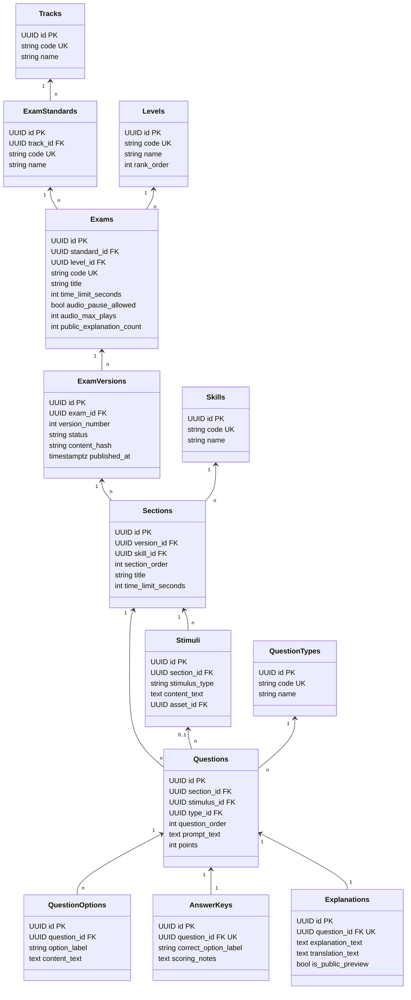
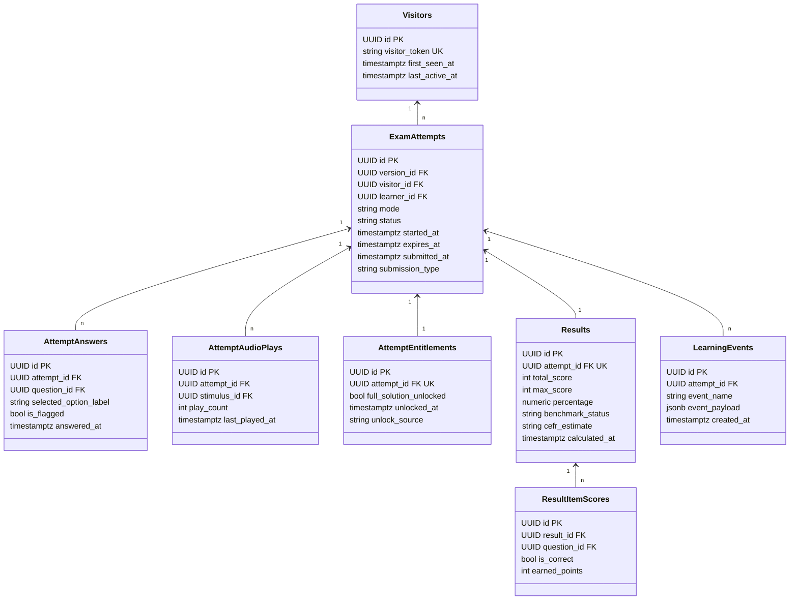
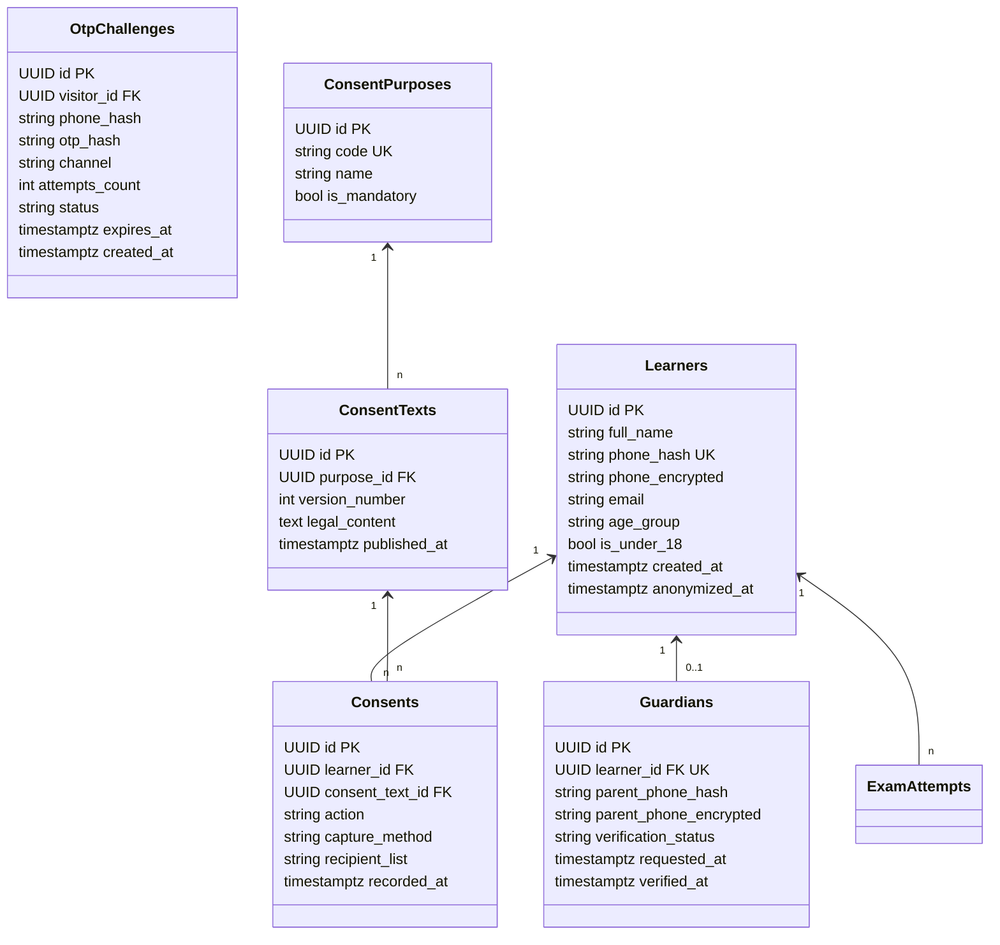
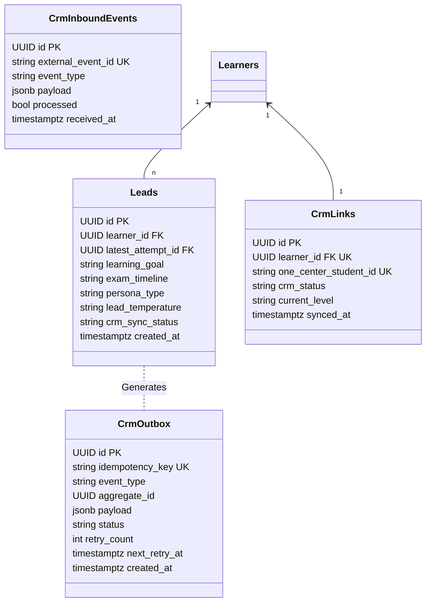
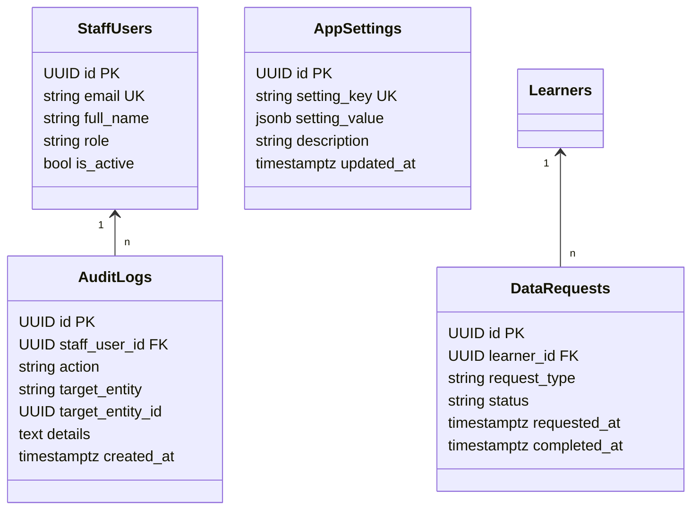
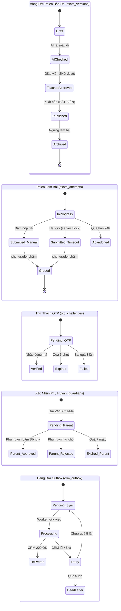

# Thiết Kế Kiến Trúc Dữ Liệu & Data Model (Data Architecture Specification)

> **Tài liệu:** `docs/architecture/02-data-model.md`  
> **Dự án:** Nền tảng tự học & luyện thi tiếng Đức miễn phí (`tuhoctiengduc.shdeducation.vn`)  
> **Phiên bản:** v1.0 (Lệnh 2.2 - Giai đoạn thiết kế dữ liệu)  
> **Vai trò:** Data Architect & Lead Systems Engineer  
> **Tài liệu đầu vào:** `docs/ux/00-assumptions.md`, `docs/ux/02-user-flows.md`, `docs/ux/03-screen-inventory.md`, `docs/ux/08-sample-exam-spec.md`, `docs/engineering-rules.md`.  
> **Trạng thái:** Chờ Duyệt (Điểm Dừng 1 - Hard Gate 1)

---

## 1. Tổng Quan Kiến Trúc & Các Quyết Định Bất Biến Đã Chốt

Mô hình dữ liệu của nền tảng được thiết kế xoay quanh 5 nguyên tắc kiến trúc cốt lõi:
1. **Server-Side Grading & Cô Lập Đáp Án:** Bảng `answer_keys` lưu trữ đáp án đúng hoàn toàn độc lập với bảng câu hỏi. Role ứng dụng `shd_app` bị thu hồi quyền `SELECT` trên bảng này ở cấp độ cơ sở dữ liệu. Chỉ role chấm thi chuyên trách `shd_grader` được phép đọc đáp án, và role này không được phép đọc bảng PII (thông tin người học, phụ huynh, lead).
2. **Phiên Bản Đề Bất Biến (Immutable Exam Versions):** Đề thi được quản lý theo vòng đời phiên bản (`draft` $\rightarrow$ `ai_checked` $\rightarrow$ `teacher_approved` $\rightarrow$ `published` $\rightarrow$ `archived`). Khi đã chuyển sang `published`, toàn bộ cây nội dung (sections, stimuli, questions, options, answer_keys, explanations) bị khóa cứng bằng trigger PostgreSQL. Mọi lượt làm bài (`exam_attempts`) liên kết tới một phiên bản đề bất biến cụ thể.
3. **Sổ Cái Đồng Ý Chỉ-Ghi-Thêm (Append-Only Consent Ledger):** Mọi hành vi cho phép hoặc rút lại sự đồng ý xử lý dữ liệu cá nhân đều được ghi thành dòng mới trong bảng `consents`. Trạng thái đồng ý hiện hành và khả năng liên hệ lead (`v_contactable_leads`) được suy ra thông qua database views, tuân thủ Luật Bảo vệ dữ liệu cá nhân số 91/2025/QH15 và Nghị định 356/2025/NĐ-CP.
4. **Bảo Mật PII & Chống Trùng Lặp Bằng HMAC:** Số điện thoại và mã OTP không lưu trữ bản thô không mã hóa. Số điện thoại được lưu kèm chuỗi băm HMAC-SHA256 với muối bí mật (`PHONE_HASH_PEPPER`) để phục vụ đối soát và chống trùng lặp. Mã OTP chỉ lưu bản băm HMAC-SHA256 (`OTP_HASH_PEPPER`).
5. **Khả Năng Mở Rộng Đa Ngôn Ngữ (Non-German Hardcoded):** Không dùng enum cố định gắn với tiếng Đức. Các trục phân loại Ngôn ngữ (`tracks`), Chuẩn khảo thí (`exam_standards`), Cấp độ CEFR (`levels`), Kỹ năng (`skills`), Dạng câu hỏi (`question_types`) đều được quản lý bằng bảng tra cứu (lookup tables) có ràng buộc toàn vẹn.

---

## 2. Sơ Đồ Thực Thể - Mối Quan Hệ (Entity-Relationship Diagrams)

Hệ thống bao gồm 37 bảng được chia thành 5 phân hệ dữ liệu logic:

### 2.1. Phân Hệ 1: Nội Dung & Đề Thi (Exam Content & Versioning)
Quản lý cây phân cấp bài thi từ đường đua ngôn ngữ, tiêu chuẩn đề thi, các phần thi (Sections), ngữ liệu bài đọc/audio (Stimuli), câu hỏi, lựa chọn và tách riêng đáp án / lời giải.

### 2.2. Phân Hệ 2: Làm Bài & Chấm Điểm (Attempts & Grading)
Quản lý phiên làm bài của khách ẩn danh và học viên, ghi nhận lựa chọn câu trả lời thời gian thực, đếm lượt nghe audio từ phía server, bảng kết quả tổng quan và kết quả chi tiết từng câu.

### 2.3. Phân Hệ 3: Người Học, Đồng Ý & Xác Thực (Learners, Consents & Auth)
Quản lý thông tin học viên định danh sau khi qua cổng Lead Gate, phụ huynh của học viên vị thành niên (<18 tuổi), thử thách mã OTP Zalo/SMS và sổ cái đồng ý xử lý dữ liệu.

### 2.4. Phân Hệ 4: Lead Tuyển Sinh & Đồng Bộ CRM (Leads & Outbox Queue)
Biến đổi dữ liệu thi thử thành cơ hội tuyển sinh chất lượng cao (Leads), xếp hạng nhiệt độ lead (Hot/Warm/Nurture) theo thời gian thi dự kiến, và đồng bộ đảm bảo tính nhất quán với One Center CRM qua transactional outbox.

### 2.5. Phân Hệ 5: Quản Trị & Vận Hành (Operations, Audit & Privacy)
Ghi nhận nhật ký truy cập PII chỉ-ghi-thêm, tiếp nhận yêu cầu xóa/xuất dữ liệu của học viên theo luật pháp, và lưu trữ cấu hình hệ thống linh hoạt không hardcode.

---

## 3. Từ Điển Bảng Dữ Liệu Chi Tiết (Table Dictionary)

### Nhóm 1: Nội Dung Đề Thi (15 Bảng)

#### 1. `tracks`
- **Mục đích:** Lưu trữ các đường đua ngôn ngữ (tiếng Đức, tiếng Hàn, tiếng Nhật...). Mở rộng không sửa cấu trúc.
- **Cột chính:** `id` (UUID PK), `code` (varchar(32) UK), `name` (varchar(128)), `is_active` (boolean default true), `created_at` (timestamptz UTC).
- **Mức nhạy cảm PII:** Không có.
- **Thời hạn lưu trữ đề xuất:** Vĩnh viễn (Master Data).

#### 2. `exam_standards`
- **Mục đích:** Danh mục chuẩn khảo thí theo từng ngôn ngữ (TELC, Goethe-Institut, ÖSD, TestDaF...).
- **Cột chính:** `id` (UUID PK), `track_id` (UUID FK tracks), `code` (varchar(32) UK), `name` (varchar(128)), `is_active` (boolean default true).
- **Mức nhạy cảm PII:** Không có.
- **Thời hạn lưu trữ đề xuất:** Vĩnh viễn (Master Data).

#### 3. `levels`
- **Mục đích:** Khung cấp độ năng lực ngôn ngữ theo CEFR (A1, A2, B1, B2, C1, C2).
- **Cột chính:** `id` (UUID PK), `code` (varchar(16) UK), `name` (varchar(64)), `rank_order` (int UK).
- **Mức nhạy cảm PII:** Không có.
- **Thời hạn lưu trữ đề xuất:** Vĩnh viễn (Master Data).

#### 4. `skills`
- **Mục đích:** Kỹ năng ngôn ngữ (Lesen - Đọc, Hören - Nghe, Schreiben - Viết, Sprechen - Nói).
- **Cột chính:** `id` (UUID PK), `code` (varchar(32) UK), `name` (varchar(64)).
- **Mức nhạy cảm PII:** Không có.
- **Thời hạn lưu trữ đề xuất:** Vĩnh viễn (Master Data).

#### 5. `question_types`
- **Mục đích:** Dạng thức câu hỏi trắc nghiệm (`single_choice`, `true_false`, `matching`).
- **Cột chính:** `id` (UUID PK), `code` (varchar(32) UK), `name` (varchar(64)).
- **Mức nhạy cảm PII:** Không có.
- **Thời hạn lưu trữ đề xuất:** Vĩnh viễn (Master Data).

#### 6. `exams`
- **Mục đích:** Thực thể bài thi cấp cao (Đề thi số 01, Đề thi số 02). Chứa cấu hình chung của đề.
- **Cột chính:** 
  - `id` (UUID PK), `standard_id` (UUID FK exam_standards), `level_id` (UUID FK levels).
  - `code` (varchar(64) UK), `title` (varchar(255)).
  - `time_limit_seconds` (int not null default 3900 - quy định 65 phút).
  - `audio_pause_allowed` (boolean not null default false - cấu hình cấm/cho phép nút pause Hören).
  - `audio_max_plays` (int not null default 2 - số lần phát tối đa do server quản lý).
  - `public_explanation_count` (int not null default 2 - số câu giải thích mở trước lead gate).
  - `is_active` (boolean default true), `created_at` (timestamptz UTC).
- **Mức nhạy cảm PII:** Không có.
- **Thời hạn lưu trữ đề xuất:** Vĩnh viễn.

#### 7. `exam_versions`
- **Mục đích:** Quản lý vòng đời và tính bất biến của nội dung đề thi.
- **Cột chính:** `id` (UUID PK), `exam_id` (UUID FK exams), `version_number` (int not null), `status` (varchar(32) not null check in (`draft`, `ai_checked`, `teacher_approved`, `published`, `archived`)), `content_hash` (varchar(64) null - SHA256 cây nội dung), `published_at` (timestamptz null), `created_at` (timestamptz UTC).
- **Ràng buộc duy nhất:** `UNIQUE(exam_id, version_number)`; Partial Unique Index: `CREATE UNIQUE INDEX uq_exam_published_version ON exam_versions(exam_id) WHERE status = 'published'`.
- **Mức nhạy cảm PII:** Không có.
- **Thời hạn lưu trữ đề xuất:** Vĩnh viễn (đáp ứng truy vết bài làm học viên trong quá khứ).

#### 8. `content_reviews`
- **Mục đích:** Lưu lịch sử phê duyệt chất lượng đề thi của AI và giáo viên bản ngữ SHD trước khi xuất bản.
- **Cột chính:** `id` (UUID PK), `version_id` (UUID FK exam_versions), `reviewer_type` (varchar(16) check in (`ai`, `teacher`)), `reviewer_id` (UUID null), `review_status` (varchar(32) check in (`approved`, `rejected`, `needs_revision`)), `feedback_notes` (text), `created_at` (timestamptz UTC).
- **Mức nhạy cảm PII:** Không có.
- **Thời hạn lưu trữ đề xuất:** 5 năm (phục vụ kiểm định học thuật).

#### 9. `sections`
- **Mục đích:** Các phần thi thành phần trong phiên bản đề (ví dụ: Phần 1 - Đọc hiểu, Phần 2 - Nghe hiểu).
- **Cột chính:** 
  - `id` (UUID PK), `version_id` (UUID FK exam_versions), `skill_id` (UUID FK skills).
  - `section_order` (int not null), `title` (varchar(128)), `instructions` (text).
  - `time_limit_seconds` (int null - cho phép NULL. Ví dụ: Lesen 2700s = 45m, Hören 1200s = 20m).
- **Quy tắc ưu tiên thời gian:** Nếu `sections.time_limit_seconds` có giá trị, đồng hồ client đếm ngược cho phần thi đó, nhưng thời điểm hết hạn tuyệt đối không bao giờ vượt quá `exam_attempts.expires_at` của bài thi tổng. Nếu NULL, áp dụng thời gian tổng của đề.
- **Mức nhạy cảm PII:** Không có.
- **Thời hạn lưu trữ đề xuất:** Theo vòng đời `exam_versions`.

#### 10. `stimuli`
- **Mục đích:** Ngữ liệu bài thi: bài đọc (Reading passage) hoặc đoạn băng âm thanh (Audio track) dùng chung cho một nhóm câu hỏi (ví dụ: Teil 1 Durchsagen).
- **Cột chính:** `id` (UUID PK), `section_id` (UUID FK sections), `stimulus_type` (varchar(16) check in (`text`, `audio`, `image`)), `title` (varchar(255)), `content_text` (text null), `asset_id` (UUID FK assets null).
- **Mức nhạy cảm PII:** Không có.
- **Thời hạn lưu trữ đề xuất:** Theo vòng đời `exam_versions`.

#### 11. `assets`
- **Mục đích:** Lưu trữ đường dẫn tệp âm thanh nghe Hören và hình ảnh minh họa trên hệ thống lưu trữ đám mây.
- **Cột chính:** `id` (UUID PK), `asset_type` (varchar(16) check in (`audio_mp3`, `image_png`, `image_webp`)), `storage_path` (text not null), `file_size_bytes` (bigint), `duration_seconds` (int null), `mime_type` (varchar(64)), `created_at` (timestamptz UTC).
- **Mức nhạy cảm PII:** Không có.
- **Thời hạn lưu trữ đề xuất:** Vĩnh viễn.

#### 12. `questions`
- **Mục đích:** Định nghĩa các câu hỏi trắc nghiệm (từ Câu 1 đến 30).
- **Cột chính:** `id` (UUID PK), `section_id` (UUID FK sections), `stimulus_id` (UUID FK stimuli null), `type_id` (UUID FK question_types), `question_order` (int not null - từ 1 đến 30), `prompt_text` (text not null), `points` (int not null default 1).
- **Mức nhạy cảm PII:** Không có.
- **Thời hạn lưu trữ đề xuất:** Theo vòng đời `exam_versions`.

#### 13. `question_options`
- **Mục đích:** Các lựa chọn phương án của từng câu hỏi (A, B, C, D hoặc Richtig/Falsch).
- **Cột chính:** `id` (UUID PK), `question_id` (UUID FK questions), `option_label` (varchar(8) not null - 'A', 'B', 'C'), `content_text` (text not null), `option_order` (int not null).
- **Ràng buộc:** `UNIQUE(question_id, option_label)`.
- **Mức nhạy cảm PII:** Không có.
- **Thời hạn lưu trữ đề xuất:** Theo vòng đời `exam_versions`.

#### 14. `answer_keys` (BẢNG BẢO MẬT TỐI CAO)
- **Mục đích:** Lưu đáp án đúng của từng câu hỏi. Bảng độc lập hoàn toàn, không nối khóa ngoại hở ra API.
- **Cột chính:** `id` (UUID PK), `question_id` (UUID FK questions UK), `correct_option_label` (varchar(8) not null), `scoring_notes` (text null), `created_at` (timestamptz UTC).
- **Phân quyền đặc biệt:** `REVOKE ALL ON answer_keys FROM PUBLIC; GRANT SELECT ON answer_keys TO shd_grader; REVOKE ALL ON answer_keys FROM shd_app;`.
- **Mức nhạy cảm PII:** Không chứa PII nhưng là dữ liệu nhạy cảm kinh doanh (Business Sensitive).
- **Thời hạn lưu trữ đề xuất:** Theo vòng đời `exam_versions`.

#### 15. `explanations`
- **Mục đích:** Lời giải thích sư phạm chi tiết bằng tiếng Việt, phân tích ngữ pháp, từ vựng và bản dịch bài đọc.
- **Cột chính:** `id` (UUID PK), `question_id` (UUID FK questions UK), `explanation_text` (text not null), `translation_text` (text null), `vocabulary_notes` (jsonb null), `is_public_preview` (boolean not null default false - Câu 1 & 2 đặt là true; Câu 3–30 đặt là false).
- **Mức nhạy cảm PII:** Không có.
- **Thời hạn lưu trữ đề xuất:** Theo vòng đời `exam_versions`.

---

### Nhóm 2: Làm Bài & Chấm Điểm (8 Bảng)

#### 16. `visitors`
- **Mục đích:** Định danh khách vãng lai ẩn danh truy cập qua Cookie / LocalStorage trước khi điền form Lead Gate.
- **Cột chính:** `id` (UUID PK), `visitor_token` (varchar(64) UK not null), `user_agent` (text null), `ip_hash` (varchar(64) null - băm SHA256 chống lưu IP thô), `first_seen_at` (timestamptz UTC), `last_active_at` (timestamptz UTC).
- **Mức nhạy cảm PII:** Định danh gián tiếp / Dữ liệu hành vi.
- **Thời hạn lưu trữ đề xuất:** 90 ngày kể từ lần hoạt động cuối [Cần pháp chế duyệt].

#### 17. `exam_attempts`
- **Mục đích:** Phiên làm bài thi thử của người học. Nguồn sự thật duy nhất về thời gian và kết quả nộp bài.
- **Cột chính:** 
  - `id` (UUID PK), `version_id` (UUID FK exam_versions).
  - `visitor_id` (UUID FK visitors not null), `learner_id` (UUID FK learners null - cập nhật sau khi qua Lead Gate).
  - `mode` (varchar(16) not null default 'exam' check in (`exam`, `practice`)).
  - `status` (varchar(32) not null check in (`in_progress`, `submitted`, `graded`, `abandoned`)).
  - `started_at` (timestamptz UTC not null), `expires_at` (timestamptz UTC not null - server clock).
  - `submitted_at` (timestamptz UTC null).
  - `submission_type` (varchar(16) null check in (`manual`, `timeout`)).
- **Mức nhạy cảm PII:** Hành vi học tập.
- **Thời hạn lưu trữ đề xuất:** 3 năm phục vụ báo cáo năng lực [Cần pháp chế duyệt].

#### 18. `attempt_answers`
- **Mục đích:** Ghi nhận phương án người học lựa chọn cho từng câu hỏi (cập nhật tự lưu nháp real-time).
- **Cột chính:** `id` (UUID PK), `attempt_id` (UUID FK exam_attempts), `question_id` (UUID FK questions), `selected_option_label` (varchar(8) null), `is_flagged` (boolean default false), `answered_at` (timestamptz UTC).
- **Ràng buộc:** `UNIQUE(attempt_id, question_id)`.
- **Mức nhạy cảm PII:** Hành vi học tập.
- **Thời hạn lưu trữ đề xuất:** Theo vòng đời `exam_attempts`.

#### 19. `attempt_audio_plays`
- **Mục đích:** SERVER-AUTHORITATIVE AUDIOPLAY COUNTER. Kiểm soát số lần nghe Hören theo quy định (tối đa 2 lần).
- **Cột chính:** `id` (UUID PK), `attempt_id` (UUID FK exam_attempts), `stimulus_id` (UUID FK stimuli), `play_count` (int not null default 1), `last_played_at` (timestamptz UTC).
- **Ràng buộc:** `UNIQUE(attempt_id, stimulus_id)`, `CHECK(play_count >= 1)`.
- **Mức nhạy cảm PII:** Hành vi học tập.
- **Thời hạn lưu trữ đề xuất:** Theo vòng đời `exam_attempts`.

#### 20. `attempt_entitlements`
- **Mục đích:** Quyền lợi xem lời giải chi tiết gắn với phiên làm bài. Lưu trong DB, không dùng flag client.
- **Cột chính:** `id` (UUID PK), `attempt_id` (UUID FK exam_attempts UK), `full_solution_unlocked` (boolean not null default false), `unlocked_at` (timestamptz UTC null), `unlock_source` (varchar(32) null - 'lead_gate_otp', 'admin_override').
- **Mức nhạy cảm PII:** Quyền lợi dịch vụ.
- **Thời hạn lưu trữ đề xuất:** Theo vòng đời `exam_attempts`.

#### 21. `results`
- **Mục đích:** Bảng điểm tổng quan sau khi nộp bài: Điểm tổng, điểm phần Đọc, điểm phần Nghe.
- **Cột chính:** `id` (UUID PK), `attempt_id` (UUID FK exam_attempts UK), `total_score` (int not null - ví dụ 21), `max_score` (int not null default 30), `percentage` (numeric(5,2) not null - 70.00), `lesen_score` (int not null - 12/15), `hoeren_score` (int not null - 9/15), `benchmark_status` (varchar(64) not null - 'Đạt ngưỡng tham khảo (70%)'), `cefr_estimate` (varchar(64) not null - 'Gần mức B1'), `calculated_at` (timestamptz UTC).
- **Mức nhạy cảm PII:** Kết quả học tập.
- **Thời hạn lưu trữ đề xuất:** 3 năm [Cần pháp chế duyệt].

#### 22. `result_item_scores`
- **Mục đích:** Điểm chi tiết từng câu do role `shd_grader` tính toán đối chiếu với `answer_keys`.
- **Cột chính:** `id` (UUID PK), `result_id` (UUID FK results), `question_id` (UUID FK questions), `is_correct` (boolean not null), `earned_points` (int not null).
- **Ràng buộc:** `UNIQUE(result_id, question_id)`.
- **Mức nhạy cảm PII:** Kết quả học tập.
- **Thời hạn lưu trữ đề xuất:** Theo vòng đời `results`.

#### 23. `learning_events`
- **Mục đích:** Nhật ký phân tích hành vi học tập (Analytics Event Log: play audio, offline mode, q3 click...).
- **Cột chính:** `id` (UUID PK), `attempt_id` (UUID FK exam_attempts null), `visitor_id` (UUID FK visitors null), `event_name` (varchar(64) not null), `event_payload` (jsonb not null), `created_at` (timestamptz UTC).
- **Mức nhạy cảm PII:** Dữ liệu hành vi.
- **Thời hạn lưu trữ đề xuất:** 12 tháng (tổng hợp dữ liệu phân tích CRO).

---

### Nhóm 3: Người Học, Đồng Ý & Xác Thực (6 Bảng)

#### 24. `learners`
- **Mục đích:** Hồ sơ học viên sau khi điền thông tin Lead Gate.
- **Cột chính:** 
  - `id` (UUID PK), `full_name` (varchar(128) not null).
  - `phone_hash` (varchar(64) not null UK - HMAC-SHA256 tra cứu).
  - `phone_encrypted` (text not null - AES-256-GCM bảo mật PII).
  - `email` (varchar(255) null - tùy chọn).
  - `age_group` (varchar(32) not null check in (`student_under18`, `university`, `worker`, `parent`)).
  - `is_under_18` (boolean not null default false).
  - `created_at` (timestamptz UTC), `anonymized_at` (timestamptz UTC null).
- **Mức nhạy cảm PII:** **ĐỊNH DANH TRỰC TIẾP (Direct PII)**.
- **Thời hạn lưu trữ đề xuất:** Lưu trữ đến khi có yêu cầu xóa hoặc sau 3 năm không có tương tác [Cần pháp chế duyệt].

#### 25. `guardians`
- **Mục đích:** Thông tin cha mẹ/người giám hộ bắt buộc đối với học viên dưới 18 tuổi theo Luật 91/2025/QH15.
- **Cột chính:** 
  - `id` (UUID PK), `learner_id` (UUID FK learners UK).
  - `parent_phone_hash` (varchar(64) not null - HMAC tra cứu).
  - `parent_phone_encrypted` (text not null - AES-256 PII).
  - `verification_status` (varchar(32) not null default 'pending' check in (`pending`, `approved`, `rejected`, `expired`)).
  - `requested_at` (timestamptz UTC), `verified_at` (timestamptz UTC null), `zns_message_id` (varchar(64) null).
- **Mức nhạy cảm PII:** **ĐỊNH DANH TRỰC TIẾP (Direct PII)**.
- **Thời hạn lưu trữ đề xuất:** Theo vòng đời tài khoản học viên vị thành niên.

#### 26. `otp_challenges`
- **Mục đích:** Quản lý vòng đời mã xác thực OTP gửi qua Zalo ZNS / SMS.
- **Cột chính:** 
  - `id` (UUID PK), `visitor_id` (UUID FK visitors).
  - `phone_hash` (varchar(64) not null).
  - `otp_hash` (varchar(64) not null - HMAC băm với `OTP_HASH_PEPPER`, không lưu số thô).
  - `channel` (varchar(16) not null default 'zalo_zns' check in (`zalo_zns`, `sms`)).
  - `attempts_count` (int not null default 0 check(attempts_count <= 3)).
  - `status` (varchar(16) not null default 'pending' check in (`pending`, `verified`, `expired`, `failed`)).
  - `expires_at` (timestamptz UTC not null - 5 phút sau khi tạo).
  - `created_at` (timestamptz UTC not null).
- **Mức nhạy cảm PII:** Dữ liệu xác thực.
- **Thời hạn lưu trữ đề xuất:** 7 ngày (phục vụ đối soát chi phí viễn thông).

#### 27. `consent_purposes`
- **Mục đích:** Danh mục các mục đích xử lý dữ liệu cá nhân theo Luật 91/2025/QH15.
- **Cột chính:** `id` (UUID PK), `code` (varchar(32) UK - 'scoring_history', 'course_consulting', 'study_abroad_18b'), `name` (varchar(128)), `is_mandatory` (boolean not null), `is_active` (boolean default true).
- **Mức nhạy cảm PII:** Không có.
- **Thời hạn lưu trữ đề xuất:** Vĩnh viễn.

#### 28. `consent_texts`
- **Mục đích:** Văn bản pháp lý chi tiết của từng điều khoản đồng ý (quản lý theo version khi luật thay đổi).
- **Cột chính:** `id` (UUID PK), `purpose_id` (UUID FK consent_purposes), `version_number` (int not null), `legal_content` (text not null), `recipient_entities` (text not null - 'SHD Education, SHD Academy, SHD Career, SHD International'), `published_at` (timestamptz UTC).
- **Ràng buộc:** `UNIQUE(purpose_id, version_number)`.
- **Mức nhạy cảm PII:** Không có.
- **Thời hạn lưu trữ đề xuất:** Vĩnh viễn (bằng chứng pháp lý giải trình).

#### 29. `consents` (SỔ CÁI CHỈ-GHI-THÊM)
- **Mục đích:** Sổ cái ghi nhận hành vi đồng ý hoặc rút lại đồng ý của người học. CẤM UPDATE/DELETE.
- **Cột chính:** `id` (UUID PK), `learner_id` (UUID FK learners), `consent_text_id` (UUID FK consent_texts), `action` (varchar(16) not null check in (`granted`, `revoked`)), `capture_method` (varchar(32) not null - 'web_checkbox', 'zalo_button'), `user_ip_hash` (varchar(64) null), `recorded_at` (timestamptz UTC not null).
- **Mức nhạy cảm PII:** Bằng chứng pháp lý gắn với định danh.
- **Thời hạn lưu trữ đề xuất:** 5 năm sau khi chấm dứt quan hệ học tập [Cần pháp chế duyệt].

---

### Nhóm 4: Lead Tuyển Sinh & Đồng Bộ CRM (4 Bảng)

#### 30. `leads`
- **Mục đích:** Thực thể Lead phục vụ đội ngũ tuyển sinh khóa học trả phí và du học nghề.
- **Cột chính:** 
  - `id` (UUID PK), `learner_id` (UUID FK learners).
  - `latest_attempt_id` (UUID FK exam_attempts).
  - `learning_goal` (varchar(64) not null - 'cert', 'ausbildung', 'visa18b', 'comms').
  - `exam_timeline` (varchar(32) not null - '1m', '1_3m', '3_6m', 'unknown').
  - `persona_type` (varchar(32) not null).
  - `lead_temperature` (varchar(16) not null check in (`hot`, `warm`, `nurture`)).
  - `crm_sync_status` (varchar(16) not null default 'pending' check in (`pending`, `synced`, `failed`)).
  - `created_at` (timestamptz UTC).
- **Quy tắc phân loại nhiệt độ:**
  - `hot`: `exam_timeline = '1m'` hoặc `'1_3m'`.
  - `warm`: `exam_timeline = '3_6m'`.
  - `nurture`: `exam_timeline = 'unknown'`.
- **Mức nhạy cảm PII:** Định danh thương mại.
- **Thời hạn lưu trữ đề xuất:** 2 năm phục vụ tuyển sinh [Cần pháp chế duyệt].

#### 31. `crm_outbox` (TRANSACTIONAL OUTBOX PATTERN)
- **Mục đích:** Đảm bảo tính nhất quán (Eventual Consistency) khi gửi lead sang One Center CRM. Hỗ trợ worker lấy việc bằng `FOR UPDATE SKIP LOCKED`.
- **Cột chính:** 
  - `id` (UUID PK), `idempotency_key` (varchar(64) not null UK).
  - `event_type` (varchar(64) not null - 'lead.created', 'parent.verified').
  - `aggregate_id` (UUID not null).
  - `payload` (jsonb not null - chỉ chứa PII tối thiểu cần thiết cho CRM).
  - `status` (varchar(16) not null default 'pending' check in (`pending`, `processing`, `delivered`, `failed`, `dead_letter`)).
  - `retry_count` (int not null default 0), `max_retries` (int not null default 5).
  - `next_retry_at` (timestamptz UTC not null default clock_timestamp()).
  - `error_log` (text null), `created_at` (timestamptz UTC).
- **Mức nhạy cảm PII:** Payload chứa PII được mã hóa hoặc hạn chế.
- **Thời hạn lưu trữ đề xuất:** Xóa dữ liệu thành công sau 30 ngày; giữ log lỗi 90 ngày.

#### 32. `crm_links`
- **Mục đích:** Lưu trữ liên kết học viên giữa hệ thống thi thử và One Center CRM.
- **Cột chính:** `id` (UUID PK), `learner_id` (UUID FK learners UK), `one_center_student_id` (varchar(64) not null UK), `crm_status` (varchar(32)), `current_enrolled_level` (varchar(16) null), `synced_at` (timestamptz UTC).
- **Mức nhạy cảm PII:** Liên kết mã định danh ngoài.
- **Thời hạn lưu trữ đề xuất:** Theo vòng đời học viên.

#### 33. `crm_inbound_events`
- **Mục đích:** Tiếp nhận webhook từ One Center CRM (ví dụ học viên đã đóng tiền nhập học).
- **Cột chính:** `id` (UUID PK), `external_event_id` (varchar(64) not null UK - chống xử lý trùng lặp), `event_type` (varchar(64) not null), `payload` (jsonb not null), `processed` (boolean not null default false), `received_at` (timestamptz UTC).
- **Mức nhạy cảm PII:** Dữ liệu sự kiện nghiệp vụ.
- **Thời hạn lưu trữ đề xuất:** 90 ngày.

---

### Nhóm 5: Quản Trị & Vận Hành (4 Bảng)

#### 34. `staff_users`
- **Mục đích:** Tài khoản cán bộ tuyển sinh, giáo viên duyệt đề và quản trị viên SHD.
- **Cột chính:** `id` (UUID PK), `email` (varchar(255) not null UK), `full_name` (varchar(128)), `role` (varchar(32) check in (`admin`, `teacher`, `advisor`, `auditor`)), `is_active` (boolean default true), `created_at` (timestamptz UTC).
- **Mức nhạy cảm PII:** PII nội bộ cán bộ nhân viên.
- **Thời hạn lưu trữ đề xuất:** Vĩnh viễn hoặc theo hợp đồng lao động.

#### 35. `audit_logs` (SỔ CÁI AUDIT CHỈ-GHI-THÊM)
- **Mục đích:** Ghi vết mọi hành vi truy cập PII (giải mã SĐT) và thao tác quản trị viên.
- **Cột chính:** `id` (UUID PK), `staff_user_id` (UUID FK staff_users null), `action` (varchar(64) not null - 'decrypt_phone', 'approve_exam_version', 'anonymize_learner'), `target_entity` (varchar(64) not null), `target_entity_id` (UUID not null), `ip_hash` (varchar(64)), `details` (text null), `created_at` (timestamptz UTC not null).
- **Mức nhạy cảm PII:** Nhật ký giám sát an ninh.
- **Thời hạn lưu trữ đề xuất:** 5 năm (yêu cầu pháp lý an toàn an ninh mạng).

#### 36. `data_requests`
- **Mục đích:** Tiếp nhận và theo dõi xử lý quyền của chủ thể dữ liệu (Quyền rút đồng ý, Quyền xóa dữ liệu, Quyền xuất báo cáo PII) theo Luật 91/2025/QH15.
- **Cột chính:** `id` (UUID PK), `learner_id` (UUID FK learners), `request_type` (varchar(32) check in (`export_data`, `delete_data`, `revoke_consent`)), `status` (varchar(16) default 'pending' check in (`pending`, `processing`, `completed`, `rejected`)), `requested_at` (timestamptz UTC), `completed_at` (timestamptz UTC null).
- **Mức nhạy cảm PII:** Yêu cầu quyền riêng tư.
- **Thời hạn lưu trữ đề xuất:** 3 năm phục vụ kiểm toán tuân thủ.

#### 37. `app_settings`
- **Mục đích:** Lưu trữ cấu hình toàn cục có thể thay đổi linh hoạt bởi ban điều hành mà không cần build lại mã nguồn.
- **Cột chính:** `id` (UUID PK), `setting_key` (varchar(64) not null UK), `setting_value` (jsonb not null), `description` (text), `updated_at` (timestamptz UTC).
- **Các key cấu hình mẫu:**
  - `otp_validity_seconds`: `300` (5 phút)
  - `otp_resend_cooldown_seconds`: `60`
  - `max_otp_daily_per_phone`: `3`
  - `default_public_explanations`: `2`
  - `hot_lead_timelines`: `["1m", "1_3m"]`
- **Mức nhạy cảm PII:** Không có.
- **Thời hạn lưu trữ đề xuất:** Vĩnh viễn.

---

## 4. Máy Trạng Thái Cốt Lõi (State Machines)

---

## 5. Danh Sách Bất Biến Bắt Buộc Kiểm Chứng (Invariants Inventory)

Mỗi bất biến dưới đây là một mệnh đề kỹ thuật kiểm chứng được bằng kiểm thử tự động ở Lệnh 2.6:

1. **`INV-01` (Bảo mật Đáp án cấp độ Role):** Bảng `answer_keys` lưu đáp án đúng độc lập; role cơ sở dữ liệu `shd_app` bị từ chối truy cập (Permission Denied 42501) khi thực hiện lệnh `SELECT` trên bảng `answer_keys`.
2. **`INV-02` (Tính Bất Biến của Đề đã Xuất Bản):** Sau khi `exam_versions.status = 'published'`, mọi thao tác `INSERT`, `UPDATE`, `DELETE` trên bảng `sections`, `stimuli`, `questions`, `question_options`, `answer_keys`, `explanations` thuộc phiên bản đó đều bị chặn bởi database trigger.
3. **`INV-03` (Phiên Bản Xuất Bản Duy Nhất):** Mỗi đề thi (`exams`) tại bất kỳ thời điểm nào chỉ được phép có tối đa MỘT phiên bản ở trạng thái `published` (bảo đảm bằng partial unique index `WHERE status = 'published'`).
4. **`INV-04` (Toàn Vẹn Phiên Làm Bài):** Mỗi phiên làm bài `exam_attempts` bắt buộc phải tham chiếu tới một `exam_versions` đang có trạng thái `published`.
5. **`INV-05` (Quyền Mở Khóa Lời Giải Lưu Trong DB):** Trạng thái mở khóa đầy đủ lời giải (`full_solution_unlocked`) được xác định bởi bản ghi trong bảng `attempt_entitlements`, tuyệt đối không tin cậy tham số boolean do client gửi lên.
6. **`INV-06` (Server Đếm Lượt Nghe Hören):** Số lượt phát audio được lưu và tăng dần tại bảng `attempt_audio_plays` trên server; server từ chối cấp luồng audio khi `play_count > exams.audio_max_plays`.
7. **`INV-07` (Đồng Hồ Server Là Nguồn Sự Thật):** Thời điểm hết hạn `exam_attempts.expires_at` do server ấn định khi khởi tạo; mọi bài thi nộp khi `clock_timestamp() > expires_at` bắt buộc bị đánh dấu `submission_type = 'timeout'`.
8. **`INV-08` (Tạm Dừng Audio Không Dừng Giờ Đề):** Trạng thái tạm dừng âm thanh (`audio_pause_allowed = true`) không làm thay đổi giá trị của `expires_at` trên phiên làm bài tổng.
9. **`INV-09` (Sổ Cái Đồng Ý Chỉ-Ghi-Thêm):** Bảng `consents` là cấu trúc Append-Only; mọi thao tác `UPDATE` hoặc `DELETE` đều bị chặn bởi database trigger.
10. **`INV-10` (Trạng Thái Đồng Ý Suy Ra Từ Bản Ghi Mới Nhất):** Trạng thái đồng ý của một người học đối với một mục đích xử lý dữ liệu được tính toán dựa trên bản ghi có `recorded_at` mới nhất trong bảng `consents`.
11. **`INV-11` (Điều Kiện Lọc Lead Đủ Quyền Liên Hệ):** Database view `v_contactable_leads` chỉ xuất ra các lead thỏa mãn đồng thời 3 điều kiện: (a) SĐT đã xác thực OTP thành công, (b) có đồng ý tư vấn hiện hành (`purpose = 'course_consulting'`, `action = 'granted'`), và (c) nếu `is_under_18 = true` thì bắt buộc phải có `guardians.verification_status = 'approved'`.
12. **`INV-12` (Băm Chuẩn Hóa Số Điện Thoại Tra Cứu):** Cột `phone_hash` được tính bằng thuật toán HMAC-SHA256 trên số điện thoại chuẩn hóa E.164 kèm khóa bí mật `PHONE_HASH_PEPPER`; chống trùng lặp không cần lưu SĐT thô.
13. **`INV-13` (Băm Mã Xác Thực OTP):** Cột `otp_hash` trong `otp_challenges` được băm bằng HMAC-SHA256 với `OTP_HASH_PEPPER`; cơ sở dữ liệu hoàn toàn không lưu trữ mã OTP dạng số thô.
14. **`INV-14` (Ràng Buộc Thời Gian & Lần Thử OTP):** Bản ghi `otp_challenges` hết hạn sau đúng 300 giây (`expires_at = created_at + interval '5 minutes'`); số lần thử tối đa không vượt quá 3 (`attempts_count <= 3`).
15. **`INV-15` (Chống Xử Lý Lặp Outbox Bằng Khóa Idempotency):** Cột `crm_outbox.idempotency_key` có ràng buộc duy nhất `UNIQUE`; hệ thống từ chối chèn hai sự kiện cùng khóa.
16. **`INV-16` (Xử Lý Outbox Không Xung Đột Bằng Skip Locked):** Truy vấn lấy việc của worker tác vụ nền bắt buộc sử dụng mệnh đề `FOR UPDATE SKIP LOCKED` để đảm bảo không bị khóa chết khi nhiều worker chạy song song.
17. **`INV-17` (Idempotent Webhook CRM Đến):** Bảng `crm_inbound_events` có ràng buộc duy nhất trên `external_event_id`; từ chối ghi nhận trùng lặp sự kiện gửi từ One Center CRM.
18. **`INV-18` (Sổ Cái Audit Giám Sát Truy Cập PII):** Mọi hành động truy xuất bản mã số điện thoại (`decrypt_phone`) bắt buộc phải ghi nhận vào bảng `audit_logs` trong cùng một database transaction.
19. **`INV-19` (Thủ Tục Ẩn Danh Hóa Xóa PII):** Thủ tục `anonymize_learner(p_learner_id)` xóa sạch các trường PII (`full_name = 'ANONYMIZED'`, `phone_encrypted = NULL`, `email = NULL`) nhưng bảo lưu nguyên vẹn điểm số trong `results` và `exam_attempts`.
20. **`INV-20` (Số Lượng Lời Giải Mở Khóa Động):** Số câu hỏi có `explanations.is_public_preview = true` trên mỗi đề thi được đối soát tự động khớp với giá trị cấu hình `exams.public_explanation_count` (mặc định 2 câu).
21. **`INV-21` (Độc Lập Ngôn Ngữ Bằng Lookup Data):** Không có cột nào sử dụng Postgres Enum cứng gắn với tiếng Đức. Các trục phân loại được cấu hình linh hoạt qua bảng tra cứu `tracks`, `exam_standards`, `levels`, `skills`.
22. **`INV-22` (Ràng Buộc Thời Gian Cấp Phần Thi):** Nếu phần thi có cấu hình `sections.time_limit_seconds` riêng, giá trị này không được lớn hơn `exams.time_limit_seconds` của bài thi tổng.

---

## 6. Ma Trận Phân Quyền Theo Role Cơ Sở Dữ Liệu (Role Privilege Matrix)

| Bảng / Khối Dữ Liệu | `shd_migrator` (DDL Owner) | `shd_app` (Web/API) | `shd_grader` (Chấm Thi Biệt Lập) | `shd_worker` (Outbox/CRM Sync) | `shd_readonly` (Báo Cáo/Audit) |
| :--- | :---: | :---: | :---: | :---: | :---: |
| **`tracks, exam_standards, levels, skills, question_types`** | ALL + DDL | SELECT | SELECT | SELECT | SELECT |
| **`exams, exam_versions, sections, stimuli, assets, questions, question_options`** | ALL + DDL | SELECT | SELECT | SELECT | SELECT |
| **`answer_keys` (ĐÁP ÁN ĐÚNG)** | ALL + DDL | **NONE (CẤM)** | **SELECT** | **NONE (CẤM)** | **NONE (CẤM)** |
| **`explanations`** | ALL + DDL | SELECT | SELECT | SELECT | SELECT |
| **`visitors`** | ALL + DDL | SELECT, INSERT, UPDATE | NONE | NONE | SELECT |
| **`exam_attempts`** | ALL + DDL | SELECT, INSERT, UPDATE | SELECT, UPDATE (status) | SELECT | SELECT |
| **`attempt_answers`** | ALL + DDL | SELECT, INSERT, UPDATE | SELECT | NONE | SELECT |
| **`attempt_audio_plays`** | ALL + DDL | SELECT, INSERT, UPDATE | NONE | NONE | SELECT |
| **`attempt_entitlements`** | ALL + DDL | SELECT, INSERT, UPDATE | SELECT | NONE | SELECT |
| **`results, result_item_scores`** | ALL + DDL | SELECT | SELECT, INSERT, UPDATE | NONE | SELECT |
| **`learning_events`** | ALL + DDL | INSERT | NONE | NONE | SELECT |
| **`learners, guardians` (PII)** | ALL + DDL | SELECT, INSERT, UPDATE | **NONE (CẤM)** | SELECT, UPDATE | SELECT |
| **`otp_challenges`** | ALL + DDL | SELECT, INSERT, UPDATE | NONE | NONE | SELECT |
| **`consent_purposes, consent_texts`** | ALL + DDL | SELECT | NONE | SELECT | SELECT |
| **`consents` (Sổ cái)** | ALL + DDL | SELECT, INSERT | NONE | SELECT | SELECT |
| **`leads`** | ALL + DDL | SELECT, INSERT, UPDATE | NONE | SELECT, UPDATE | SELECT |
| **`crm_outbox`** | ALL + DDL | INSERT | NONE | SELECT, UPDATE, DELETE | SELECT |
| **`crm_links, crm_inbound_events`** | ALL + DDL | SELECT | NONE | SELECT, INSERT, UPDATE | SELECT |
| **`staff_users, audit_logs, data_requests`**| ALL + DDL | NONE | NONE | NONE | SELECT |
| **`app_settings`** | ALL + DDL | SELECT | SELECT | SELECT | SELECT |
| **View `v_contactable_leads`** | ALL + DDL | SELECT | **NONE (CẤM)** | **SELECT** | SELECT |

---

## 7. Bảng Truy Vết Yêu Cầu Giao Diện Wireframe ↔ Cột Dữ Liệu (Traceability Matrix)

Bảng đối soát chứng minh toàn bộ các màn hình và trường thông tin trong `docs/ux/03-screen-inventory.md` đều có bảng/cột cơ sở dữ liệu tương ứng phục vụ, không có bảng mồ côi:

| Mã Màn Hình | Trường hiển thị trên Wireframe | Bảng & Cột dữ liệu tương ứng trong Database | Loại dữ liệu |
| :--- | :--- | :--- | :---: |
| **SCR-01** (Catalog) | Tên đề thi, Badge kỳ thi, Trình độ | `exams.title`, `exam_standards.name`, `levels.code` | Trực tiếp |
| **SCR-01** (Catalog) | Thời gian làm bài, Số lượng câu hỏi | `exams.time_limit_seconds`, `COUNT(questions.id)` | Trực tiếp / Suy ra |
| **SCR-01** (Catalog) | Bộ lọc: Kỳ thi, Trình độ, Kỹ năng | `exam_standards.code`, `levels.code`, `skills.code` | Bảng tra cứu |
| **SCR-02** (Phòng thi Đọc) | Đồng hồ đếm ngược server | `exam_attempts.expires_at - clock_timestamp()` | Dữ liệu suy ra |
| **SCR-02** (Phòng thi Đọc) | Văn bản bài đọc tiếng Đức (Beispieltext) | `stimuli.content_text` (nơi `stimulus_type = 'text'`) | Trực tiếp |
| **SCR-02** (Phòng thi Đọc) | Danh sách câu hỏi 1–15 & Các lựa chọn A, B, C | `questions.prompt_text`, `question_options.content_text` | Trực tiếp |
| **SCR-02** (Phòng thi Đọc) | Trạng thái đã chọn & Cờ xem lại (Flagged) | `attempt_answers.selected_option_label`, `is_flagged` | Trực tiếp |
| **SCR-03** (Phòng thi Nghe) | Trình phát Hören & File âm thanh | `assets.storage_path`, `stimuli.title` | Trực tiếp |
| **SCR-03** (Phòng thi Nghe) | Đếm số lượt nghe còn lại ("Lượt 1/2") | `attempt_audio_plays.play_count` vs `exams.audio_max_plays` | Trực tiếp / Suy ra |
| **SCR-03** (Phòng thi Nghe) | Cấu hình bật/tắt nút Pause | `exams.audio_pause_allowed` (boolean) | Cấu hình đề |
| **SCR-04** (Xác nhận nộp) | Số câu đã làm, số câu chưa làm, gắn cờ | `COUNT(attempt_answers)` theo nhóm `is_flagged`, `selected` | Dữ liệu suy ra |
| **SCR-05** (Trang kết quả) | Điểm tổng 21/30, % Đúng 70% | `results.total_score`, `results.percentage` | Trực tiếp |
| **SCR-05** (Trang kết quả) | Đạt ngưỡng tham khảo, Gần mức B1 | `results.benchmark_status`, `results.cefr_estimate` | Trực tiếp |
| **SCR-05** (Trang kết quả) | Điểm Lesen (12/15) & Điểm Hören (9/15) | `results.lesen_score`, `results.hoeren_score` | Trực tiếp |
| **SCR-06** (Lời giải & Khóa)| Lời giải Câu 1 & 2 mở công khai | `explanations.explanation_text` nơi `is_public_preview = true`| Trực tiếp |
| **SCR-06** (Lời giải & Khóa)| Khối khóa Câu 3–30 (Mờ sau Lead Gate) | Kiểm tra `attempt_entitlements.full_solution_unlocked` | Quyền dữ liệu |
| **SCR-07** (Lead Gate Form)| Họ và tên, SĐT/Zalo, Email | `learners.full_name`, `phone_encrypted`, `email` | Trực tiếp (PII) |
| **SCR-07** (Lead Gate Form)| Mục tiêu học, Thời gian thi, Đối tượng | `leads.learning_goal`, `exam_timeline`, `persona_type` | Trực tiếp |
| **SCR-07** (Lead Gate Form)| Nhánh < 18 tuổi: SĐT Cha/Mẹ | `guardians.parent_phone_encrypted` | Trực tiếp (PII) |
| **SCR-07** (Lead Gate Form)| 3 Checkbox đồng ý pháp lý | `consents.action = 'granted'` gắn với `consent_texts.id` | Sổ cái pháp lý |
| **SCR-08** (OTP Modal) | Mã OTP gửi Zalo ZNS / SMS | `otp_challenges.otp_hash`, `channel`, `expires_at` | Trực tiếp |
| **SCR-09** (Thành công) | Mở khóa 30 câu giải thích & Tặng Ebook | `attempt_entitlements.full_solution_unlocked = true` | Trực tiếp |
| **CRM Sync** (Tác vụ ngầm) | Đẩy Lead và kết quả thi sang CRM | `crm_outbox.payload` $\rightarrow$ One Center CRM | Hàng đợi Outbox |

---

## 8. Mục Cần Duyệt & Các Giả Định Chờ Quyết Định (Decisions Needing Approval)

| Mã | Nội dung đề xuất | Căn cứ & Rủi ro | Tác động schema nếu thay đổi | Trạng thái |
| :---: | :--- | :--- | :--- | :---: |
| **DEC-ARCH-01** | **Thời hạn lưu trữ PII đề xuất** | Đề xuất lưu PII học viên 3 năm kể từ tương tác cuối, sổ cái đồng ý lưu 5 năm. Cần pháp chế SHD rà soát và xác nhận chính thức theo Luật 91/2025/QH15. | Nếu pháp chế yêu cầu ngắn hơn, chỉ cần cập nhật job cron xóa định kỳ, không đổi cấu trúc bảng. | **[CẦN DUYỆT]** |
| **DEC-ARCH-02** | **Lưu Hash IP thay cho IP thô** | Bảng `visitors` và `consents` chỉ lưu `ip_hash` (băm SHA256 kèm muối) thay vì IP thô để giảm thiểu rủi ro vi phạm dữ liệu cá nhân theo khuyến nghị an ninh mạng. | Không ảnh hưởng schema (giữ kiểu varchar(64)). | **[CẦN DUYỆT]** |
| **DEC-ARCH-03** | **Tạm dừng Audio không dừng giờ làm bài tổng** | Giữ nguyên quy định: Nút tạm dừng của file âm thanh Hören (nếu đề cho phép) chỉ dừng phát băng, không dừng đồng hồ đếm ngược của phòng thi. | Khóa cứng `expires_at` của attempt không đổi. | **[CẦN DUYỆT]** |
| **DEC-ARCH-04** | **Quy tắc ưu tiên thời gian cấp phần thi** | `sections.time_limit_seconds` là tùy chọn (Lesen: 2700s, Hören: 1200s). Nếu cả hai cùng có giá trị: đồng hồ từng phần đếm ngược theo phần, nhưng khi đồng hồ tổng bài thi (`expires_at`) chạm 0 thì toàn bộ bài thi tự nộp ngay lập tức. | Logic kiểm tra ở tầng ứng dụng và worker nộp bài. | **[CẦN DUYỆT]** |
| **DEC-ARCH-05** | **Số câu giải thích công khai mặc định** | Đặt mặc định là `2` câu trong cấu hình đề (`exams.public_explanation_count = 2`). Cho phép ban học thuật tùy biến nâng lên 3 câu cho các đề đặc thù mà không cần sửa code. | Bảng `exams` và `explanations` đã có sẵn trường hỗ trợ. | **[CẦN DUYỆT]** |
| **DEC-ARCH-06** | **Quy trình kích hoạt Lead của người dưới 18 tuổi** | View `v_contactable_leads` loại bỏ hoàn toàn học viên dưới 18 tuổi nếu phụ huynh chưa bấm đồng ý xác nhận qua Zalo ZNS. Đội ngũ tư vấn telesale SHD tuyệt đối không được phân bổ các lead này. | Cấu trúc View đã lọc cứng điều kiện `guardians.verification_status = 'approved'`. | **[CẦN DUYỆT]** |
