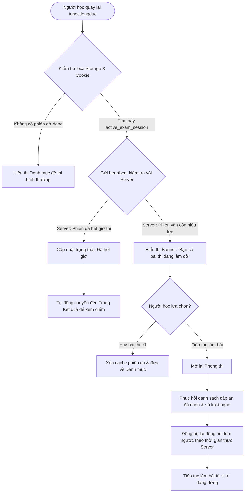
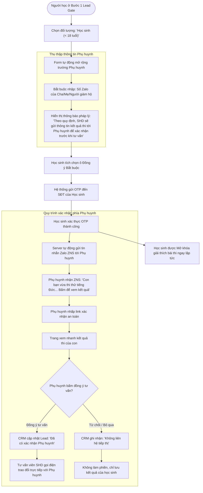
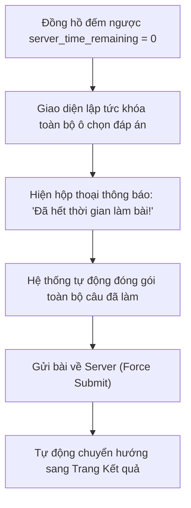
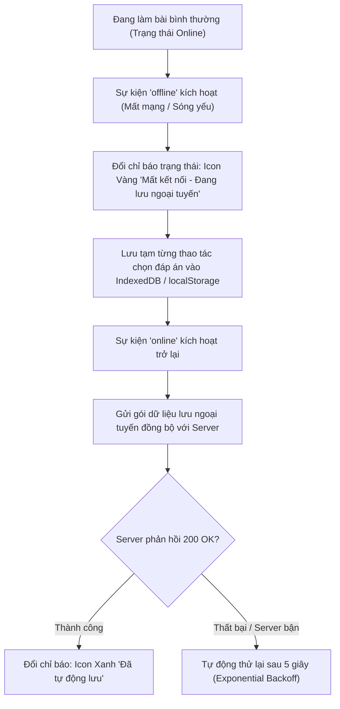
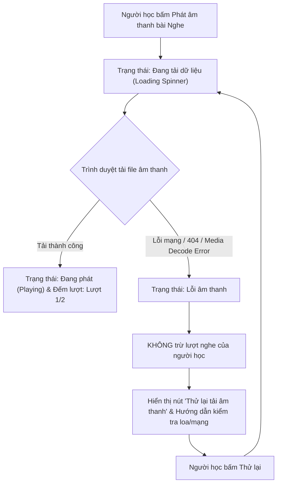
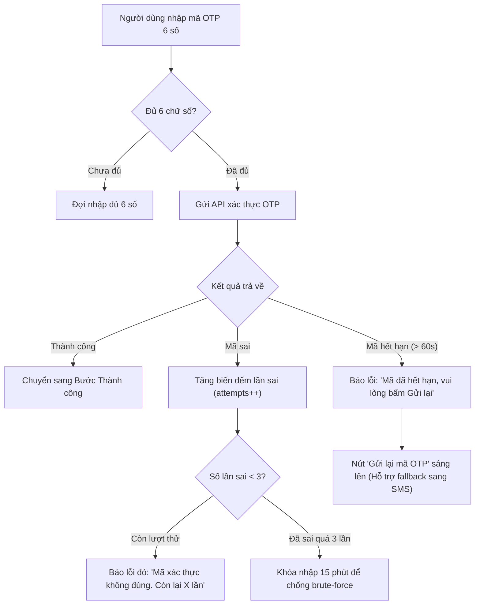
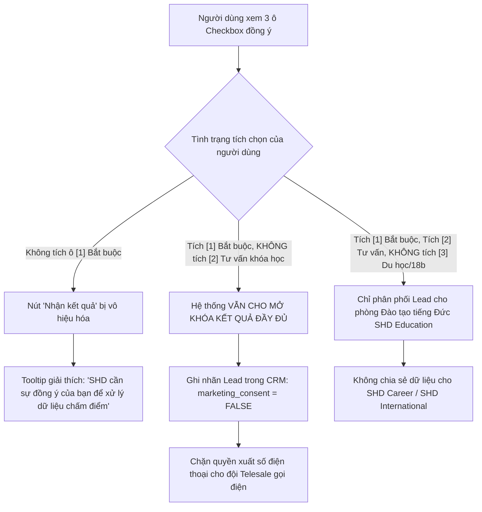

# Sơ Đồ Luồng Người Dùng & Các Nhánh Lỗi (User Flows & Error Paths)

> **Dự án:** Nền tảng tự học & luyện thi tiếng Đức miễn phí (`tuhoctiengduc.shdeducation.vn`)  
> **Đơn vị phát triển:** SHD Education (Hệ sinh thái SHD Corp)  
> **Tài liệu:** UX Architecture - Core Flows & Edge Case State Machines

---

## 1. Luồng A: Khách ẩn danh làm bài → Nộp bài → Xem kết quả → Lead Gate → Thành công

Luồng chính yếu (Happy Path) dẫn dắt khách vãng lai trải nghiệm thi thử và chuyển đổi thành Lead tiềm năng thông qua điểm chặn giá trị.

```mermaid
flowchart TD
    Start(["Khách truy cập Catalog"]) --> SelectExam["Xem chi tiết đề thi & bấm 'Làm bài ngay'"]
    SelectExam --> InitSession["Khởi tạo anonymous_session_id & tải đề thi"]
    InitSession --> ExamRoom["Màn hình Phòng thi (Split-screen Đọc / Nghe)"]
    
    subgraph ExamProgress ["Quá trình làm bài"]
        ExamRoom --> DoQuestions["Làm bài: Đọc văn bản / Nghe audio & chọn đáp án"]
        DoQuestions --> AutoSave["Hệ thống tự động lưu nháp mỗi câu hoặc định kỳ 15s"]
        AutoSave --> ClickSubmit["Người học bấm nút 'Nộp bài'"]
    end

    ClickSubmit --> ConfirmModal{"Hộp thoại xác nhận: Còn câu chưa làm không?"}
    ConfirmModal -- "Còn câu chưa làm" --> ShowWarning["Cảnh báo số câu chưa chọn & hỏi xác nhận nộp"]
    ShowWarning -- "Xác nhận nộp" --> ForceSubmit["Gửi bài về Server chấm điểm"]
    ConfirmModal -- "Đã làm hết" --> ForceSubmit

    ForceSubmit --> ResultPage["Màn hình Kết quả bài thi"]
    
    subgraph ResultView ["Xem kết quả & Điểm chạm Lead Gate"]
        ResultPage --> ViewScores["Xem Điểm tổng & Điểm theo kỹ năng (Miễn phí)"]
        ViewScores --> ViewFreeExplanations["Xem Lời giải chi tiết Câu 1 & Câu 2 (Miễn phí)"]
        ViewFreeExplanations --> ReachGate{"Hành động tiếp theo của người học?"}
        
        ReachGate -- "Bấm xem Câu 3+" --> TriggerGate1["Kích hoạt Lead Gate: Mở khóa giải thích"]
        ReachGate -- "Bấm 'Lưu lịch sử bài thi'" --> TriggerGate2["Kích hoạt Lead Gate: Lưu tiến trình"]
        ReachGate -- "Bấm 'Đăng ký Test 1-1'" --> TriggerGate3["Kích hoạt Lead Gate: Nhận tư vấn chuyên sâu"]
    end

    TriggerGate1 --> OpenModal["Mở Modal Lead Gate (Bước 1: Điền thông tin)"]
    TriggerGate2 --> OpenModal
    TriggerGate3 --> OpenModal

    subgraph LeadCapture ["Xử lý Lead & Xác thực"]
        OpenModal --> FillForm["Nhập: Họ tên, SĐT/Zalo, Email, Mục tiêu, Thời gian dự kiến thi"]
        FillForm --> CheckConsents{"Kiểm tra 3 ô Checkbox đồng ý"}
        CheckConsents -- "Chưa tích ô Bắt buộc" --> DisableBtn["Nút 'Nhận mã OTP' bị khóa (kèm nhắc nhở)"]
        CheckConsents -- "Đã tích ô Bắt buộc" --> RequestOTP["Gửi mã OTP 6 số qua Zalo ZNS / SMS"]
        RequestOTP --> EnterOTP["Bước 2: Nhập mã OTP (Đếm ngược 60s)"]
        EnterOTP --> ValidateOTP{"Server kiểm tra mã OTP"}
        ValidateOTP -- "Hợp lệ" --> SuccessState["Bước 3: Trạng thái Thành công"]
    end

    SuccessState --> UnlockedResult["Mở khóa toàn bộ lời giải chi tiết từ Câu 3+"]
    SuccessState --> ScheduleCall["Kích hoạt hàng đợi tư vấn viên SHD liên hệ"]
    UnlockedResult --> End(["Hoàn thành chuyển đổi"])
```

---

## 2. Luồng B: Người học quay lại và Tiếp tục phiên làm bài (Returning Learner)

Xử lý trường hợp người học đang làm bài dở dang thì đóng trình duyệt hoặc quay lại sau một khoảng thời gian.

---

## 3. Luồng C: Nhánh Người dùng Dưới 18 tuổi & Xác nhận từ Phụ huynh (Parental Branch)

Tuân thủ nghiêm ngặt Nghị định 13/2023/NĐ-CP về xử lý dữ liệu trẻ em và bảo vệ quyền lợi người học vị thành niên.

---

## 4. Luồng D: Các nhánh lỗi và Ngoại lệ (Edge Cases & Error Paths)

### D1. Hết giờ làm bài (Server-Authoritative Timeout)

### D2. Mất kết nối mạng & Khôi phục (Offline & Recovery)

### D3. Lỗi trình phát âm thanh (Audio Hören Error)

### D4. Nhập sai hoặc Hết hạn mã OTP

### D5. Xử lý từ chối các điều khoản đồng ý (Consent Refusal)

